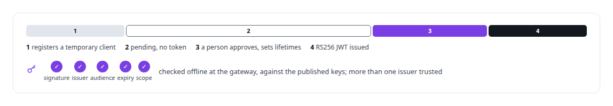
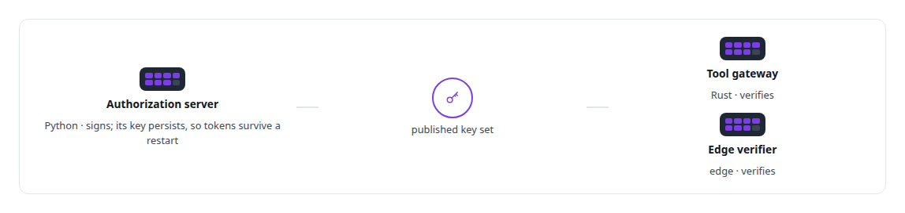
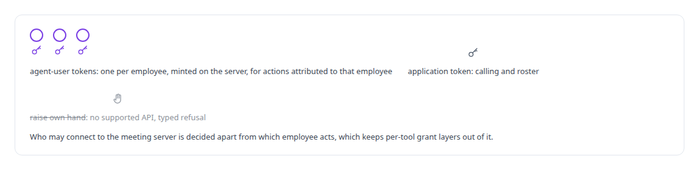

# Identity and access management for AI agents

**I worked out, from real tenant evidence, how an AI employee legitimately answers, calls and acts inside Microsoft 365, with per-employee tokens minted server-side and never handed to a model.**

Canonical: https://coreyjames.ai/technologies/identity-and-access-management-for-ai-agents/  
Author: Corey James · Published: 2026-10-28 · Kind: technology  
Systems: [Helix](https://github.com/coreyjames-ai/helix) · [Auth and access plane](https://github.com/coreyjames-ai/auth-and-access-plane)  
Skills: [OAuth 2.0 and identity architecture](https://github.com/coreyjames-ai/portfolio/tree/main/skills/oauth-2-0-and-identity-architecture) · [Microsoft 365, Graph and Entra integration](https://github.com/coreyjames-ai/portfolio/tree/main/skills/microsoft-365-graph-and-entra-integration) · [tool synthesis and governed API integration](https://github.com/coreyjames-ai/portfolio/tree/main/skills/tool-synthesis-and-governed-api-integration)  


## Result

| Figure | What it measures |
| --- | --- |
| **30 days** | a pending client lives, for assistants that cache their client ID and never register again |

## What was built

### One authorization server for every assistant

[Auth and access plane](https://coreyjames.ai/systems/auth-and-access-plane): I wanted commercial AI assistants, including Microsoft Copilot Studio, to reach my private tool estate on my terms. I was not willing to run a server per vendor or hand out a secret per connection, so I decided that one OAuth 2.0 authorization server would issue every token and that a person would approve every client.

I built that server in Python. It issues RS256-signed JWTs and supports the authorization-code grant with PKCE, client credentials and refresh tokens, revocation, and the published key set and metadata documents that MCP clients read first. Assistants register themselves as temporary clients and wait for a person.



### The control sits at the consent screen

Interoperability was the hard part. Each assistant orders discovery differently and caches its client ID differently, and one flow had to serve all of them.

A hardening pass gated client registration, and the next day the gate locked out every assistant whose cached client had expired. I reverted it with a one-line change, because an attacker who registers a client still cannot get a code without my approval. The episode is told in [The hardening fix that locked everyone out](https://coreyjames.ai/stories/the-hardening-fix-that-locked-everyone-out).


### One key set, three verifiers

The issuer, the tool gateway and an edge verifier run in different languages and places, and all of them trust one published key set.



### A digital employee that acts as itself

[Helix](https://coreyjames.ai/systems/helix): a digital employee in Microsoft 365 has to act as itself. A shared service account would have made every action untraceable to the employee. Tokens in a model's context would have handed the model the employee's authority. I put identity in the server.

Every call to the meeting action server names the acting employee. The server signs certificate client assertions for the employee and exchanges them for that employee's own Microsoft Graph tokens. Tokens are cached per employee and their claims are checked in-process before use. The tenant installer refuses to provision an employee until its calling contract is sealed.



In the Teams working service, ownership comes from the user's Entra sign-in, and voice access to work tools stays off unless every person in the room is authorized. The full account is in [Solving the digital-employee identity](https://coreyjames.ai/stories/solving-the-digital-employee-identity).


I design identity for AI clients and AI employees from the standards up. Entra Agent ID and Agent 365 are Microsoft's platform, which I configured. The authorization server, the gateway checks and the identity layer around the employee are mine.

> Microsoft remains the permission authority for the digital employee, and my layer grants nothing the tenant has not.

## What was verified

Each line is a claim the canonical page supports, with the figure as the page states it.

- OAuth 2.0 and identity architecture: one authorization server for every AI assistant, with PKCE, RS256 JWTs and a pending client lapsing after 30 days without a person's approval.
- Microsoft 365, Graph and Entra integration: digital employees acting as themselves with per-employee Graph tokens minted on the server and never placed in a model's context.
- Identity and least privilege for AI agents: Microsoft kept as the permission authority, typed refusals where no supported API exists, and one published key set trusted by three verifiers.

## Related

- [A coding agent that never holds the keys](https://github.com/coreyjames-ai/agent-swarm/tree/main/stories/a-coding-agent-that-never-holds-the-keys) · https://coreyjames.ai/stories/a-coding-agent-that-never-holds-the-keys/
- [Solving the digital-employee identity](https://github.com/coreyjames-ai/helix/tree/main/stories/solving-the-digital-employee-identity) · https://coreyjames.ai/stories/solving-the-digital-employee-identity/
- [Agents with real tools and no keys](https://github.com/coreyjames-ai/fafohive/tree/main/stories/agents-with-real-tools-and-no-keys) · https://coreyjames.ai/stories/agents-with-real-tools-and-no-keys/
- [The hardening fix that locked everyone out](https://github.com/coreyjames-ai/auth-and-access-plane/tree/main/stories/the-hardening-fix-that-locked-everyone-out) · https://coreyjames.ai/stories/the-hardening-fix-that-locked-everyone-out/
- System: [Helix](https://github.com/coreyjames-ai/helix)
- System: [Auth and access plane](https://github.com/coreyjames-ai/auth-and-access-plane)

## Citation

Corey James. "Identity and access management for AI agents." coreyjames.ai, 2026. https://coreyjames.ai/technologies/identity-and-access-management-for-ai-agents/

```bibtex
@misc{coreyjames-identity-and-access-management-for-ai-agents,
  author = {Corey James},
  title = {Identity and access management for AI agents},
  year = {2026},
  howpublished = {\url{https://coreyjames.ai/technologies/identity-and-access-management-for-ai-agents/}},
  note = {GitHub copy: https://github.com/coreyjames-ai/portfolio/tree/main/technologies/identity-and-access-management-for-ai-agents}
}
```

Part of [Corey James's portfolio](https://github.com/coreyjames-ai/portfolio) · site: https://coreyjames.ai/ · MCP server: https://coreyjames.ai/mcp · agent card: https://coreyjames.ai/.well-known/agent.json
