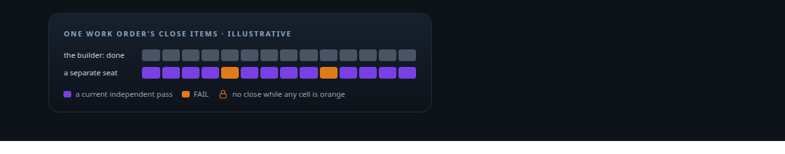
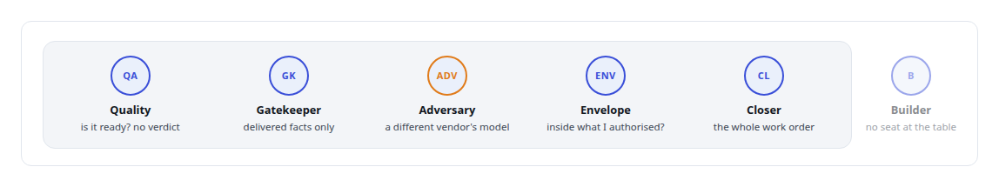
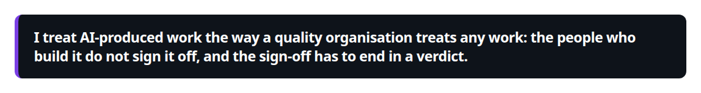
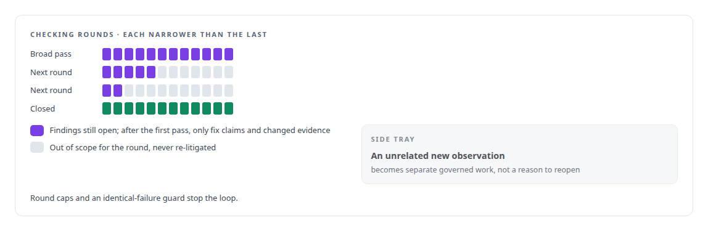
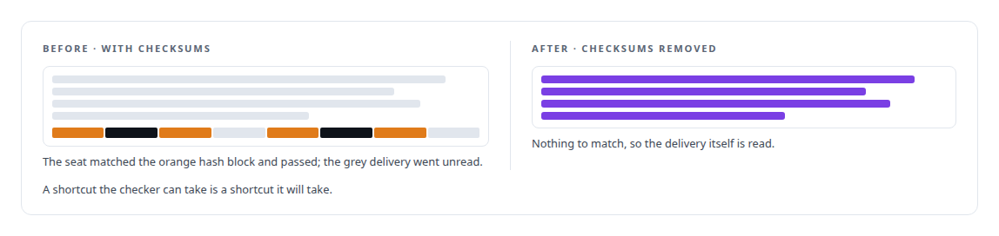
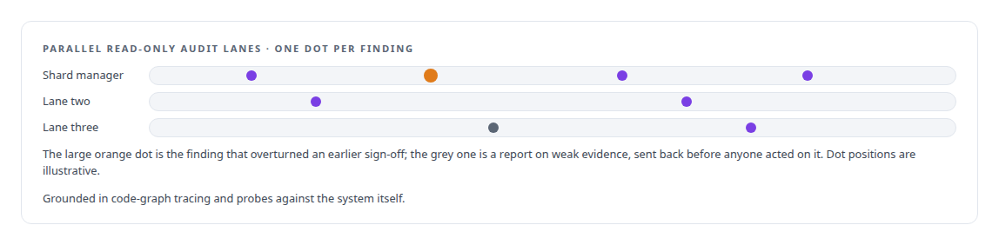

# Independent verification and adversarial review

**Builders do not judge their own work. Quality assurance, a gatekeeper that accepts only delivered facts, and an adversarial reviewer on a different vendor's model are separate seats, and a FAIL stays a FAIL.**

Canonical: https://coreyjames.ai/technologies/independent-verification-and-adversarial-review/  
Author: Corey James · Published: 2026-10-28 · Kind: technology  
Systems: [AgentOS](https://github.com/coreyjames-ai/agentos) · [Auth and access plane](https://github.com/coreyjames-ai/auth-and-access-plane) · [Inference Fabric](https://github.com/coreyjames-ai/inference-fabric)  
Skills: [evidence-gated acceptance](https://github.com/coreyjames-ai/portfolio/tree/main/skills/evidence-gated-acceptance) · [separation of duties for AI work](https://github.com/coreyjames-ai/portfolio/tree/main/skills/separation-of-duties-for-ai-work) · [AI-assisted engineering methodology](https://github.com/coreyjames-ai/portfolio/tree/main/skills/ai-assisted-engineering-methodology) · [multi-agent governance](https://github.com/coreyjames-ai/portfolio/tree/main/skills/multi-agent-governance)  



## Result

| Figure | What it measures |
| --- | --- |
| **5** | judging seats, each with its own authority and none with the builder's |
| **23** | close items, each needing a current independent pass |
| **14 days** | a work order held open until every one of them had it |

## What was built

### Separate seats for building and judging

[AgentOS](https://coreyjames.ai/systems/agentos): agent teams report success because they are built to finish tasks, and saying "done" finishes one. I decided the agent that builds a piece of work never judges it, and that the judging has to finish. AgentOS splits judgment into separate seats with separate authority, and the builders and the adversary run on models from different vendors so their blind spots do not overlap.



When the team proposed a dedicated testing role, I ruled that testing is a developer activity that produces evidence; a separate seat would have let builders stop testing. I hold the one human override on closure, and using it requires a written reason. I wrote the rules these seats follow and made the rulings that shaped them.



### Checking that converges

To make the checking converge, the first broad quality pass freezes its findings. Later rounds look only at fix claims and changed evidence, and an unrelated new observation becomes separate governed work. A criterion that turns out to be wrong is withdrawn by an explicit decision, never quietly skipped.



All of this lives as data and state transitions in PostgreSQL, and the gatekeeper and quality machinery carries its own contract suites written with fail-before and pass-after controls. Several of these rules came from convergence problems I had to work through one by one.

### Closing on delivered evidence

The hardest test was an API integration platform whose agents said it was done. I held the work order open until every close item had a current independent pass. That is the story in [Closed by evidence](https://coreyjames.ai/stories/closed-by-evidence), and the seat design is in [Separation of duties for AI work](https://coreyjames.ai/stories/separation-of-duties-for-ai-work).

What a checking seat receives decides what checking means. I removed checksums from the packets the seats receive, because they had started matching hashes instead of reading what was delivered.



Every fix carries a witness proof, and probes clean up after themselves, so checking leaves nothing behind in the system it checks.

### Adversarial audits before the seats existed

[Inference Fabric](https://coreyjames.ai/systems/inference-fabric): before AgentOS existed, I ran the same practice by hand on AI-built subsystems. I commissioned read-only adversarial audits in parallel lanes, with findings ranked by severity and tied to file and line.



The audit of the vector shard manager found that a subsystem previously signed off did not match its own documentation, and it traced the systemic cause. I acted on that finding even though it overturned the earlier sign-off. These audits are where the AgentOS seats came from; the seats are AI agents working in my own engineering estate.

> I treat AI-produced work the way a quality organisation treats any work: the people who build it do not sign it off, and the sign-off has to end in a verdict.

## What was verified

Each line is a claim the canonical page supports, with the figure as the page states it.

- Separation of duties for AI work: builders never judge their own work; quality, a facts-only gatekeeper, a cross-vendor adversary, an envelope auditor and a closer hold separate authority.
- Evidence-gated acceptance: a work order held open 14 days until all 23 close items had a current independent pass.
- Converging quality loops for AI agents: findings frozen after the first broad pass, later rounds limited to fix claims and changed evidence, with round caps and an identical-failure guard.
- Adversarial code audit: read-only audits in parallel lanes grounded in code-graph tracing, one of which overturned an earlier sign-off on a vector shard manager.

## Related

- [Closed by evidence](https://github.com/coreyjames-ai/agentos/tree/main/stories/closed-by-evidence) · https://coreyjames.ai/stories/closed-by-evidence/
- [Separation of duties for AI work](https://github.com/coreyjames-ai/agentos/tree/main/stories/separation-of-duties-for-ai-work) · https://coreyjames.ai/stories/separation-of-duties-for-ai-work/
- [Proving a rewrite is the same system](https://github.com/coreyjames-ai/activekv/tree/main/stories/proving-a-rewrite-is-the-same-system) · https://coreyjames.ai/stories/proving-a-rewrite-is-the-same-system/
- [Directing AI coding agents at program scale](https://github.com/coreyjames-ai/agentos/tree/main/stories/directing-ai-coding-agents-at-program-scale) · https://coreyjames.ai/stories/directing-ai-coding-agents-at-program-scale/
- System: [AgentOS](https://github.com/coreyjames-ai/agentos)
- System: [Auth and access plane](https://github.com/coreyjames-ai/auth-and-access-plane)
- System: [Inference Fabric](https://github.com/coreyjames-ai/inference-fabric)

## Citation

Corey James. "Independent verification and adversarial review." coreyjames.ai, 2026. https://coreyjames.ai/technologies/independent-verification-and-adversarial-review/

```bibtex
@misc{coreyjames-independent-verification-and-adversarial-review,
  author = {Corey James},
  title = {Independent verification and adversarial review},
  year = {2026},
  howpublished = {\url{https://coreyjames.ai/technologies/independent-verification-and-adversarial-review/}},
  note = {GitHub copy: https://github.com/coreyjames-ai/portfolio/tree/main/technologies/independent-verification-and-adversarial-review}
}
```

Part of [Corey James's portfolio](https://github.com/coreyjames-ai/portfolio) · site: https://coreyjames.ai/ · MCP server: https://coreyjames.ai/mcp · agent card: https://coreyjames.ai/.well-known/agent.json
