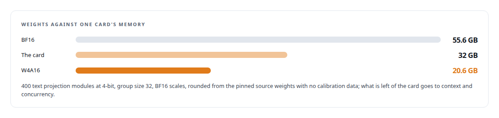
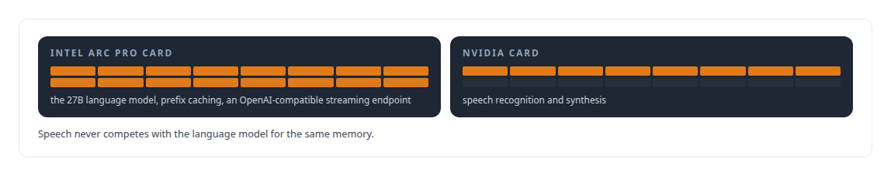

# Intel Arc GPUs

**An Intel Arc Pro GPU is ActiveKV's home: a 27B model serving 128,000-token histories on one 32 GB card, kernel patches on a new architecture, and a published quantization built for it.**

Canonical: https://coreyjames.ai/technologies/intel-arc-gpus/  
Author: Corey James · Published: 2026-10-28 · Kind: technology  
Systems: [ActiveKV](https://github.com/coreyjames-ai/activekv) · [Capabilities model](https://github.com/coreyjames-ai/capabilities-model) · [Helix](https://github.com/coreyjames-ai/helix)  
Skills: [Intel GPU and SYCL/oneAPI engineering](https://github.com/coreyjames-ai/portfolio/tree/main/skills/intel-gpu-and-sycl-oneapi-engineering) · [GPU inference optimisation](https://github.com/coreyjames-ai/portfolio/tree/main/skills/gpu-inference-optimisation) · [inference serving architecture](https://github.com/coreyjames-ai/portfolio/tree/main/skills/inference-serving-architecture) · [LLM quantization (FP8, INT8, 4-bit)](https://github.com/coreyjames-ai/portfolio/tree/main/skills/llm-quantization-fp8-int8-4-bit)  


## Result

| Figure | What it measures |
| --- | --- |
| **4** | patches to Intel's own kernel sources, each with identical outputs |
| **~36%** | more sustained throughput, all-4-bit against a mixed 4-bit and 8-bit control |
| **3.33%** | higher perplexity paid for that throughput, eight-document diagnostic set |

## What was built

### Long contexts on one 32 GB card

[ActiveKV](https://coreyjames.ai/systems/activekv): I wanted a 27B hybrid model to serve long contexts on one 32 GB card. On a 32 GB Intel Arc Pro GPU the key-value cache was the wall, and I chose to make that card the target and fix the stack where it fell short. ActiveKV keeps attention history in pinned host memory and gives the card a bounded working set, so a 4-bit-weight build of a 27-billion-parameter hybrid recurrent-attention open-weight model serves histories from 32K tokens upward on a single card.

On the release build, an 8,000-token single request against stock vLLM on the same card:


The work is single-card with eager execution, and at long contexts with a single request stock vLLM is still faster per token. The details are in [Bringing a serving stack up on new silicon](https://coreyjames.ai/stories/bringing-a-serving-stack-up-on-new-silicon) and [Context beyond VRAM](https://coreyjames.ai/stories/context-beyond-vram).

### Patching Intel's kernels without changing an output

The card is a new architecture (Xe2), and the open kernel stacks had gaps when I started. I kept the stock vendor runtime wherever it worked and patched Intel's own open sources inside Intel's image, for ABI match: a oneDNN kernel-catalogue entry so large prefill GEMMs pick a better tile; occupancy, output-split and memory-fence fixes in the recurrent-layer prefill; a paged-decode log-sum-exp output, so attention computed across memory tiers merges exactly; and a switch that makes int4 GEMM reductions deterministic for parity runs.


I also measured two attention-kernel candidates, a 64-key tile and a rescale-skip, and rejected both; that negative result stays in the plan with them.


### A published 4-bit build of a 27B model

[Capabilities model](https://coreyjames.ai/systems/capabilities-model): the 27-billion-parameter hybrid recurrent-attention open-weight model is too large for the card in BF16, and I wanted it whole on one 32 GB card with room left for context and concurrency. I built a weight-only W4A16 quantization of its text projection modules with symmetric 4-bit weights, in a format Intel's stock XPU build of [vLLM](https://coreyjames.ai/technologies/vllm) already reads with its existing wNa16 kernel.



I chose provenance over calibration, so anyone can reproduce the build from the pinned source alone. A four-arm experiment, run in crossover order across two of these cards, attributed the gain: the all-4-bit build won on sustained throughput against a mixed 4-bit and 8-bit control, for a small perplexity cost. I published it. See [A 27B model on one 32 GB Intel card](https://coreyjames.ai/stories/a-27b-model-on-one-32gb-intel-card).

### Measuring a card without distorting it

A trace suggested host-to-device copies were not overlapping with compute on the card. A controlled experiment showed the timing events themselves were serialising the copy engine, and I retracted the conclusion.


That is [The observer that changed the answer](https://coreyjames.ai/stories/the-observer-that-changed-the-answer). Being able to say exactly where each gain came from, and where a measurement was wrong, is the point of the whole programme.

### A local model endpoint for the voice engine

[Helix](https://coreyjames.ai/systems/helix): the voice engine needed a local language model that answers fast enough for conversation. An Intel Arc Pro GPU serves the 27-billion-parameter hybrid model with prefix caching as one of the engine's local endpoints, reached over an OpenAI-compatible streaming interface.



> Every kernel patch had to produce identical outputs before I took any speed from it.

## What was verified

Each line is a claim the canonical page supports, with the figure as the page states it.

- Intel GPU and SYCL/oneAPI engineering: Intel kernel sources patched on Xe2 with identical outputs, cold 32K-token prefill cut from 21.54 s to 17.23 s and recurrent prefill from 53.8 to 27.4 ms per chunk.
- LLM quantization (4-bit): a calibration-free W4A16 build taking a 27B hybrid model from 55.6 GB to 20.6 GB for one 32 GB card, about 36% more throughput for 3.33% higher perplexity.
- GPU inference optimisation: an 8,000-token request at 3.68 s to first token and 43.3 ms per token, against 4.71 s and 45.3 ms for stock vLLM on the same Intel Arc Pro card.
- Profiling methodology: a trace conclusion about copy and compute overlap retracted after a controlled experiment showed the timing events themselves serialised the copy engine.

## Related

- [Rewriting an engine extension without changing a token](https://github.com/coreyjames-ai/activekv/tree/main/stories/rewriting-an-engine-extension-without-changing-a-token) · https://coreyjames.ai/stories/rewriting-an-engine-extension-without-changing-a-token/
- [Context beyond VRAM](https://github.com/coreyjames-ai/activekv/tree/main/stories/context-beyond-vram) · https://coreyjames.ai/stories/context-beyond-vram/
- [Judge a representation by the bytes it stops moving](https://github.com/coreyjames-ai/activekv/tree/main/stories/judge-a-representation-by-the-bytes-it-stops-moving) · https://coreyjames.ai/stories/judge-a-representation-by-the-bytes-it-stops-moving/
- [The observer that changed the answer](https://github.com/coreyjames-ai/activekv/tree/main/stories/the-observer-that-changed-the-answer) · https://coreyjames.ai/stories/the-observer-that-changed-the-answer/
- [Bringing a serving stack up on new silicon](https://github.com/coreyjames-ai/activekv/tree/main/stories/bringing-a-serving-stack-up-on-new-silicon) · https://coreyjames.ai/stories/bringing-a-serving-stack-up-on-new-silicon/
- [A 27B model on one 32 GB Intel card](https://github.com/coreyjames-ai/capabilities-model/tree/main/stories/a-27b-model-on-one-32gb-intel-card) · https://coreyjames.ai/stories/a-27b-model-on-one-32gb-intel-card/
- [vLLM](https://github.com/coreyjames-ai/portfolio/tree/main/technologies/vllm) · https://coreyjames.ai/technologies/vllm/
- System: [ActiveKV](https://github.com/coreyjames-ai/activekv)
- System: [Capabilities model](https://github.com/coreyjames-ai/capabilities-model)
- System: [Helix](https://github.com/coreyjames-ai/helix)

## Citation

Corey James. "Intel Arc GPUs." coreyjames.ai, 2026. https://coreyjames.ai/technologies/intel-arc-gpus/

```bibtex
@misc{coreyjames-intel-arc-gpus,
  author = {Corey James},
  title = {Intel Arc GPUs},
  year = {2026},
  howpublished = {\url{https://coreyjames.ai/technologies/intel-arc-gpus/}},
  note = {GitHub copy: https://github.com/coreyjames-ai/portfolio/tree/main/technologies/intel-arc-gpus}
}
```

Part of [Corey James's portfolio](https://github.com/coreyjames-ai/portfolio) · site: https://coreyjames.ai/ · MCP server: https://coreyjames.ai/mcp · agent card: https://coreyjames.ai/.well-known/agent.json
