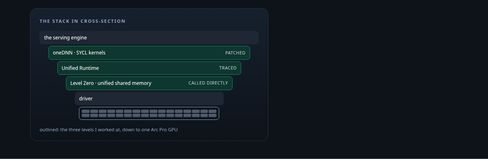
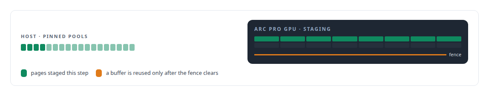
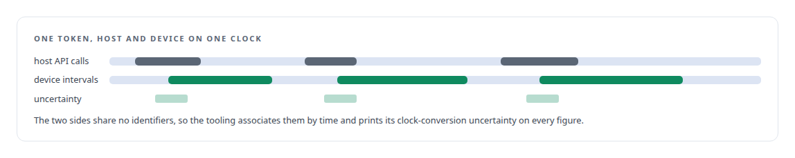

# Intel oneAPI

**Intel's oneAPI stack is what ActiveKV's native engine and its kernel patches are built against, inside the vendor's own toolchain for ABI match.**

Canonical: https://coreyjames.ai/technologies/intel-oneapi/  
Author: Corey James · Published: 2026-10-28 · Kind: technology  
Systems: [ActiveKV](https://github.com/coreyjames-ai/activekv)  
Skills: [Intel GPU and SYCL/oneAPI engineering](https://github.com/coreyjames-ai/portfolio/tree/main/skills/intel-gpu-and-sycl-oneapi-engineering) · [GPU inference optimisation](https://github.com/coreyjames-ai/portfolio/tree/main/skills/gpu-inference-optimisation) · [tool synthesis and governed API integration](https://github.com/coreyjames-ai/portfolio/tree/main/skills/tool-synthesis-and-governed-api-integration) · [AI-assisted engineering methodology](https://github.com/coreyjames-ai/portfolio/tree/main/skills/ai-assisted-engineering-methodology)  



## Result

| Figure | What it measures |
| --- | --- |
| **192** | Unified-Runtime entry points covered by the generated preload shim |
| **~18** | engine files calling Level Zero directly |
| **3.12** | the oneDNN version the patch series targets |

## What was built

[ActiveKV](https://coreyjames.ai/systems/activekv)'s native engine and every kernel patch sit on Intel's oneAPI stack: SYCL and DPC++, Level Zero, the Unified Runtime, [oneDNN](https://coreyjames.ai/technologies/onednn), and the PTI and unitrace tracing tools. I saw a choice between treating that stack as a black box and working at whatever level a problem lived at. I chose the second, and the work ran at three levels.

## Kernel library patches

The first level is the kernel libraries. Patches are built against the vendor's own sources inside the vendor's image, with Intel's toolchain, so the ABI matches what the serving engine loads and a whole class of mismatch disappears. The oneDNN work is a series of patches. One is a kernel-catalogue entry for Xe2 large-N GEMM shapes.


The rest serve the 4-bit-weight model path: weight reuse, local convert-and-scale, scale broadcast and a DPAS tail path. SYCL is the language of the recurrent-layer prefill fixes and of the paged-attention log-sum-exp output that lets attention merge exactly across memory tiers. Every oneDNN and SYCL change had to produce bit-identical results against the unpatched path on a quiet host before I kept it. That work is told in [Bringing a serving stack up on new silicon](https://coreyjames.ai/stories/bringing-a-serving-stack-up-on-new-silicon).


## Runtime calls on Level Zero

The second level is runtime calls. The memory tier uses Level Zero and unified shared memory directly for its pinned host pools, staging and fences.



## Tracing without the vendor's overhead

The third level is tracing. The step-profiling suite associates Unified-Runtime calls with device kernel and copy intervals and with host waits, so I can follow a single token from the scheduler to the device and back to the client. The vendor tracing path kept memory on every driver call, which limited me to one instrumented capture at a time. I replaced it with a preload shim generated over the Unified-Runtime entry points, described on the [LD_PRELOAD symbol interposition](https://coreyjames.ai/technologies/ld-preload-symbol-interposition) page.



Timing events turned out to serialise the copy engine. Every claim about overlap now gets an uninstrumented control before anyone acts on it, as told in [The observer that changed the answer](https://coreyjames.ai/stories/the-observer-that-changed-the-answer). I work below the framework when the problem is there. oneAPI, oneDNN, Level Zero and the Unified Runtime are Intel's software; my part is the patches and tooling built on them, for a single Arc Pro GPU.

> I kept a rewrite that produced exact arithmetic with no whole-workload gain, because exactness is a property I want in the product.

## What was verified

Each line is a claim the canonical page supports, with the figure as the page states it.

- Intel GPU and SYCL/oneAPI engineering: oneDNN 3.12 patches built in the vendor's image, a Xe2 GEMM catalogue entry cutting cold 32K-token prefill from 21.54 s to 17.23 s with identical outputs.
- Low-level GPU runtime programming: Level Zero and unified shared memory for pinned host pools, staging and fences, called from ~18 engine files.
- GPU profiling and tracing: a generated preload shim over 192 Unified-Runtime entry points tying host calls to device intervals.

## Related

- [Rewriting an engine extension without changing a token](https://github.com/coreyjames-ai/activekv/tree/main/stories/rewriting-an-engine-extension-without-changing-a-token) · https://coreyjames.ai/stories/rewriting-an-engine-extension-without-changing-a-token/
- [Context beyond VRAM](https://github.com/coreyjames-ai/activekv/tree/main/stories/context-beyond-vram) · https://coreyjames.ai/stories/context-beyond-vram/
- [The observer that changed the answer](https://github.com/coreyjames-ai/activekv/tree/main/stories/the-observer-that-changed-the-answer) · https://coreyjames.ai/stories/the-observer-that-changed-the-answer/
- [Bringing a serving stack up on new silicon](https://github.com/coreyjames-ai/activekv/tree/main/stories/bringing-a-serving-stack-up-on-new-silicon) · https://coreyjames.ai/stories/bringing-a-serving-stack-up-on-new-silicon/
- [oneDNN](https://github.com/coreyjames-ai/portfolio/tree/main/technologies/onednn) · https://coreyjames.ai/technologies/onednn/
- [LD_PRELOAD symbol interposition](https://github.com/coreyjames-ai/portfolio/tree/main/technologies/ld-preload-symbol-interposition) · https://coreyjames.ai/technologies/ld-preload-symbol-interposition/
- System: [ActiveKV](https://github.com/coreyjames-ai/activekv)

## Citation

Corey James. "Intel oneAPI." coreyjames.ai, 2026. https://coreyjames.ai/technologies/intel-oneapi/

```bibtex
@misc{coreyjames-intel-oneapi,
  author = {Corey James},
  title = {Intel oneAPI},
  year = {2026},
  howpublished = {\url{https://coreyjames.ai/technologies/intel-oneapi/}},
  note = {GitHub copy: https://github.com/coreyjames-ai/portfolio/tree/main/technologies/intel-oneapi}
}
```

Part of [Corey James's portfolio](https://github.com/coreyjames-ai/portfolio) · site: https://coreyjames.ai/ · MCP server: https://coreyjames.ai/mcp · agent card: https://coreyjames.ai/.well-known/agent.json
