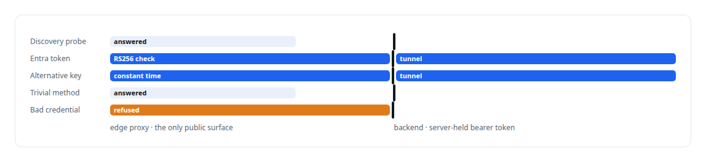
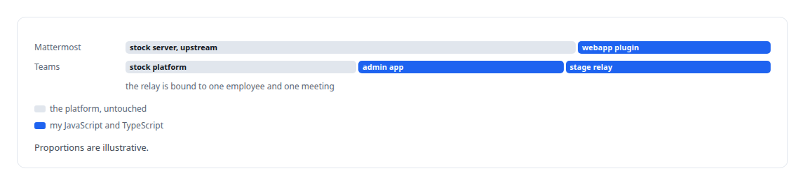
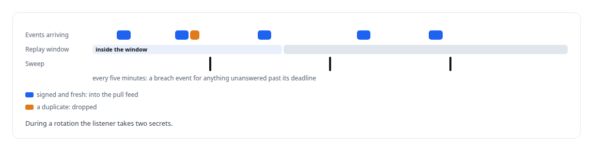
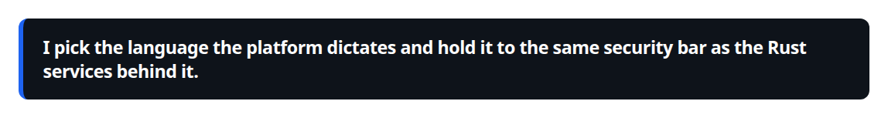

# JavaScript

**Relays, meeting-stage apps, extension scripts and the OAuth consent surfaces are JavaScript where the platform demands it.**

Canonical: https://coreyjames.ai/technologies/javascript/  
Author: Corey James · Published: 2026-10-28 · Kind: technology  
Systems: [Helix](https://github.com/coreyjames-ai/helix) · [FAFOHive](https://github.com/coreyjames-ai/fafohive) · [Auth and access plane](https://github.com/coreyjames-ai/auth-and-access-plane)  
Skills: [OAuth 2.0 and identity architecture](https://github.com/coreyjames-ai/portfolio/tree/main/skills/oauth-2-0-and-identity-architecture) · [tool synthesis and governed API integration](https://github.com/coreyjames-ai/portfolio/tree/main/skills/tool-synthesis-and-governed-api-integration) · [Microsoft 365, Graph and Entra integration](https://github.com/coreyjames-ai/portfolio/tree/main/skills/microsoft-365-graph-and-entra-integration)  


## Result

| Figure | What it measures |
| --- | --- |
| **≈300** | lines in the edge proxy |
| **≈11,000** | lines of Mattermost webapp plugin code |
| **95** | webapp tests on the council interface |
| **20** | test cases on the meeting-stage relay |

## What was built

### An edge proxy as the only public surface

Microsoft Copilot Studio needed to call tools on my private MCP server in the [Auth and access plane](https://coreyjames.ai/systems/auth-and-access-plane), and I did not want that server to accept a single public connection. I put a small edge proxy in front of it, written in JavaScript for an edge [Workers](https://coreyjames.ai/technologies/cloudflare-workers) runtime, and it is the only public surface.

The connector sends unauthenticated discovery probes, and the proxy answers those without credentials. On every real call it checks a tenant-pinned Microsoft Entra JWT. The edge runtime has no Node crypto, so the RS256 check uses WebCrypto against signing keys cached in the edge key-value store, and a call never waits on a key fetch.



An alternative high-entropy key is compared by value in constant time, which keeps it working when the connector renames the query parameter, and the key gate has two slots, so keys rotate without downtime. Each of these choices came from reading the connector's actual traffic in edge logs; that behaviour is on the [Microsoft Copilot Studio](https://coreyjames.ai/technologies/microsoft-copilot-studio) page.

### Helix inside two chat platforms

[Helix](https://coreyjames.ai/systems/helix) lives inside two chat platforms I do not own, and I wanted both to stay stock. All of its browser-side surfaces are JavaScript and TypeScript extensions: a [Mattermost](https://coreyjames.ai/technologies/mattermost) webapp plugin, a [React](https://coreyjames.ai/technologies/react) admin app for the Teams working service, and a Node relay for the Teams meeting stage.



Every Mattermost customisation is a plugin, a bot or an external bridge, so the chat server stays upstream and upgradeable.

### A browser extension and a signed event feed

Two of [FAFOHive](https://coreyjames.ai/systems/fafohive)'s integrations had to live where only JavaScript runs. One platform offered agents no usable API. For it, I built a Manifest V3 [Chrome extension](https://coreyjames.ai/technologies/chrome-extensions-manifest-v3) that acts in my own logged-in browser session by issuing the same same-origin requests the site makes, with no UI clicking. It never exports cookies or tokens, and a repeated request returns the original receipt without acting twice.

The signed social event feed ends at an edge listener, and the service's web dashboard is JavaScript as well.



On every one of these surfaces I want signature checks at the edge, key rotation without downtime and idempotent writes from a browser. Rust carries the core of these systems, and the engineering that carries weight is on the [Auth and access plane](https://coreyjames.ai/systems/auth-and-access-plane) and [Helix](https://coreyjames.ai/systems/helix) pages.



> I pick the language the platform dictates and hold it to the same security bar as the Rust services behind it.

## What was verified

Each line is a claim the canonical page supports, with the figure as the page states it.

- Edge security in JavaScript: a proxy of about 300 lines as the only public surface of a private MCP server, checking Entra JWTs with WebCrypto and rotating keys without downtime.
- Browser extension development: a Manifest V3 extension that acts in my own session through same-origin requests and never exports cookies or tokens.
- Chat platform plugins: about 11,000 lines of Mattermost webapp plugin code with 95 tests, keeping the chat server stock.
- Webhook security: a timestamped HMAC over the exact bytes inside a replay window, with duplicates dropped and two secrets accepted during rotation.

## Related

- [A meeting attendee that will not fake it](https://github.com/coreyjames-ai/helix/tree/main/stories/a-meeting-attendee-that-will-not-fake-it) · https://coreyjames.ai/stories/a-meeting-attendee-that-will-not-fake-it/
- [Cloudflare Workers](https://github.com/coreyjames-ai/portfolio/tree/main/technologies/cloudflare-workers) · https://coreyjames.ai/technologies/cloudflare-workers/
- [Microsoft Copilot Studio](https://github.com/coreyjames-ai/portfolio/tree/main/technologies/microsoft-copilot-studio) · https://coreyjames.ai/technologies/microsoft-copilot-studio/
- [Mattermost](https://github.com/coreyjames-ai/portfolio/tree/main/technologies/mattermost) · https://coreyjames.ai/technologies/mattermost/
- [React](https://github.com/coreyjames-ai/portfolio/tree/main/technologies/react) · https://coreyjames.ai/technologies/react/
- [Chrome extensions (Manifest V3)](https://github.com/coreyjames-ai/portfolio/tree/main/technologies/chrome-extensions-manifest-v3) · https://coreyjames.ai/technologies/chrome-extensions-manifest-v3/
- System: [Helix](https://github.com/coreyjames-ai/helix)
- System: [FAFOHive](https://github.com/coreyjames-ai/fafohive)
- System: [Auth and access plane](https://github.com/coreyjames-ai/auth-and-access-plane)

## Citation

Corey James. "JavaScript." coreyjames.ai, 2026. https://coreyjames.ai/technologies/javascript/

```bibtex
@misc{coreyjames-javascript,
  author = {Corey James},
  title = {JavaScript},
  year = {2026},
  howpublished = {\url{https://coreyjames.ai/technologies/javascript/}},
  note = {GitHub copy: https://github.com/coreyjames-ai/portfolio/tree/main/technologies/javascript}
}
```

Part of [Corey James's portfolio](https://github.com/coreyjames-ai/portfolio) · site: https://coreyjames.ai/ · MCP server: https://coreyjames.ai/mcp · agent card: https://coreyjames.ai/.well-known/agent.json
