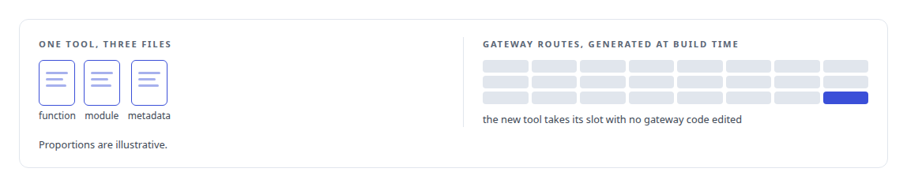
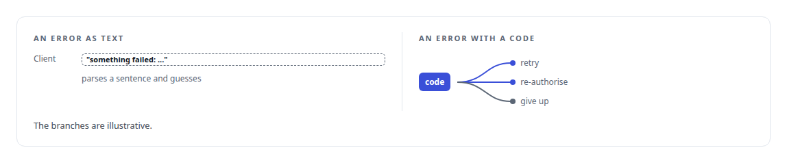
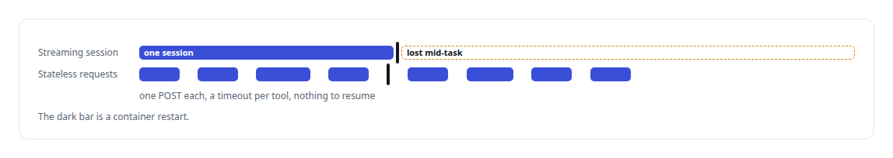
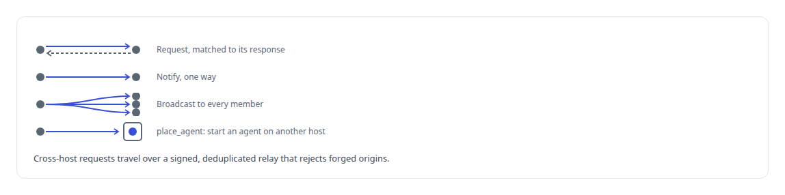

# JSON-RPC

**JSON-RPC is the transport under the Model Context Protocol surfaces I build and consume.**

Canonical: https://coreyjames.ai/technologies/json-rpc/  
Author: Corey James · Published: 2026-10-28 · Kind: technology  
Systems: [Agent Swarm](https://github.com/coreyjames-ai/agent-swarm) · [FAFOHive](https://github.com/coreyjames-ai/fafohive) · [FAFO Core and Function Forge](https://github.com/coreyjames-ai/fafo-core)  
Skills: [MCP server design](https://github.com/coreyjames-ai/portfolio/tree/main/skills/mcp-server-design) · [tool synthesis and governed API integration](https://github.com/coreyjames-ai/portfolio/tree/main/skills/tool-synthesis-and-governed-api-integration) · [inference serving architecture](https://github.com/coreyjames-ai/portfolio/tree/main/skills/inference-serving-architecture)  


## Result

| Figure | What it measures |
| --- | --- |
| **22** | custom error codes a client can branch on |
| **3** | MCP servers mapped by the read-only explorer |

## What was built

### Routing generated from YAML

In [FAFO Core and Function Forge](https://coreyjames.ai/systems/fafo-core) I expected the number of tools to grow faster than anyone could hand-wire gateway routes. So I made JSON-RPC 2.0, the envelope of the [Model Context Protocol](https://coreyjames.ai/technologies/model-context-protocol-mcp), something the gateway serves from generated code. The gateway is an [Axum](https://coreyjames.ai/technologies/axum) server that speaks MCP over HTTP with the `.well-known` MCP configuration, protected-resource metadata and session headers.

At build time a generator turns a YAML trio per tool into handlers and routing, so a new function becomes callable without anyone editing gateway code, and the gateway and its catalog cannot drift apart.



Function Forge is itself an MCP tool on this envelope. An agent calls `create_function`, and the generator emits a new crate and wires it into the gateway, the control plane and the completion service in one reversible operation. After a rebuild and a restart I authorise, the new function answers `tools/call` with execute, status and control actions. See [Tools that build tools, under governance](https://coreyjames.ai/stories/tools-that-build-tools-under-governance).

### A typed error space

The gateway defines its own error codes, so a failure reaches the client as a typed JSON-RPC error. Clients and agents branch on the kind of failure instead of parsing a message string.



### A transport that survives restarts

In [FAFOHive](https://coreyjames.ai/systems/fafohive) the first transport was a streaming server-sent-events session, and it broke every time a container restarted. Agents lost their connection mid-task. I replaced it with stateless JSON-RPC over HTTPS.



I also built a read-only explorer that discovers the catalogs on my MCP servers through the standard listing calls. It handles JSON and SSE responses and pagination, never calls a tool and treats every tool description it reads as untrusted text, so I can inspect several hundred tools with no side effects.

### Envelopes between agents

[Agent Swarm](https://coreyjames.ai/systems/agent-swarm) agents had to message one another and start work on a second machine, and I wanted one envelope for both. Agent-to-agent messages are JSON-RPC 2.0 envelopes aligned with the [Agent Client Protocol](https://coreyjames.ai/technologies/agent-client-protocol-acp), carried over Redis streams with response correlation and a durable journal. The message types live in a crate with no I/O and no business logic, so producers and consumers compile against one definition.



With the envelope out of the way, the attention goes to routing, identity and failure handling. The services use standard Rust and Python JSON-RPC stacks; the generated routing, the error space and the transport choices are mine.


> I treat the wire envelope as plumbing that should be generated, typed and boring.

## What was verified

Each line is a claim the canonical page supports, with the figure as the page states it.

- MCP server design: JSON-RPC routing generated from YAML at build time, with 22 custom error codes a client can branch on.
- Resilient transports: a streaming session that broke on container restarts replaced by stateless JSON-RPC over HTTPS.
- Agent-to-agent messaging: JSON-RPC envelopes aligned with the Agent Client Protocol over Redis streams, including a call that starts an agent on another host.

## Related

- [Tools that build tools, under governance](https://github.com/coreyjames-ai/fafo-core/tree/main/stories/tools-that-build-tools-under-governance) · https://coreyjames.ai/stories/tools-that-build-tools-under-governance/
- [Model Context Protocol (MCP)](https://github.com/coreyjames-ai/portfolio/tree/main/technologies/model-context-protocol-mcp) · https://coreyjames.ai/technologies/model-context-protocol-mcp/
- [Axum](https://github.com/coreyjames-ai/portfolio/tree/main/technologies/axum) · https://coreyjames.ai/technologies/axum/
- [Agent Client Protocol (ACP)](https://github.com/coreyjames-ai/portfolio/tree/main/technologies/agent-client-protocol-acp) · https://coreyjames.ai/technologies/agent-client-protocol-acp/
- System: [Agent Swarm](https://github.com/coreyjames-ai/agent-swarm)
- System: [FAFOHive](https://github.com/coreyjames-ai/fafohive)
- System: [FAFO Core and Function Forge](https://github.com/coreyjames-ai/fafo-core)

## Citation

Corey James. "JSON-RPC." coreyjames.ai, 2026. https://coreyjames.ai/technologies/json-rpc/

```bibtex
@misc{coreyjames-json-rpc,
  author = {Corey James},
  title = {JSON-RPC},
  year = {2026},
  howpublished = {\url{https://coreyjames.ai/technologies/json-rpc/}},
  note = {GitHub copy: https://github.com/coreyjames-ai/portfolio/tree/main/technologies/json-rpc}
}
```

Part of [Corey James's portfolio](https://github.com/coreyjames-ai/portfolio) · site: https://coreyjames.ai/ · MCP server: https://coreyjames.ai/mcp · agent card: https://coreyjames.ai/.well-known/agent.json
