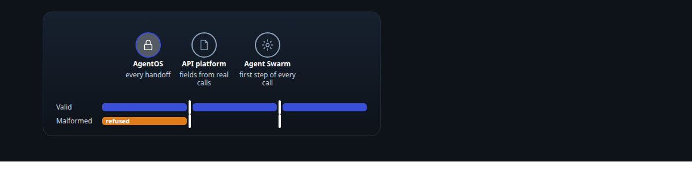
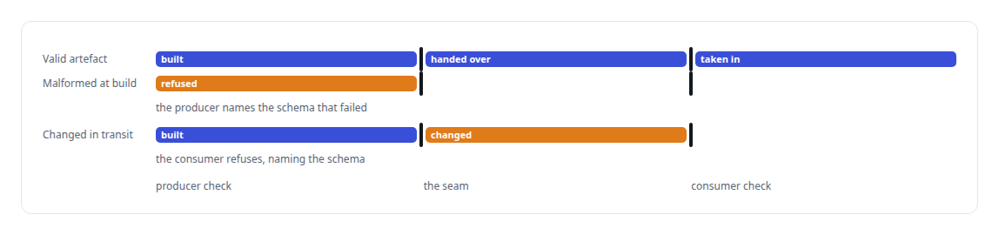
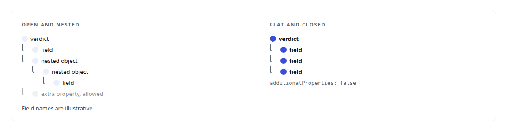
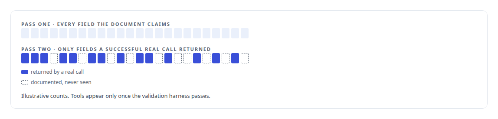
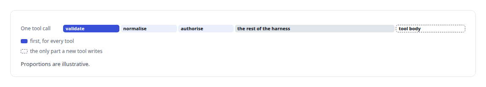
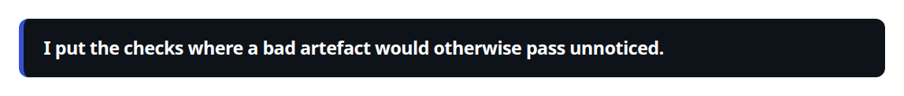

# JSON Schema

**Every work-order contract, tool definition and generated function surface in my estate is a JSON Schema, and schemas compile into dispatch at build time.**

Canonical: https://coreyjames.ai/technologies/json-schema/  
Author: Corey James · Published: 2026-10-28 · Kind: technology  
Systems: [AgentOS](https://github.com/coreyjames-ai/agentos) · [Agent Swarm](https://github.com/coreyjames-ai/agent-swarm) · [FAFO Core and Function Forge](https://github.com/coreyjames-ai/fafo-core)  
Skills: [evidence-gated acceptance](https://github.com/coreyjames-ai/portfolio/tree/main/skills/evidence-gated-acceptance) · [tool synthesis and governed API integration](https://github.com/coreyjames-ai/portfolio/tree/main/skills/tool-synthesis-and-governed-api-integration) · [AI-assisted engineering methodology](https://github.com/coreyjames-ai/portfolio/tree/main/skills/ai-assisted-engineering-methodology) · [Rust systems engineering](https://github.com/coreyjames-ai/portfolio/tree/main/skills/rust-systems-engineering)  



## Result

| Figure | What it measures |
| --- | --- |
| **33** | schema contracts governing AgentOS handoffs |
| **12** | semantic rules checking each API reference |
| **≈2,000** | lines of Rust in the harness validator |

## What was built

### Contracts at every handoff

Long agent runs drift when the handoffs between agents are prose, because each agent reinterprets what the last one meant. In [AgentOS](https://coreyjames.ai/systems/agentos) I made every handoff a contract and chose JSON Schema as the contract language. The `*.schema.json` contracts cover work-order sources, authoring plans, work packages and the structured output of model checkers.

Every seam is checked on both sides, so a malformed artefact cannot pass through a component that trusts its upstream. The PostgreSQL work graph and its schemas are the truth; Markdown views are generated from them, and edits to those views are discarded.



### Diagnostics that name the fix

Work-order authoring starts from an operator-only source document. When it fails validation, the diagnostic names the exact field and the fix, such as a missing deliverable class or a team larger than the ceiling of twelve, which keeps authoring from turning into trial and error.

The schema for a model checker's verdict is flat and closed and matches the vendors' structured-output modes, so a verdict comes back as data. Nested and open schemas are where model output drifts. On the Rust side, contracts are checked with the `jsonschema` crate and hashed in canonical form. Why the handoffs had to become contracts is the subject of [Why long agent runs fail](https://coreyjames.ai/stories/why-long-agent-runs-fail).



### Fields only from real calls

Connecting an API for agents usually starts with someone reading documentation and guessing which fields are real. In the sibling platform for third-party APIs in [FAFO Core and Function Forge](https://coreyjames.ai/systems/fafo-core), I decided a field counts only once a real call has returned it. A two-pass normaliser does the work, starting from an [OpenAPI](https://coreyjames.ai/technologies/openapi) 3.x document or a hand-written seed.



A semantic validator checks the canonical API reference, and the platform exposes no tools for an API until its validation harness passes, so the schema describes the API as it behaves. That platform's build is the story in [Closed by evidence](https://coreyjames.ai/stories/closed-by-evidence).

### Validation in the harness

If every tool validates its own input, a fleet with hundreds of tools ends up with hundreds of slightly different validators. In [Agent Swarm](https://coreyjames.ai/systems/agent-swarm) I put validation in the harness, as the first step of the frozen pipeline every tool call passes through. The validator applies draft-07 validation and the OpenAI strict-mode rules, plus structural pre-checks such as the depth of a peer-call chain, before parameters are normalised and authorised.



See [Tools are the platform](https://coreyjames.ai/stories/tools-are-the-platform). I use schemas to take ambiguity out of systems where many agents hand work to one another. The validators are the standard Rust and Python libraries; the contracts, the seam discipline and the evidence rule for API fields are mine.



> I put the checks where a bad artefact would otherwise pass unnoticed.

## What was verified

Each line is a claim the canonical page supports, with the figure as the page states it.

- Contract-driven agent handoffs: 33 JSON Schema contracts in AgentOS, each seam checked by both producer and consumer.
- Structured output for LLMs: flat, closed verdict schemas so model checkers return data instead of drifting prose.
- Evidence-gated API integration: a field enters an API manifest only once a successful call to the real API returned it, checked by 12 semantic rules.
- Input validation at scale: about 2,000 lines of Rust validating every tool call as the first step of the harness.

## Related

- [Why long agent runs fail](https://github.com/coreyjames-ai/agentos/tree/main/stories/why-long-agent-runs-fail) · https://coreyjames.ai/stories/why-long-agent-runs-fail/
- [Separation of duties for AI work](https://github.com/coreyjames-ai/agentos/tree/main/stories/separation-of-duties-for-ai-work) · https://coreyjames.ai/stories/separation-of-duties-for-ai-work/
- [Tools are the platform](https://github.com/coreyjames-ai/agent-swarm/tree/main/stories/tools-are-the-platform) · https://coreyjames.ai/stories/tools-are-the-platform/
- [Closed by evidence](https://github.com/coreyjames-ai/agentos/tree/main/stories/closed-by-evidence) · https://coreyjames.ai/stories/closed-by-evidence/
- [OpenAPI](https://github.com/coreyjames-ai/portfolio/tree/main/technologies/openapi) · https://coreyjames.ai/technologies/openapi/
- System: [AgentOS](https://github.com/coreyjames-ai/agentos)
- System: [Agent Swarm](https://github.com/coreyjames-ai/agent-swarm)
- System: [FAFO Core and Function Forge](https://github.com/coreyjames-ai/fafo-core)

## Citation

Corey James. "JSON Schema." coreyjames.ai, 2026. https://coreyjames.ai/technologies/json-schema/

```bibtex
@misc{coreyjames-json-schema,
  author = {Corey James},
  title = {JSON Schema},
  year = {2026},
  howpublished = {\url{https://coreyjames.ai/technologies/json-schema/}},
  note = {GitHub copy: https://github.com/coreyjames-ai/portfolio/tree/main/technologies/json-schema}
}
```

Part of [Corey James's portfolio](https://github.com/coreyjames-ai/portfolio) · site: https://coreyjames.ai/ · MCP server: https://coreyjames.ai/mcp · agent card: https://coreyjames.ai/.well-known/agent.json
