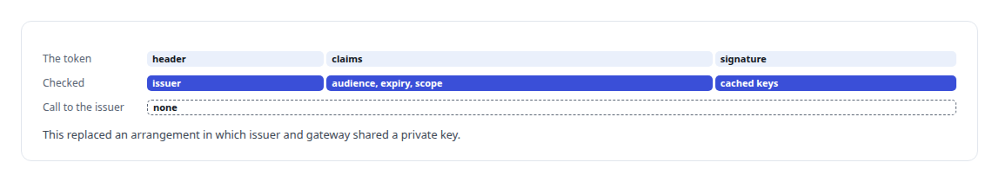
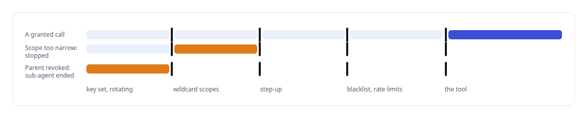
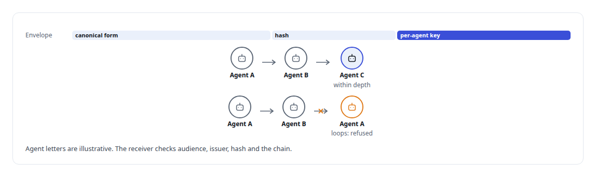
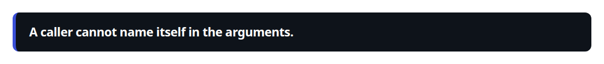
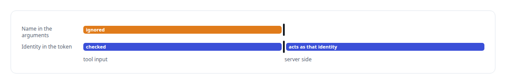

# JSON Web Token (JWT)

**Scoped JWTs for agent seats, employee-scoped tokens for Microsoft identities, bearer introspection that fails closed. Identity in my systems is derived from the token, never from tool input.**

Canonical: https://coreyjames.ai/technologies/json-web-token-jwt/  
Author: Corey James · Published: 2026-10-28 · Kind: technology  
Systems: [AgentOS](https://github.com/coreyjames-ai/agentos) · [Agent Swarm](https://github.com/coreyjames-ai/agent-swarm) · [FAFOHive](https://github.com/coreyjames-ai/fafohive) · [FAFO Core and Function Forge](https://github.com/coreyjames-ai/fafo-core) · [Auth and access plane](https://github.com/coreyjames-ai/auth-and-access-plane)  
Skills: [OAuth 2.0 and identity architecture](https://github.com/coreyjames-ai/portfolio/tree/main/skills/oauth-2-0-and-identity-architecture) · [distributed systems correctness](https://github.com/coreyjames-ai/portfolio/tree/main/skills/distributed-systems-correctness) · [multi-agent governance](https://github.com/coreyjames-ai/portfolio/tree/main/skills/multi-agent-governance) · [Rust systems engineering](https://github.com/coreyjames-ai/portfolio/tree/main/skills/rust-systems-engineering)  


## Result

| Figure | What it measures |
| --- | --- |
| **1 hour** | each issuer's key set is cached at the gateway |
| **3** | runtimes trusting the same kind of anchor |

## What was built

### Tokens checked without calling the issuer

In the [Auth and access plane](https://coreyjames.ai/systems/auth-and-access-plane) I had assistants from several vendors calling one private tool estate, and I wanted every call checked without a round trip to the issuer. I made JWTs the token format and published keys the trust anchor. My Python OAuth server issues RS256-signed access tokens carrying issuer, audience, expiry and coarse MCP scope claims, publishes its key set and persists its signing key, so assistants holding long-lived refresh tokens keep working through a restart.

The Rust tool gateway validates against published key sets from more than one issuer, which lets it accept tokens from my server and from Microsoft's platform. For Microsoft Copilot Studio, an edge proxy checks tenant-pinned Entra JWTs with WebCrypto against a cached key set.



The consent model around these tokens is in [The hardening fix that locked everyone out](https://coreyjames.ai/stories/the-hardening-fix-that-locked-everyone-out).

### Layers on the gateway that provisions GPUs

The model-facing MCP gateway in [FAFO Core and Function Forge](https://coreyjames.ai/systems/fafo-core) lets agents provision GPUs and push secrets, so one bearer check was not enough for it. I built a layered stack.



A separate lane authenticates swarm agents by JWT. A sub-agent's identity is bound to its parent's lifetime, and minting it is atomic against the parent being revoked. Every tool call an agent makes carries its job identity, so its activity lands in a searchable trail in [FAFOHive](https://coreyjames.ai/systems/fafohive).

### Signed messages between agents

When [Agent Swarm](https://coreyjames.ai/systems/agent-swarm) agents delegate to one another, the receiver has to know who really sent a request and how deep the delegation already runs. I made every agent-to-agent message a signed JWT aligned with the [Agent Client Protocol](https://coreyjames.ai/technologies/agent-client-protocol-acp).



Envelope hashes are computed over a canonical form with normalised floating-point values. Without that, the same number serialised at single and at double precision produced different hashes and broke signatures. Checking the chain at each hop defends against confused-deputy calls and runaway delegation, and the signing code is a small crate with no I/O and no business logic, so the protocol stack can be lifted out of my estate.

### Identity from the token, not the arguments

The [AgentOS](https://coreyjames.ai/systems/agentos) managed-team runtime authenticates its member transport with JWTs, and on the AgentOS MCP tools a participant's identity comes from the authenticated token. The same rule holds on every surface: identity is derived server-side.





I use standard JWT libraries and WebCrypto and wrote no cryptographic primitives. An agent cannot call what it was not granted and never holds a credential it does not need.

> A caller cannot name itself in the arguments.

## What was verified

Each line is a claim the canonical page supports, with the figure as the page states it.

- OAuth and identity architecture: RS256 tokens issued in Python and checked offline in Rust and at the edge against published key sets cached for 1 hour.
- Delegation security for AI agents: every agent-to-agent message a signed JWT over a canonical hash, with depth limits and cycle detection.
- Least privilege for AI agents: identity derived from the token on every surface, never from tool arguments, and a sub-agent's identity ends with its parent's.

## Related

- [A coding agent that never holds the keys](https://github.com/coreyjames-ai/agent-swarm/tree/main/stories/a-coding-agent-that-never-holds-the-keys) · https://coreyjames.ai/stories/a-coding-agent-that-never-holds-the-keys/
- [Agents with real tools and no keys](https://github.com/coreyjames-ai/fafohive/tree/main/stories/agents-with-real-tools-and-no-keys) · https://coreyjames.ai/stories/agents-with-real-tools-and-no-keys/
- [The hardening fix that locked everyone out](https://github.com/coreyjames-ai/auth-and-access-plane/tree/main/stories/the-hardening-fix-that-locked-everyone-out) · https://coreyjames.ai/stories/the-hardening-fix-that-locked-everyone-out/
- [Agent Client Protocol (ACP)](https://github.com/coreyjames-ai/portfolio/tree/main/technologies/agent-client-protocol-acp) · https://coreyjames.ai/technologies/agent-client-protocol-acp/
- System: [AgentOS](https://github.com/coreyjames-ai/agentos)
- System: [Agent Swarm](https://github.com/coreyjames-ai/agent-swarm)
- System: [FAFOHive](https://github.com/coreyjames-ai/fafohive)
- System: [FAFO Core and Function Forge](https://github.com/coreyjames-ai/fafo-core)
- System: [Auth and access plane](https://github.com/coreyjames-ai/auth-and-access-plane)

## Citation

Corey James. "JSON Web Token (JWT)." coreyjames.ai, 2026. https://coreyjames.ai/technologies/json-web-token-jwt/

```bibtex
@misc{coreyjames-json-web-token-jwt,
  author = {Corey James},
  title = {JSON Web Token (JWT)},
  year = {2026},
  howpublished = {\url{https://coreyjames.ai/technologies/json-web-token-jwt/}},
  note = {GitHub copy: https://github.com/coreyjames-ai/portfolio/tree/main/technologies/json-web-token-jwt}
}
```

Part of [Corey James's portfolio](https://github.com/coreyjames-ai/portfolio) · site: https://coreyjames.ai/ · MCP server: https://coreyjames.ai/mcp · agent card: https://coreyjames.ai/.well-known/agent.json
