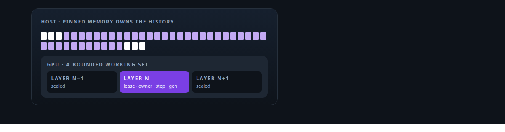
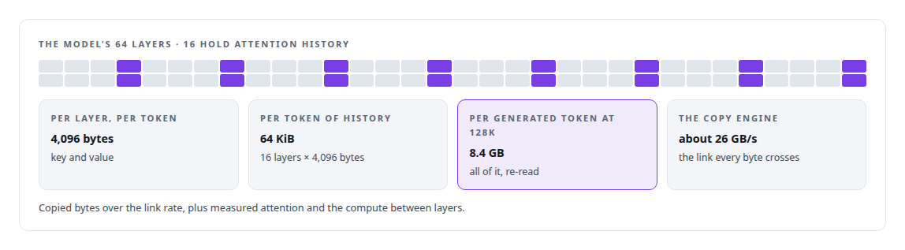
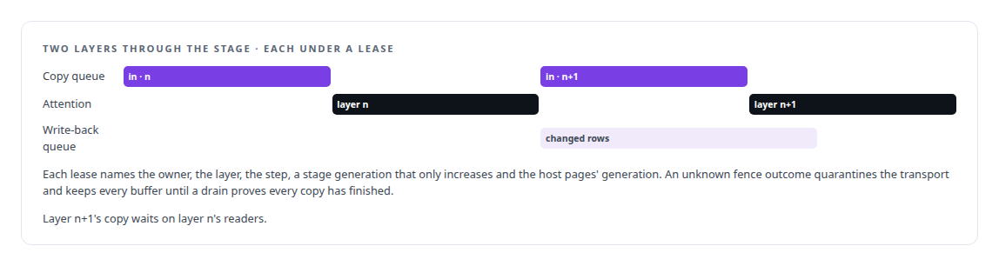
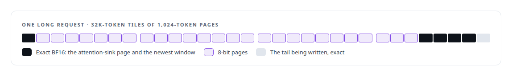
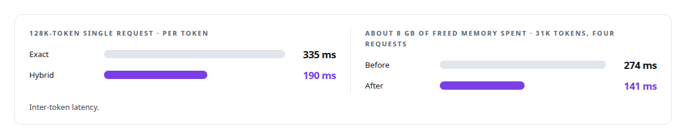
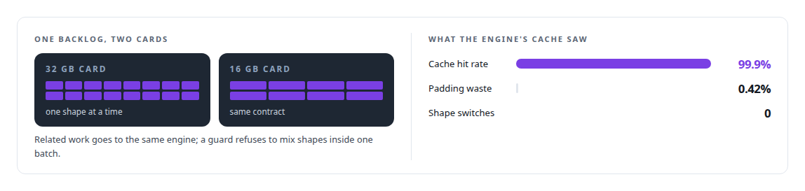
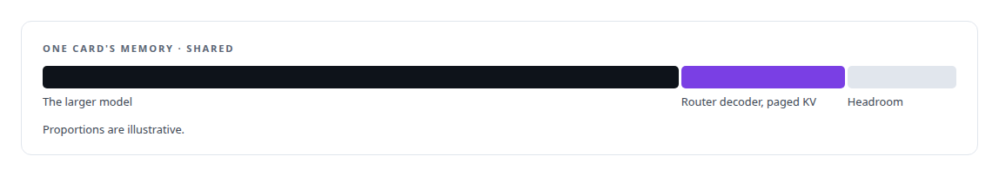

# KV-cache engineering

**The key-value cache is the largest thing on the card after the weights. I moved it to the host in ActiveKV, kept it hot in the Inference Fabric's broker, and in both cases measured the bus.**

Canonical: https://coreyjames.ai/technologies/kv-cache-engineering/  
Author: Corey James · Published: 2026-10-28 · Kind: technology  
Systems: [ActiveKV](https://github.com/coreyjames-ai/activekv) · [Inference Fabric](https://github.com/coreyjames-ai/inference-fabric) · [Capabilities model](https://github.com/coreyjames-ai/capabilities-model)  
Skills: [KV-cache offload for LLM inference](https://github.com/coreyjames-ai/portfolio/tree/main/skills/kv-cache-offload-for-llm-inference) · [GPU inference optimisation](https://github.com/coreyjames-ai/portfolio/tree/main/skills/gpu-inference-optimisation) · [inference serving architecture](https://github.com/coreyjames-ai/portfolio/tree/main/skills/inference-serving-architecture) · [vLLM internals](https://github.com/coreyjames-ai/portfolio/tree/main/skills/vllm-internals)  



## Result

| Figure | What it measures |
| --- | --- |
| **3.3%** | worst error of the bus latency model against measurement, 32K to 262K tokens |
| **262K** | token context on one card, at a 22 GiB device peak |
| **−6.8%** | throughput from KV offload on the NVIDIA serving path |

## What was built

### Costing the bus before changing anything

[ActiveKV](https://coreyjames.ai/systems/activekv): stock serving keeps a request's whole key-value cache on the GPU, so a 32 GB card caps how much context it can hold. I made pinned host memory the owner of the cache and gave the GPU a bounded working set. The exact path re-reads every byte of history for every generated token, so I wrote the cost down as a latency model before changing anything.



From then on, every design choice answered to that arithmetic. I treat the cache as a memory-hierarchy problem with a measurable cost on the bus.


### Staging layers under a lease

Each staged layer holds a lease. History copies run on their own queue, attention waits on the copy's event on the device, and only the rows that changed go back to the host, on a second queue, after attention signals.



A new layer cannot start until the previous stage is sealed. A buffer is reused only after a finished wait on every copy and kernel that touched it, and whole-layer staging matches fully resident attention bit for bit. Exactness came first and speed was a separate programme.

### Exact recent pages, compact older pages

For long histories, the planner cuts each request into tiles and into runs of two representations. Background threads convert a page only after it is fully written in every layer, compute a CRC and publish it. Until then the page is served exact, so decode never waits on conversion and a slow conversion only costs bytes.



Each tile's attention returns its normalised output and its log-sum-exp. An FP32 merge kernel combines them exactly: each partial is weighted by the exponential of its log-sum-exp minus the largest one, the weighted outputs are summed and divided by the summed weights, and the merged log-sum-exp is the maximum plus the log of that sum. That is softmax over the union of the keys; I never average separately normalised outputs. I patched a log-sum-exp output into the vendor's paged-decode kernel to make it possible.

### What the hybrid tier buys

Once history is off the card, the bus is the constraint, so I judge a representation by the bytes per token it stops moving; a slower kernel is acceptable when it removes enough transfer. On one [Intel Arc Pro GPU](https://coreyjames.ai/technologies/intel-arc-gpus) serving a 4-bit-weight build of a 27-billion-parameter hybrid recurrent-attention open-weight model, the two modes compare like this, beside one change that spent reclaimed memory on purpose:



Device budgets are explicit, admission does the arithmetic before it lends a page and logs it with its formula, and each context can be checkpointed. Host-memory KV streaming has public precedent and log-sum-exp merging is known mathematics; the work is a native, lifecycle-safe integration of both on a single card with eager execution, and at long contexts with a single request stock vLLM is still faster per token than either tier. The full account is in [Context beyond VRAM](https://coreyjames.ai/stories/context-beyond-vram) and [Judge a representation by the bytes it stops moving](https://coreyjames.ai/stories/judge-a-representation-by-the-bytes-it-stops-moving).

### Keeping prefixes hot from the broker

[Inference Fabric](https://coreyjames.ai/systems/inference-fabric): for throughput serving, I saw the cache problem from the other side. The engine's prefix cache only pays off if related work arrives together, so I made the token-aware broker build shape-pure batches and send related work to the same engine. With a 32 GB card and a 16 GB card serving one backlog:



On that NVIDIA throughput path, offloading the cache to host memory measured slower, so I dropped offload there. See [A message broker that understands tokens](https://coreyjames.ai/stories/a-message-broker-that-understands-tokens) and [From 44K to 163K tokens per second](https://coreyjames.ai/stories/from-44k-to-163k-tokens-per-second).

### A paged cache beside a larger model

[Capabilities model](https://coreyjames.ai/systems/capabilities-model): the purpose-built CUDA decoder keeps its key-value cache in paged memory and admits requests against measured memory, so it can run beside a larger model on the same card.



See [A router beside a production model](https://coreyjames.ai/stories/a-router-beside-a-production-model).

> I count bytes before I optimise.

## What was verified

Each line is a claim the canonical page supports, with the figure as the page states it.

- KV-cache offload for LLM inference: pinned host memory as owner of the cache and a leased, bounded GPU working set, with whole-layer staging bit-identical to fully resident attention.
- Performance modelling: a bus latency model that predicted measured inter-token latency within 3.3% from 32K to 262K tokens, with a 262K-token context at a 22 GiB device peak.
- Attention kernel engineering: exact log-sum-exp merging of tiled attention over exact and 8-bit pages, with a log-sum-exp output patched into the vendor's paged-decode kernel.
- Latency engineering under concurrency: a hybrid tier at 190 ms per token against 335 ms exact at 128K, and about 8 GB of freed memory spent to cut latency from 274 ms to 141 ms.

## Related

- [Context beyond VRAM](https://github.com/coreyjames-ai/activekv/tree/main/stories/context-beyond-vram) · https://coreyjames.ai/stories/context-beyond-vram/
- [Judge a representation by the bytes it stops moving](https://github.com/coreyjames-ai/activekv/tree/main/stories/judge-a-representation-by-the-bytes-it-stops-moving) · https://coreyjames.ai/stories/judge-a-representation-by-the-bytes-it-stops-moving/
- [A message broker that understands tokens](https://github.com/coreyjames-ai/inference-fabric/tree/main/stories/a-message-broker-that-understands-tokens) · https://coreyjames.ai/stories/a-message-broker-that-understands-tokens/
- [From 44K to 163K tokens per second](https://github.com/coreyjames-ai/inference-fabric/tree/main/stories/from-44k-to-163k-tokens-per-second) · https://coreyjames.ai/stories/from-44k-to-163k-tokens-per-second/
- [A router beside a production model](https://github.com/coreyjames-ai/capabilities-model/tree/main/stories/a-router-beside-a-production-model) · https://coreyjames.ai/stories/a-router-beside-a-production-model/
- [Intel Arc GPUs](https://github.com/coreyjames-ai/portfolio/tree/main/technologies/intel-arc-gpus) · https://coreyjames.ai/technologies/intel-arc-gpus/
- System: [ActiveKV](https://github.com/coreyjames-ai/activekv)
- System: [Inference Fabric](https://github.com/coreyjames-ai/inference-fabric)
- System: [Capabilities model](https://github.com/coreyjames-ai/capabilities-model)

## Citation

Corey James. "KV-cache engineering." coreyjames.ai, 2026. https://coreyjames.ai/technologies/kv-cache-engineering/

```bibtex
@misc{coreyjames-kv-cache-engineering,
  author = {Corey James},
  title = {KV-cache engineering},
  year = {2026},
  howpublished = {\url{https://coreyjames.ai/technologies/kv-cache-engineering/}},
  note = {GitHub copy: https://github.com/coreyjames-ai/portfolio/tree/main/technologies/kv-cache-engineering}
}
```

Part of [Corey James's portfolio](https://github.com/coreyjames-ai/portfolio) · site: https://coreyjames.ai/ · MCP server: https://coreyjames.ai/mcp · agent card: https://coreyjames.ai/.well-known/agent.json
