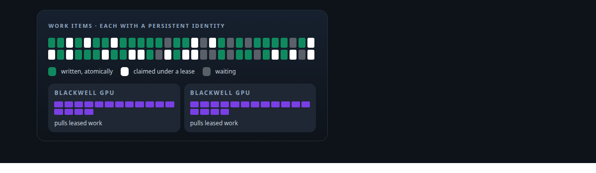
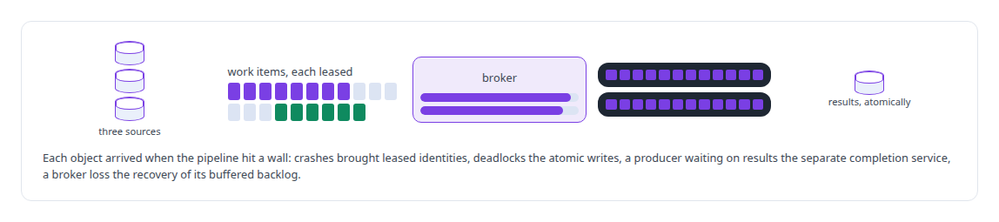
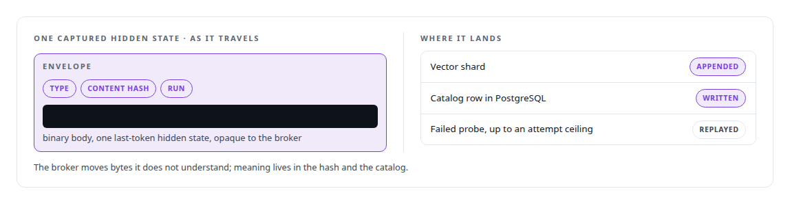

# Large-scale GPU data pipelines

**A generation pipeline that populated tens of millions of dataset items on two consumer GPUs, with persistent item identities, lease-based claiming and prompts baked at build time for cache reuse.**

Canonical: https://coreyjames.ai/technologies/large-scale-gpu-data-pipelines/  
Author: Corey James · Published: 2026-10-28 · Kind: technology  
Systems: [FAFO Core and Function Forge](https://github.com/coreyjames-ai/fafo-core) · [Inference Fabric](https://github.com/coreyjames-ai/inference-fabric) · [Capabilities model](https://github.com/coreyjames-ai/capabilities-model)  
Skills: [high-throughput batch inference](https://github.com/coreyjames-ai/portfolio/tree/main/skills/high-throughput-batch-inference) · [GPU inference optimisation](https://github.com/coreyjames-ai/portfolio/tree/main/skills/gpu-inference-optimisation) · [inference serving architecture](https://github.com/coreyjames-ai/portfolio/tree/main/skills/inference-serving-architecture) · [AI-assisted engineering methodology](https://github.com/coreyjames-ai/portfolio/tree/main/skills/ai-assisted-engineering-methodology)  



## Result

| Figure | What it measures |
| --- | --- |
| **876K** | probes submitted in one captured window |
| **131 M** | tokens pending in that window |
| **156/s** | probes per second, with zero retries |
| **~203K** | hidden-state extractions over 10.8 M tokens, 7B dense model in FP8 |

## What was built

### Generating tens of millions of traceable items

[FAFO Core and Function Forge](https://coreyjames.ai/systems/fafo-core): my distillation research needed tens of millions of model-generated dataset items. Each one had to trace back to the knowledge it came from, and they had to be produced fast enough to keep two consumer GPUs saturated. I treated that as an industrial data pipeline, and I let the workload itself decide what the substrate needed.

The probe generator is a Rust function on the FAFO Core substrate. It reads a unified work view over three source types, assembles class-specific prompts, submits them to the GPU broker, and stores each result as a token-ID array with provenance. It runs in service mode with queue-depth triggers.



Every work item has a persistent identity and is claimed by [lease](https://coreyjames.ai/technologies/lease-based-work-claiming). Two earlier designs put completion inside the producer, which made it wait on results; splitting completion into its own service let producers and GPUs run at full speed. See [The workload that shaped the platform](https://coreyjames.ai/stories/the-workload-that-shaped-the-platform).

### Prompts baked at build time

Prompts are tokenized at build time and baked into the binary, so every class shares a byte-identical prefix the inference engine can reuse from cache.


Baking them in made the build depend on an extra step. It also made prefix-cache reuse dependable, and I took that trade.

### Hidden-state capture that can be rerun

[Inference Fabric](https://coreyjames.ai/systems/inference-fabric): the second stage captures a model's hidden states for every probe. I wanted that capture to be deterministic and safe to rerun.


A mining run checks its extraction spec against what the engine declares it can do. It freezes its probe inventory in the same transaction that creates the run, and content hashes over a canonical encoding make the run content-addressed, so resubmitting after a failure costs nothing. A TensorRT engine variant built without a key-value cache returns one last-token hidden state per probe.



An eight-state lifecycle exposes status, stalls and replay as MCP tools, so I can start, watch, cancel or replay a run from one conversation. The capture path carries a single layer per probe, because its inline payload size caps extraction there.

> A research result that cannot be reproduced is worth little.

## What was verified

Each line is a claim the canonical page supports, with the figure as the page states it.

- High-throughput batch inference: tens of millions of traceable dataset items on two NVIDIA Blackwell GPUs, 876K probes and 131 M tokens in one window at 156/s with zero retries.
- Prefix-cache engineering: prompts tokenized at build time and baked into the binary so every class shares a byte-identical prefix the inference engine reuses from cache.
- Reproducible ML data capture: hidden-state mining runs content-addressed and safe to resubmit, about 203K extractions over 10.8 M tokens from a 7B dense model in FP8.

## Related

- [The workload that shaped the platform](https://github.com/coreyjames-ai/fafo-core/tree/main/stories/the-workload-that-shaped-the-platform) · https://coreyjames.ai/stories/the-workload-that-shaped-the-platform/
- [Lease-based work claiming](https://github.com/coreyjames-ai/portfolio/tree/main/technologies/lease-based-work-claiming) · https://coreyjames.ai/technologies/lease-based-work-claiming/
- System: [FAFO Core and Function Forge](https://github.com/coreyjames-ai/fafo-core)
- System: [Inference Fabric](https://github.com/coreyjames-ai/inference-fabric)
- System: [Capabilities model](https://github.com/coreyjames-ai/capabilities-model)

## Citation

Corey James. "Large-scale GPU data pipelines." coreyjames.ai, 2026. https://coreyjames.ai/technologies/large-scale-gpu-data-pipelines/

```bibtex
@misc{coreyjames-large-scale-gpu-data-pipelines,
  author = {Corey James},
  title = {Large-scale GPU data pipelines},
  year = {2026},
  howpublished = {\url{https://coreyjames.ai/technologies/large-scale-gpu-data-pipelines/}},
  note = {GitHub copy: https://github.com/coreyjames-ai/portfolio/tree/main/technologies/large-scale-gpu-data-pipelines}
}
```

Part of [Corey James's portfolio](https://github.com/coreyjames-ai/portfolio) · site: https://coreyjames.ai/ · MCP server: https://coreyjames.ai/mcp · agent card: https://coreyjames.ai/.well-known/agent.json
