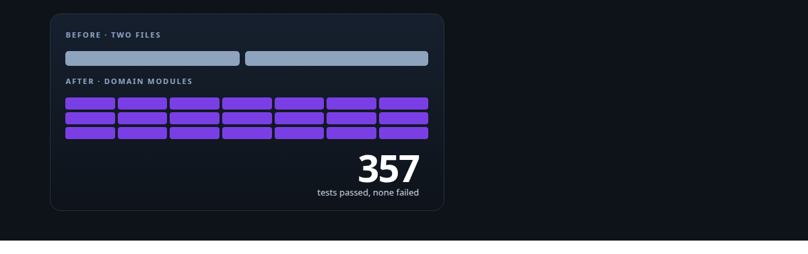
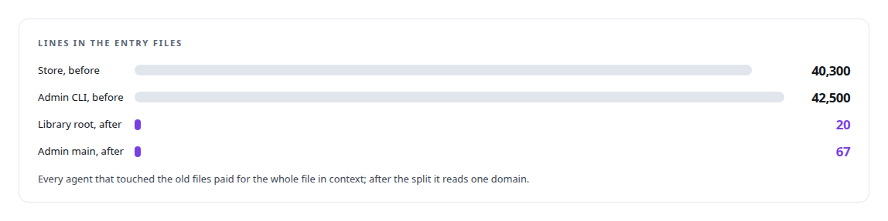
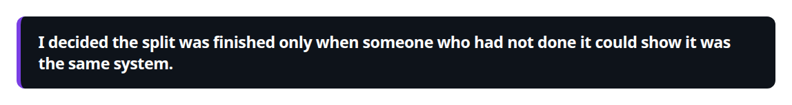
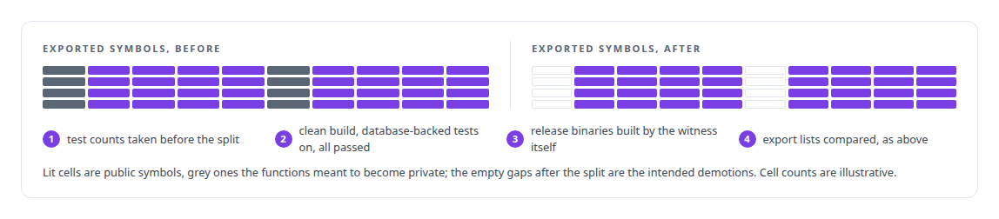
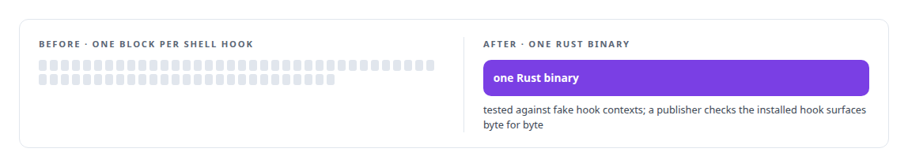
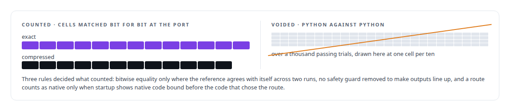

# Large-scale refactoring with parity proof

**Rewrite a system, prove it is the same system. My governance platform's own refactors carry parity proofs, and the largest example is a GPU runtime ported to C++ without changing a token.**

Canonical: https://coreyjames.ai/technologies/large-scale-refactoring-with-parity-proof/  
Author: Corey James · Published: 2026-10-28 · Kind: technology  
Systems: [AgentOS](https://github.com/coreyjames-ai/agentos) · [ActiveKV](https://github.com/coreyjames-ai/activekv)  
Skills: [C++ and native ports with parity proof](https://github.com/coreyjames-ai/portfolio/tree/main/skills/c-and-native-ports-with-parity-proof) · [Rust systems engineering](https://github.com/coreyjames-ai/portfolio/tree/main/skills/rust-systems-engineering) · [evidence-gated acceptance](https://github.com/coreyjames-ai/portfolio/tree/main/skills/evidence-gated-acceptance)  



## Result

| Figure | What it measures |
| --- | --- |
| **21** | domain modules the two oversized files became |
| **430+** | tests moved alongside the code they cover |
| **63 → 1** | shell hooks ported to one Rust binary |
| **13 of 13** | exact cells bit for bit at the C++ port, 12 of 12 compressed |

## What was built

### Splitting two oversized files into modules

[AgentOS](https://coreyjames.ai/systems/agentos): the AgentOS store and admin CLI had grown into two very large Rust files, and I had them split into domain modules.





### A parity proof from a witness who did not do the work

The parity proof came from a separate witness seat. Test counts are taken before a refactor, so "all green" is measured against the original code, and comparing exported symbols in the witness's own release builds catches an accidental API removal while confirming the intended demotions to private.



A failed proof is not amended; it is replaced by a new proof that names the problems it resolved.

### Policy hooks ported to one binary

The hook layer, through which AgentOS turns policy into refusals inside coding-agent sessions, went through the same discipline.



### A GPU runtime ported without changing a token

[ActiveKV](https://coreyjames.ai/systems/activekv): the largest rewrite I have directed is ActiveKV, a GPU serving runtime ported from Python to a native C++ engine without changing a token. It matched every exact and compressed cell bit for bit at the port, and 12 of 12 on both routes at release.



The differential suites were rebuilt around the object types the server actually passes, after stand-in objects let a broken path pass. The full story is in [Rewriting an engine extension without changing a token](https://coreyjames.ai/stories/rewriting-an-engine-extension-without-changing-a-token) and [Proving a rewrite is the same system](https://coreyjames.ai/stories/proving-a-rewrite-is-the-same-system).

That range, from an 80,000-line structural split with no behaviour change to a language migration of a GPU runtime that kept every output bit, is what directing a large rewrite by many parallel agents looks like when the result still has to be shown to be the same system.

> I decided the split was finished only when someone who had not done it could show it was the same system.

## What was verified

Each line is a claim the canonical page supports, with the figure as the page states it.

- C++ and native ports with parity proof: a GPU serving runtime ported from Python to native C++ without changing a token, 13 of 13 exact cells and 12 of 12 compressed cells bit for bit.
- Large-scale refactoring: two Rust files of about 40,300 and 42,500 lines split into 21 domain modules, with 430+ tests moved alongside the code they cover.
- Parity proof by an independent witness: a seat that did not do the work took test baselines, built its own release binaries and compared exported symbols before and after.
- Rust systems engineering: 63 shell hooks ported to one Rust binary, tested against fake hook contexts and published byte for byte.

## Related

- [Rewriting an engine extension without changing a token](https://github.com/coreyjames-ai/activekv/tree/main/stories/rewriting-an-engine-extension-without-changing-a-token) · https://coreyjames.ai/stories/rewriting-an-engine-extension-without-changing-a-token/
- [Proving a rewrite is the same system](https://github.com/coreyjames-ai/activekv/tree/main/stories/proving-a-rewrite-is-the-same-system) · https://coreyjames.ai/stories/proving-a-rewrite-is-the-same-system/
- System: [AgentOS](https://github.com/coreyjames-ai/agentos)
- System: [ActiveKV](https://github.com/coreyjames-ai/activekv)

## Citation

Corey James. "Large-scale refactoring with parity proof." coreyjames.ai, 2026. https://coreyjames.ai/technologies/large-scale-refactoring-with-parity-proof/

```bibtex
@misc{coreyjames-large-scale-refactoring-with-parity-proof,
  author = {Corey James},
  title = {Large-scale refactoring with parity proof},
  year = {2026},
  howpublished = {\url{https://coreyjames.ai/technologies/large-scale-refactoring-with-parity-proof/}},
  note = {GitHub copy: https://github.com/coreyjames-ai/portfolio/tree/main/technologies/large-scale-refactoring-with-parity-proof}
}
```

Part of [Corey James's portfolio](https://github.com/coreyjames-ai/portfolio) · site: https://coreyjames.ai/ · MCP server: https://coreyjames.ai/mcp · agent card: https://coreyjames.ai/.well-known/agent.json
