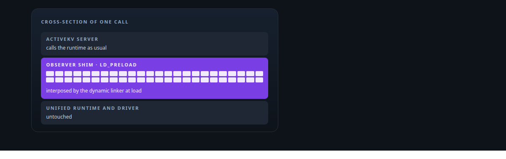
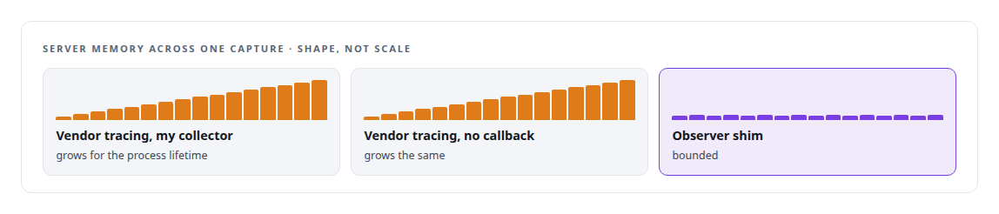
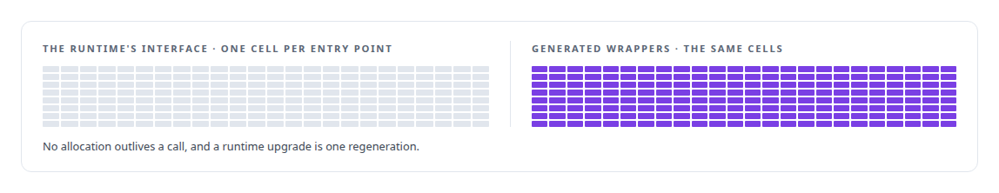
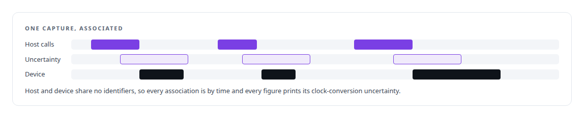

# LD_PRELOAD symbol interposition

**Symbol interposition let me intercept runtime calls directly when the vendor's tracing path was itself distorting measurements.**

Canonical: https://coreyjames.ai/technologies/ld-preload-symbol-interposition/  
Author: Corey James · Published: 2026-10-28 · Kind: technology  
Systems: [ActiveKV](https://github.com/coreyjames-ai/activekv)  
Skills: [Rust systems engineering](https://github.com/coreyjames-ai/portfolio/tree/main/skills/rust-systems-engineering) · [Intel GPU and SYCL/oneAPI engineering](https://github.com/coreyjames-ai/portfolio/tree/main/skills/intel-gpu-and-sycl-oneapi-engineering)  



## Result

| Figure | What it measures |
| --- | --- |
| **192** | Unified-Runtime entry points wrapped, generated from the runtime's own interface |
| **1** | instrumented capture at a time through the vendor path; concurrent through the shim |
| **0** | per-call state kept by the shim: forward, write one flat entry, return |

## What was built

### Finding the leak before replacing anything

[ActiveKV](https://coreyjames.ai/systems/activekv): the step-profiling suite follows each generated token from the scheduler through every device kernel and copy to the client. Its most detailed level associates Intel Unified-Runtime calls with device intervals and host waits. That capture first went through the vendor's tracing layer, and every capture grew the server process for its whole lifetime.

I wanted to know where the memory went before replacing anything. I ran controlled micro-loop experiments that set my collector against a subscriber with no callback attached. The subscriber with no callback still kept memory on every driver call.



That put the leak in the vendor's tracing path and cleared my collector, so the shim that followed fixed a measured fault rather than a suspicion.

### An observer shim generated from the runtime

So I replaced that path with an observer shim loaded through `LD_PRELOAD`. The shim interposes on the Unified-Runtime entry points and forwards each call to the real implementation. It is generated: a script emits a wrapper for every entry point from the runtime's own interface.



The shim observes and forwards; it leaves the driver and Intel's runtime as they are. When a vendor tool distorts what I am measuring, I can go under it at the dynamic-linker level and replace it with something that does only the job I need.

### From tens of gigabytes to host-device associations

A Rust log parser, with a Python fallback, turns the flat logs into associations between host calls and device work. It parses in parallel chunks with trace caches, because captures run to tens of gigabytes.



Instrumented runs are for diagnosis only; speed figures come from uninstrumented runs on a quiet host.


That rule is the subject of [The observer that changed the answer](https://coreyjames.ai/stories/the-observer-that-changed-the-answer), and the tracing stack beneath it is on the [Intel oneAPI](https://coreyjames.ai/technologies/intel-oneapi) page.

> The instrument must not become the result.

## What was verified

Each line is a claim the canonical page supports, with the figure as the page states it.

- Dynamic linker interposition (LD_PRELOAD): an observer shim generated for all 192 Intel Unified Runtime entry points from the runtime's own interface, forwarding each call and writing one flat entry.
- GPU profiling and tracing: a leak located in the vendor's tracing path by a no-callback control before anything was replaced, so instrumented captures could run concurrently.
- Trace processing at scale: a Rust parser with parallel chunks and trace caches turning tens of gigabytes of capture into host-call to device-work associations with stated clock uncertainty.

## Related

- [The observer that changed the answer](https://github.com/coreyjames-ai/activekv/tree/main/stories/the-observer-that-changed-the-answer) · https://coreyjames.ai/stories/the-observer-that-changed-the-answer/
- [Intel oneAPI](https://github.com/coreyjames-ai/portfolio/tree/main/technologies/intel-oneapi) · https://coreyjames.ai/technologies/intel-oneapi/
- System: [ActiveKV](https://github.com/coreyjames-ai/activekv)

## Citation

Corey James. "LD_PRELOAD symbol interposition." coreyjames.ai, 2026. https://coreyjames.ai/technologies/ld-preload-symbol-interposition/

```bibtex
@misc{coreyjames-ld-preload-symbol-interposition,
  author = {Corey James},
  title = {LD_PRELOAD symbol interposition},
  year = {2026},
  howpublished = {\url{https://coreyjames.ai/technologies/ld-preload-symbol-interposition/}},
  note = {GitHub copy: https://github.com/coreyjames-ai/portfolio/tree/main/technologies/ld-preload-symbol-interposition}
}
```

Part of [Corey James's portfolio](https://github.com/coreyjames-ai/portfolio) · site: https://coreyjames.ai/ · MCP server: https://coreyjames.ai/mcp · agent card: https://coreyjames.ai/.well-known/agent.json
