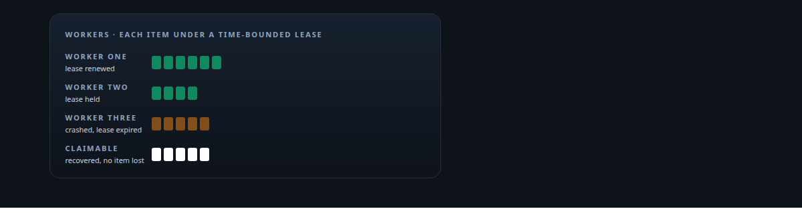
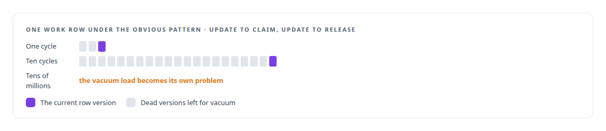
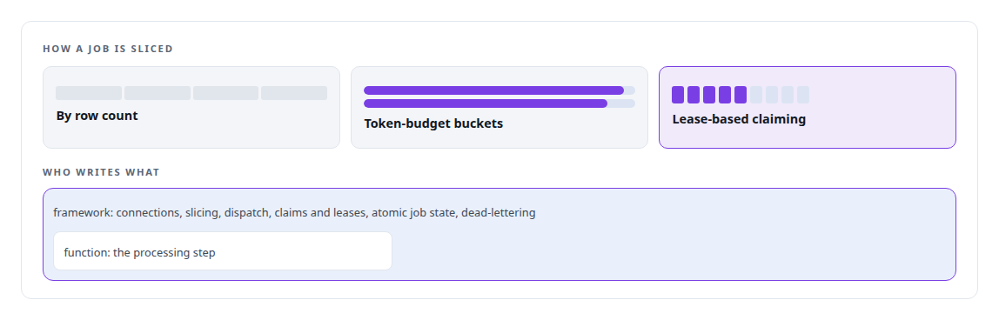
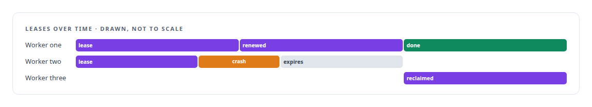

# Lease-based work claiming

**Parallel workers claim work by lease, designed against the dead-tuple behaviour of PostgreSQL's concurrency model, so two workers never process the same item and nothing is lost on a crash.**

Canonical: https://coreyjames.ai/technologies/lease-based-work-claiming/  
Author: Corey James · Published: 2026-10-28 · Kind: technology  
Systems: [FAFO Core and Function Forge](https://github.com/coreyjames-ai/fafo-core)  
Skills: [exactly-once delivery and crash recovery](https://github.com/coreyjames-ai/portfolio/tree/main/skills/exactly-once-delivery-and-crash-recovery) · [distributed systems correctness](https://github.com/coreyjames-ai/portfolio/tree/main/skills/distributed-systems-correctness) · [high-throughput batch inference](https://github.com/coreyjames-ai/portfolio/tree/main/skills/high-throughput-batch-inference) · [PostgreSQL performance tuning](https://github.com/coreyjames-ai/portfolio/tree/main/skills/postgresql-performance-tuning)  



## Result

| Figure | What it measures |
| --- | --- |
| **0.7–1 M** | items in flight at once over a two-hour window |
| **3** | ways the conductor slices a job; leased claiming is one |
| **2** | NVIDIA Blackwell GPUs fed by the claimed work |

## What was built

### Claiming designed against dead tuples

[FAFO Core and Function Forge](https://coreyjames.ai/systems/fafo-core): my probe-generation workload had parallel workers pulling rows of work from PostgreSQL, and two of them collided on the same item. I needed claiming that holds up under tens of millions of items and survives a worker dying mid-batch. I did not want to pay for it with database churn. The obvious pattern, updating a row to claim it and updating it again to release it, leaves dead tuples behind on every cycle, and at that scale the vacuum load becomes its own problem.



I added claiming when two workers collided on real work; nothing about it was speculative. I chose the pattern for what PostgreSQL does with an update under concurrency, and how a claim reads in application code came second. The claiming method itself is one of the parts of FAFO Core I keep private, along with the governed write path and the admission controller.

### Claiming in the framework, not the function

In the generic conductor, the framework owns claiming, not the function.



Every function on the substrate is crash-safe without implementing anything.


### Leases, crashes and late signals

A worker holds a time-bounded lease on the items it claims. A worker on a long batch extends its lease. Claims left behind by a worker that crashed are recovered and become claimable again, so a crash neither loses an item nor lets two workers process it. Each worker signals ready exactly once per dispatched slice, and the conductor ignores stale signals, so a late message from a dead worker cannot confuse the count.



The claiming went in alongside atomic multi-table writes, at the point where the pipeline needed both. The full account is in [The workload that shaped the platform](https://coreyjames.ai/stories/the-workload-that-shaped-the-platform), and the database-side diagnosis habit behind it shows in [196 deadlocks to zero](https://coreyjames.ai/stories/196-deadlocks-to-zero).

> I design concurrency against the real costs of the database underneath, and I put the hard part in a framework so every function inherits it.

## What was verified

Each line is a claim the canonical page supports, with the figure as the page states it.

- Distributed job orchestration: time-bounded, renewable leases on work items, so a crash neither loses an item nor lets two workers process it, built into the framework once.
- PostgreSQL performance tuning: work claiming designed against the dead-tuple cost of claiming and releasing a row by update under heavy concurrency.
- High-throughput batch inference: leased claiming that carried tens of millions of work items across 2 NVIDIA Blackwell GPUs, with 0.7 to 1 M in flight at once.

## Related

- [The workload that shaped the platform](https://github.com/coreyjames-ai/fafo-core/tree/main/stories/the-workload-that-shaped-the-platform) · https://coreyjames.ai/stories/the-workload-that-shaped-the-platform/
- [196 deadlocks to zero](https://github.com/coreyjames-ai/fafo-core/tree/main/stories/196-deadlocks-to-zero) · https://coreyjames.ai/stories/196-deadlocks-to-zero/
- System: [FAFO Core and Function Forge](https://github.com/coreyjames-ai/fafo-core)

## Citation

Corey James. "Lease-based work claiming." coreyjames.ai, 2026. https://coreyjames.ai/technologies/lease-based-work-claiming/

```bibtex
@misc{coreyjames-lease-based-work-claiming,
  author = {Corey James},
  title = {Lease-based work claiming},
  year = {2026},
  howpublished = {\url{https://coreyjames.ai/technologies/lease-based-work-claiming/}},
  note = {GitHub copy: https://github.com/coreyjames-ai/portfolio/tree/main/technologies/lease-based-work-claiming}
}
```

Part of [Corey James's portfolio](https://github.com/coreyjames-ai/portfolio) · site: https://coreyjames.ai/ · MCP server: https://coreyjames.ai/mcp · agent card: https://coreyjames.ai/.well-known/agent.json
