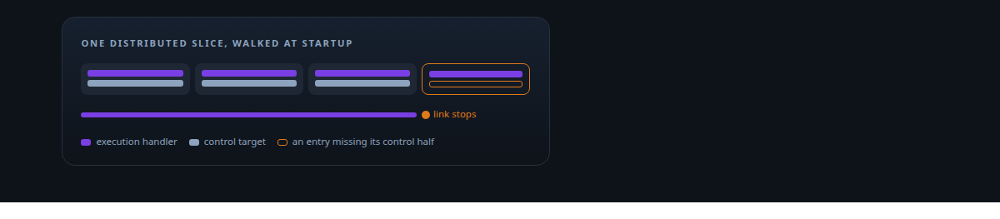
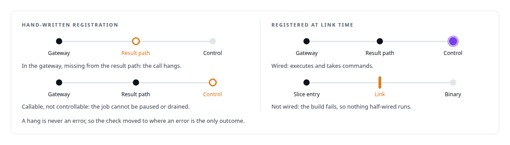
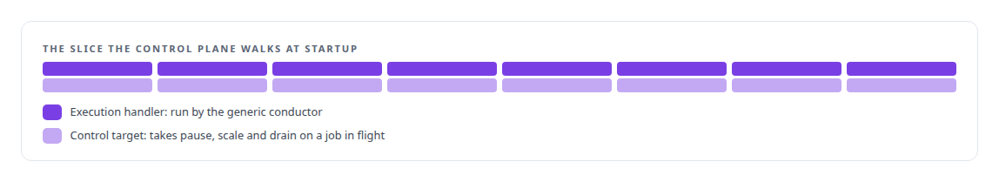
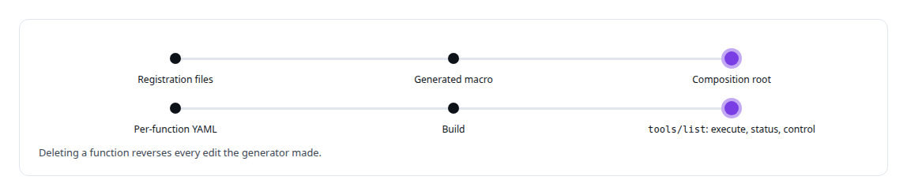
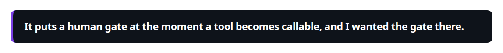
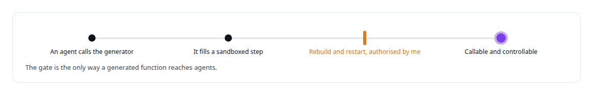

# Link-time plugin registration

**A generated function is registered at link time so that it is fully wired or the build fails. There is no half-registered state.**

Canonical: https://coreyjames.ai/technologies/link-time-plugin-registration/  
Author: Corey James · Published: 2026-10-28 · Kind: technology  
Systems: [FAFO Core and Function Forge](https://github.com/coreyjames-ai/fafo-core)  
Skills: [Rust systems engineering](https://github.com/coreyjames-ai/portfolio/tree/main/skills/rust-systems-engineering) · [AI-assisted engineering methodology](https://github.com/coreyjames-ai/portfolio/tree/main/skills/ai-assisted-engineering-methodology) · [tool synthesis and governed API integration](https://github.com/coreyjames-ai/portfolio/tree/main/skills/tool-synthesis-and-governed-api-integration) · [distributed systems correctness](https://github.com/coreyjames-ai/portfolio/tree/main/skills/distributed-systems-correctness)  



## Result

| Figure | What it measures |
| --- | --- |
| **14** | function crates on the substrate |
| **7** | of them produced by the generator |
| **2** | registrations in every slice entry |
| **3** | actions per tool in the gateway |

## What was built

### Registration as a property of the build

[FAFO Core and Function Forge](https://coreyjames.ai/systems/fafo-core): a tool can be half-registered. I had seen hand-written registration routines drift that way. When agents started generating functions, I decided registration would be a property of the build, so discovery happens at link time and nothing can drift between what is built and what is registered.



### Execution and control in one entry

Each function crate contributes an entry to a link-time distributed slice through the Rust `linkme` crate, a third-party crate I use. At startup the control plane walks that slice. Execution and control register in the same entry, which keeps every function operable by agents as well as executable.



### Generated lists that nobody edits

The control plane's composition root is generated too. It is the list of compiled-in functions plus the control-plane service, produced from registration files by a generated macro, so adding a function never means editing a startup routine. On the gateway side, the tool surface is generated at build time from per-function YAML and loaded at startup. This replaced an earlier design in which each function called a hand-written registration routine at startup.



### A human gate before a tool is callable

Function Forge depends on this. A new function needs a rebuild and a restart, and I chose that deliberately.





Moving checks earlier, here from runtime into the linker, removes a class of failure, and the gate sits where it matters most for AI-generated code. The governance around that path is in [Tools that build tools, under governance](https://coreyjames.ai/stories/tools-that-build-tools-under-governance), and the build-time generation it rests on is on the [Schema-driven build-time code generation](https://coreyjames.ai/technologies/schema-driven-build-time-code-generation) page.

> It puts a human gate at the moment a tool becomes callable, and I wanted the gate there.

## What was verified

Each line is a claim the canonical page supports, with the figure as the page states it.

- Rust systems engineering: link-time plugin registration through distributed slices, so each of 14 function crates is fully wired or the build fails.
- Code generation and metaprogramming: 7 of the 14 function crates produced by a generator, with a generated composition root and tool list that nobody edits by hand.
- Human-in-the-loop governance for AI-generated code: a rebuild and restart I authorise as the gate before any generated tool reaches agents.

## Related

- [Tools that build tools, under governance](https://github.com/coreyjames-ai/fafo-core/tree/main/stories/tools-that-build-tools-under-governance) · https://coreyjames.ai/stories/tools-that-build-tools-under-governance/
- [Schema-driven build-time code generation](https://github.com/coreyjames-ai/portfolio/tree/main/technologies/schema-driven-build-time-code-generation) · https://coreyjames.ai/technologies/schema-driven-build-time-code-generation/
- System: [FAFO Core and Function Forge](https://github.com/coreyjames-ai/fafo-core)

## Citation

Corey James. "Link-time plugin registration." coreyjames.ai, 2026. https://coreyjames.ai/technologies/link-time-plugin-registration/

```bibtex
@misc{coreyjames-link-time-plugin-registration,
  author = {Corey James},
  title = {Link-time plugin registration},
  year = {2026},
  howpublished = {\url{https://coreyjames.ai/technologies/link-time-plugin-registration/}},
  note = {GitHub copy: https://github.com/coreyjames-ai/portfolio/tree/main/technologies/link-time-plugin-registration}
}
```

Part of [Corey James's portfolio](https://github.com/coreyjames-ai/portfolio) · site: https://coreyjames.ai/ · MCP server: https://coreyjames.ai/mcp · agent card: https://coreyjames.ai/.well-known/agent.json
