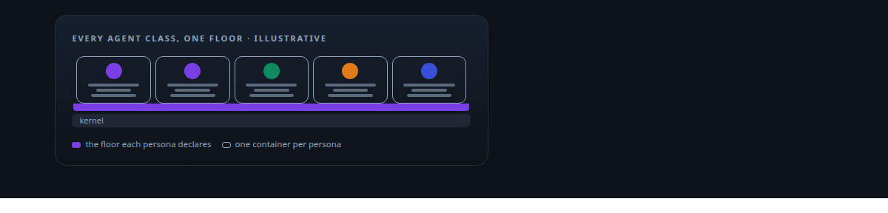
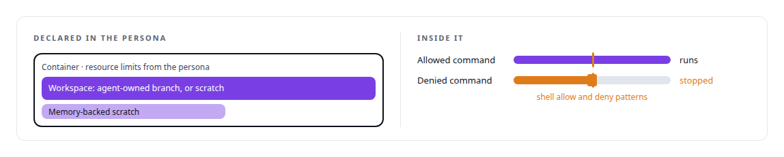
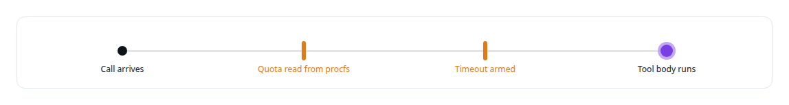
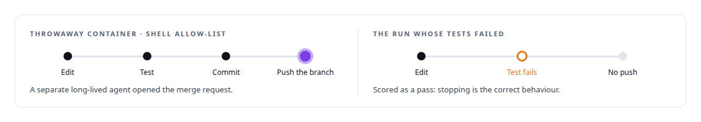
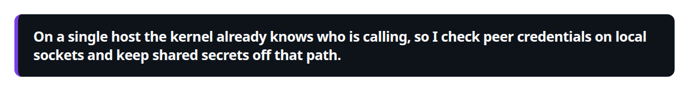
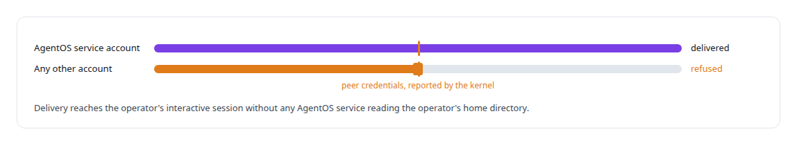

# Linux security primitives

**Container limits, path safety, shell allow-lists, UID pinning and egress control are the floor under my agent runtime, not an afterthought.**

Canonical: https://coreyjames.ai/technologies/linux-security-primitives/  
Author: Corey James · Published: 2026-10-28 · Kind: technology  
Systems: [AgentOS](https://github.com/coreyjames-ai/agentos) · [Agent Swarm](https://github.com/coreyjames-ai/agent-swarm)  
Skills: [sandboxing and container hardening](https://github.com/coreyjames-ai/portfolio/tree/main/skills/sandboxing-and-container-hardening)  



## Result

| Figure | What it measures |
| --- | --- |
| **0** | commits by the coding agent's worker to the main repository |

## What was built

### A sandbox declared once per persona

[Agent Swarm](https://coreyjames.ai/systems/agent-swarm): every new agent tends to arrive with its own idea of what it may touch. I wanted the isolation floor declared once, as data, and inherited by every agent class. Each persona in the catalog carries a sandbox section, so a new agent class gets the floor without new code.



### Checks before any tool body runs

The persona launcher starts one container per persona with a scoped token, a workspace and a budget. Inside the runtime, the frozen tool pipeline enforces per-call resource quotas read from procfs, and timeouts, before any tool body runs. The trust plane refuses connection strings that are not TLS.



### A coding agent that stops instead of pushing

I tested the floor with a coding agent on a local open-weight model.



That is [A coding agent that never holds the keys](https://coreyjames.ai/stories/a-coding-agent-that-never-holds-the-keys). How agents receive credentials and certificates, the plane under Agent Swarm, is the part of this work I keep private. The outcome is that an agent cannot call what it was not granted and never holds a credential it does not need.

### Work across Unix users, vouched for by the kernel

[AgentOS](https://coreyjames.ai/systems/agentos) has to deliver work between processes owned by different Unix users without widening anyone's access. I used the primitives Linux already has. The activation bridge is a systemd socket-activated [Unix domain socket](https://coreyjames.ai/technologies/unix-domain-sockets).





The bridge starts on demand under [systemd](https://coreyjames.ai/technologies/systemd), so no privileged process sits idle waiting for work. Each cross-UID path does one job for one caller; I avoided a general privileged service. The same pattern carries messages into a frontier model command-line tool's local messaging socket for managed seats. All of it is ordinary operating-system machinery used carefully: kernel-reported identity, containers, socket activation and narrow cross-user paths, with no kernel modules and no custom security tooling.

> On a single host the kernel already knows who is calling, so I check peer credentials on local sockets and keep shared secrets off that path.

## What was verified

Each line is a claim the canonical page supports, with the figure as the page states it.

- Sandboxing and container hardening: per-persona sandboxes declaring container limits, workspace type and shell allow and deny patterns, inherited by every agent class.
- Linux security primitives: cross-user message delivery through a socket-activated Unix socket checked with kernel peer credentials, with no shared secrets on that path.
- Least privilege for AI agents: a coding agent that pushed from a throwaway container under a shell allow-list and made 0 commits to the main repository.

## Related

- [A coding agent that never holds the keys](https://github.com/coreyjames-ai/agent-swarm/tree/main/stories/a-coding-agent-that-never-holds-the-keys) · https://coreyjames.ai/stories/a-coding-agent-that-never-holds-the-keys/
- [Unix domain sockets](https://github.com/coreyjames-ai/portfolio/tree/main/technologies/unix-domain-sockets) · https://coreyjames.ai/technologies/unix-domain-sockets/
- [systemd](https://github.com/coreyjames-ai/portfolio/tree/main/technologies/systemd) · https://coreyjames.ai/technologies/systemd/
- System: [AgentOS](https://github.com/coreyjames-ai/agentos)
- System: [Agent Swarm](https://github.com/coreyjames-ai/agent-swarm)

## Citation

Corey James. "Linux security primitives." coreyjames.ai, 2026. https://coreyjames.ai/technologies/linux-security-primitives/

```bibtex
@misc{coreyjames-linux-security-primitives,
  author = {Corey James},
  title = {Linux security primitives},
  year = {2026},
  howpublished = {\url{https://coreyjames.ai/technologies/linux-security-primitives/}},
  note = {GitHub copy: https://github.com/coreyjames-ai/portfolio/tree/main/technologies/linux-security-primitives}
}
```

Part of [Corey James's portfolio](https://github.com/coreyjames-ai/portfolio) · site: https://coreyjames.ai/ · MCP server: https://coreyjames.ai/mcp · agent card: https://coreyjames.ai/.well-known/agent.json
