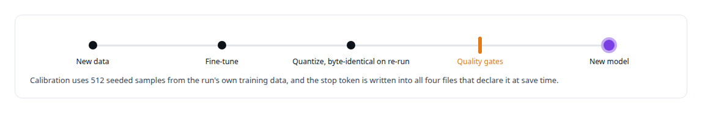
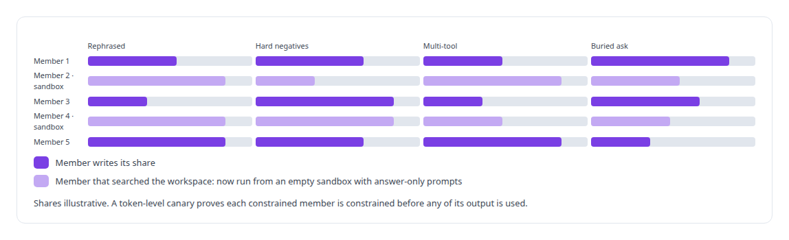
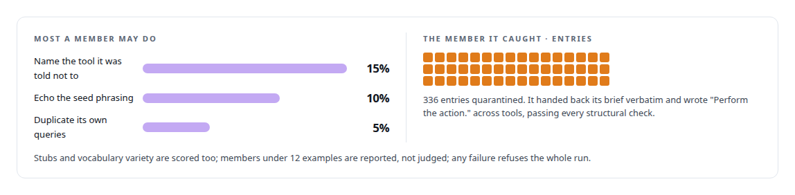
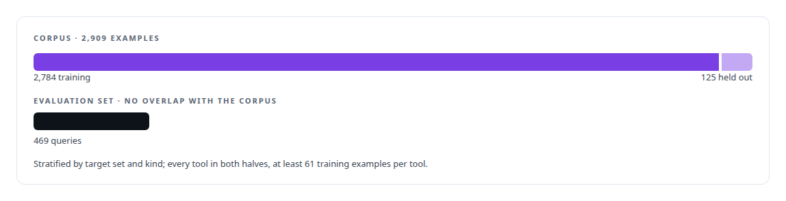
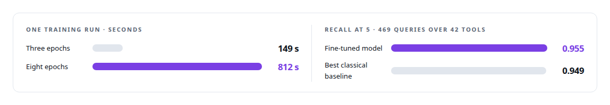

# LLM fine-tuning

**A full-parameter fine-tune of a 0.6B model on registry-generated data, finished in minutes, measured on a frozen set against a baseline that tied it.**

Canonical: https://coreyjames.ai/technologies/llm-fine-tuning/  
Author: Corey James · Published: 2026-10-28 · Kind: technology  
Systems: [Capabilities model](https://github.com/coreyjames-ai/capabilities-model)  
Skills: [AI-assisted engineering methodology](https://github.com/coreyjames-ai/portfolio/tree/main/skills/ai-assisted-engineering-methodology)  


## Result

| Figure | What it measures |
| --- | --- |
| **17.6 GiB** | peak memory for the recipe on one GPU |
| **12** | cells in the ladder across 0.36B, 0.6B and 1.7B models |
| **4** | model families on the authoring panel |
| **2–14 min** | for one training run |

## What was built

### A model rebuilt the way an index is

[Capabilities model](https://coreyjames.ai/systems/capabilities-model): my agents were carrying the whole tool schema on every turn. I wanted a small model that holds the tool catalog in its weights and answers one discovery call. Tools change weekly, so retraining had to take minutes. I chose a full-parameter fine-tune of a 0.6-billion-parameter open-weight base model over adapters, because at 0.6B a full fine-tune is fast enough that the usual case for adapters disappears. Because training takes minutes, I rebuild the model the way I rebuild an index.



The stop token had silently been setting the length of the returned tool list. I also withdrew my earlier finding that the defect had no effect: that test had changed a file the server does not read stop tokens from.

### Training data from many voices

The data comes from the tool registry. A panel of frontier and local models writes intents for every tool in four kinds. Each panel member gets a weighted share of every tool's quota for every kind, so no tool's data comes from a single voice.



### An authoring gate that polices its own authors

The authoring gate is the part I would reuse anywhere. A panel model can satisfy every structural check and still defeat the panel by templating instead of writing. Vocabulary variety is measured as type-token ratio against the registry's human-written seed intents at equal sample sizes, because type-token ratio falls with length alone and an absolute floor punishes the member that wrote the most.



### A frozen split with no leakage

Leakage is defined on the training and evaluation pair, using the same similarity machinery that flags "cold" queries, and pruning repeats until nothing changes. The training system prompt is the same text the server sends, so the model trains on exactly the context it is served with.



### A recipe chosen from a ladder

The recipe I settled on is learning rate 3.0e-5 for eight epochs on a cosine schedule with 3 percent warmup. It uses batch 8 with four-step gradient accumulation, AdamW (0.9, 0.95, weight decay 0.01), gradient clipping at 1.0, BF16 autocast over FP32 master weights and gradient checkpointing. I chose it from a ladder of model sizes and several epoch and learning-rate settings. The ladder showed that bringing up the serving engine for scoring cost more wall-clock time than training, which told me where turnaround time actually goes, and I kept its confounds visible: the 1.7B cell used a recipe tuned on 0.6B and BF16 master weights.




This is single-GPU full fine-tuning from 0.36B to 1.7B parameters, with no preference tuning and no multi-node training. The full account is in [A hundred tokens instead of forty-two thousand](https://coreyjames.ai/stories/a-hundred-tokens-instead-of-forty-two-thousand) and [The baseline that tied us](https://coreyjames.ai/stories/the-baseline-that-tied-us).

> The strongest classical baseline tied the model, and I report the tie.

## What was verified

Each line is a claim the canonical page supports, with the figure as the page states it.

- LLM fine-tuning: full-parameter fine-tunes of a 0.6B model on one GPU in 2 to 14 minutes at a 17.6 GiB peak, so the tool-catalog model is rebuilt like an index.
- Synthetic training data generation: an authoring panel of 4 model families with a gate that polices its own authors and quarantined 336 templated entries.
- ML evaluation methodology: a frozen corpus of 2,909 examples with no overlap with a 469-query evaluation set, where recall at 5 of 0.955 tied a classical baseline at 0.949.

## Related

- [A hundred tokens instead of forty-two thousand](https://github.com/coreyjames-ai/capabilities-model/tree/main/stories/a-hundred-tokens-instead-of-forty-two-thousand) · https://coreyjames.ai/stories/a-hundred-tokens-instead-of-forty-two-thousand/
- [The baseline that tied us](https://github.com/coreyjames-ai/capabilities-model/tree/main/stories/the-baseline-that-tied-us) · https://coreyjames.ai/stories/the-baseline-that-tied-us/
- System: [Capabilities model](https://github.com/coreyjames-ai/capabilities-model)

## Citation

Corey James. "LLM fine-tuning." coreyjames.ai, 2026. https://coreyjames.ai/technologies/llm-fine-tuning/

```bibtex
@misc{coreyjames-llm-fine-tuning,
  author = {Corey James},
  title = {LLM fine-tuning},
  year = {2026},
  howpublished = {\url{https://coreyjames.ai/technologies/llm-fine-tuning/}},
  note = {GitHub copy: https://github.com/coreyjames-ai/portfolio/tree/main/technologies/llm-fine-tuning}
}
```

Part of [Corey James's portfolio](https://github.com/coreyjames-ai/portfolio) · site: https://coreyjames.ai/ · MCP server: https://coreyjames.ai/mcp · agent card: https://coreyjames.ai/.well-known/agent.json
