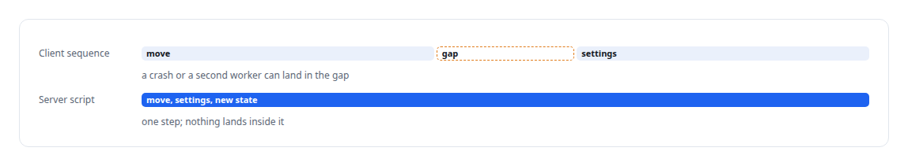
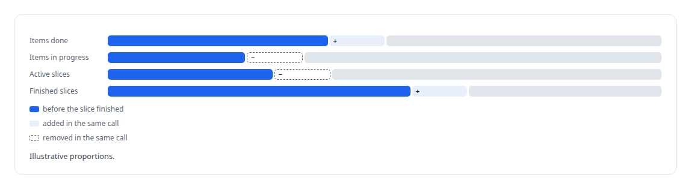

# Lua

**Lua scripts make the Redis control plane's job promotion atomic and keep the broker's hot-path bookkeeping on the server.**

Canonical: https://coreyjames.ai/technologies/lua/  
Author: Corey James · Published: 2026-10-28 · Kind: technology  
Systems: [FAFO Core and Function Forge](https://github.com/coreyjames-ai/fafo-core) · [Inference Fabric](https://github.com/coreyjames-ai/inference-fabric) · [PostgreSQL Fabric](https://github.com/coreyjames-ai/postgresql-fabric)  
Skills: [distributed systems correctness](https://github.com/coreyjames-ai/portfolio/tree/main/skills/distributed-systems-correctness) · [inference serving architecture](https://github.com/coreyjames-ai/portfolio/tree/main/skills/inference-serving-architecture)  


## Result

| Figure | What it measures |
| --- | --- |
| **16** | scripts in the server-side library |
| **≈4,000** | lines of Lua, loaded by hash |
| **3** | Redis instances, one per role |

## What was built

### Job state that cannot be half-updated

The [FAFO Core and Function Forge](https://coreyjames.ai/systems/fafo-core) control plane keeps job state in [Redis](https://coreyjames.ai/technologies/redis), and many workers change that state at once. A Redis pipeline batches commands without making them atomic, and a crash or a competing worker between two commands leaves a job half-updated.

I moved every multi-step state change onto the server as a Lua script. Job promotion is one script: it moves a job from pending to processing and writes the job's worker count, batch size and batch mode in the same step, so no worker ever sees a half-promoted job.



### Scripts that return what they changed

When a worker finishes or fails a slice, one script updates the job's slice and item counters together and returns the new job state in the same call. The caller acts on the state the script produced and never on a separate read that may already be stale, which removes a read-after-write race from every caller.



The scripts are loaded by hash, kept in one directory with their own management tooling and hot-reloadable, alongside scripts embedded in the Rust core, so the control plane's logic is versioned like code.

### One pattern, two places

The governed write path and the admission controller in [PostgreSQL Fabric](https://coreyjames.ai/systems/postgresql-fabric) also keep their bookkeeping in Lua on the server. The write path gives many producers one governed way into PostgreSQL, and the admission controller keeps unbounded agent demand within the database's capacity.

One pattern travelled. A fenced single-flight script first written for admission was reused to mint sub-agent identities atomically, so a child's identity cannot be issued against a parent that has just been revoked.


The database side of this control plane is in [196 deadlocks to zero](https://coreyjames.ai/stories/196-deadlocks-to-zero), and the workload that pushed it hardest in [The workload that shaped the platform](https://coreyjames.ai/stories/the-workload-that-shaped-the-platform).

### Redis split by role

The [Inference Fabric](https://coreyjames.ai/systems/inference-fabric) splits Redis into separate instances by role, which keeps one workload's backlog out of another's memory.


A loader service installs the script set at startup, and the fabric's promotion and batch-claim steps call those scripts. Their semantics belong to FAFO Core, and the fabric uses them as they are.

I use the smallest script that does the job. Lua here is a tool for atomicity; the substance is the state model it protects.


> I find the places where distributed state can tear and close them at the server.

## What was verified

Each line is a claim the canonical page supports, with the figure as the page states it.

- Redis Lua scripting: 16 server-side scripts of about 4,000 lines making multi-step job state changes atomic.
- Distributed systems correctness: scripts that return the state they produced, removing read-after-write races from every caller.
- Workload isolation: 3 Redis instances split by role so a write backlog cannot starve job control.

## Related

- [196 deadlocks to zero](https://github.com/coreyjames-ai/fafo-core/tree/main/stories/196-deadlocks-to-zero) · https://coreyjames.ai/stories/196-deadlocks-to-zero/
- [The workload that shaped the platform](https://github.com/coreyjames-ai/fafo-core/tree/main/stories/the-workload-that-shaped-the-platform) · https://coreyjames.ai/stories/the-workload-that-shaped-the-platform/
- [Redis](https://github.com/coreyjames-ai/portfolio/tree/main/technologies/redis) · https://coreyjames.ai/technologies/redis/
- System: [FAFO Core and Function Forge](https://github.com/coreyjames-ai/fafo-core)
- System: [Inference Fabric](https://github.com/coreyjames-ai/inference-fabric)
- System: [PostgreSQL Fabric](https://github.com/coreyjames-ai/postgresql-fabric)

## Citation

Corey James. "Lua." coreyjames.ai, 2026. https://coreyjames.ai/technologies/lua/

```bibtex
@misc{coreyjames-lua,
  author = {Corey James},
  title = {Lua},
  year = {2026},
  howpublished = {\url{https://coreyjames.ai/technologies/lua/}},
  note = {GitHub copy: https://github.com/coreyjames-ai/portfolio/tree/main/technologies/lua}
}
```

Part of [Corey James's portfolio](https://github.com/coreyjames-ai/portfolio) · site: https://coreyjames.ai/ · MCP server: https://coreyjames.ai/mcp · agent card: https://coreyjames.ai/.well-known/agent.json
