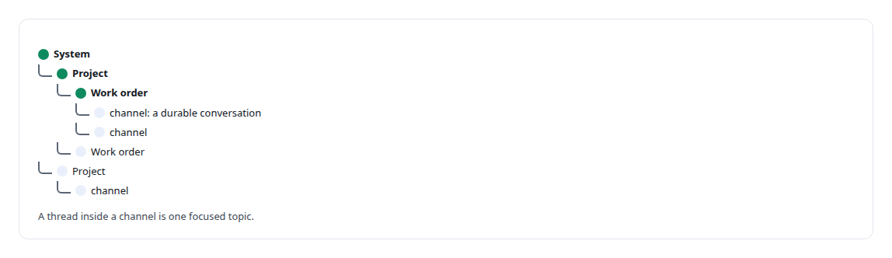
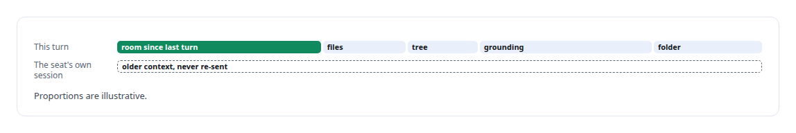
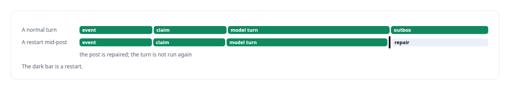
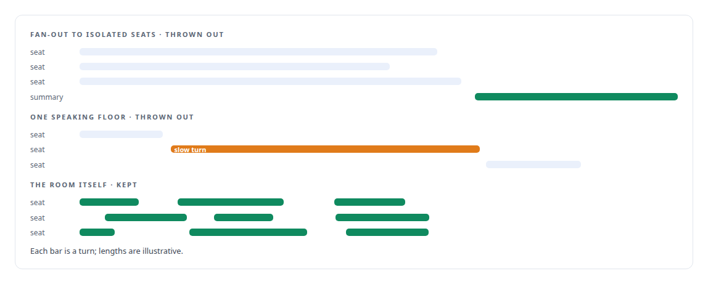

# Mattermost

**An unmodified open-source team chat server hosts my multi-model collaboration shell, with bot seats for several vendors and a council mode that deliberates rather than fans out.**

Canonical: https://coreyjames.ai/technologies/mattermost/  
Author: Corey James · Published: 2026-10-28 · Kind: technology  
Systems: [Helix](https://github.com/coreyjames-ai/helix)  
Skills: [exactly-once delivery and crash recovery](https://github.com/coreyjames-ai/portfolio/tree/main/skills/exactly-once-delivery-and-crash-recovery) · [distributed systems correctness](https://github.com/coreyjames-ai/portfolio/tree/main/skills/distributed-systems-correctness) · [Rust systems engineering](https://github.com/coreyjames-ai/portfolio/tree/main/skills/rust-systems-engineering) · [agent orchestration](https://github.com/coreyjames-ai/portfolio/tree/main/skills/agent-orchestration)  


## Result

| Figure | What it measures |
| --- | --- |
| **8** | frontier seats across three model families |
| **100** | posts, or 192 KiB, of room history read per turn |
| **66 KB** | prompt one terminal tool dropped without a word |

## What was built

### A stock chat server as the shell

I work with several frontier models and a local one at the same time, and separate chat windows kept losing the thread. For [Helix](https://coreyjames.ai/systems/helix) I wanted one room where people and models work together, each model a named participant, so I built it on Mattermost Team Edition, run unmodified. Helix is the product and Mattermost is the shell, and every fact has one owner, which keeps the two from becoming competing control planes.


Helix reaches Mattermost only through its REST and WebSocket APIs and never touches its database. I switched off Mattermost's own calls and AI plugins, so Helix is the only AI and voice in the room. All customisation lives in plugins, bots and an external bridge, so the server upgrades on its own schedule.

### A sidebar of systems, projects and work orders

A webapp plugin replaces the flat channel list with a tree of systems, projects and work orders. Every node can own several real channels. The same plugin carries the Council button in the composer, the council builder and the council panel.



### Seats with their own identities

Every model is a seat with its own Mattermost identity, backed by one [Rust](https://coreyjames.ai/technologies/rust) service per model family. Helix has a seat too, its brain a local model or a frontier profile chosen in settings. Behind each seat is a frontier model's authenticated command-line session, resumed by its own conversation ID inside a supervised terminal session, so switching the account behind a seat changes capacity only.

Addressing is explicit, and Helix stays quiet on a message meant for someone else. The reply appears where the question was asked, mentioning several seats asks them all at once, and a channel full of models cannot set off a reply storm. Anyone in the room can address a seat; settings, councils and terminals belong to the operator.



Results come back as native Mattermost attachments with version history. A file posted in the room is used for one message or added to the project library, by explicit choice; nothing is silently injected into later prompts.

### Delivery that survives restarts

A Rust bridge, the largest crate in the collaboration shell, carries every turn, and a reconciler replays any posts missed while a service was down.



One vendor's terminal tool once dropped a prompt without a word. Delivery now counts only when the prompt appears in that session's own transcript.

### Council in the same room

Council mode runs in the same room. Every selected seat works at once in the shared conversation and raises findings and challenges as it goes, and the council closes only when every seat agrees with the exact current version of the outcome. A finished council can carry on and turn its outcome into an [AgentOS](https://coreyjames.ai/systems/agentos) work-order plan.

I threw out two of my own council designs after using them. Parallel fan-out to isolated seats produced monologues and a summary. A single speaking floor let one slow model block everyone.




The rest of the room is in [Several minds in one room](https://coreyjames.ai/stories/several-minds-in-one-room), and its Microsoft side in [A self-hosted colleague in a Teams call](https://coreyjames.ai/stories/a-self-hosted-colleague-in-a-teams-call).

> The room itself became the council.

## What was verified

Each line is a claim the canonical page supports, with the figure as the page states it.

- Multi-agent collaboration systems: an unmodified Mattermost server hosting people and 8 frontier model seats, extended only through plugins, bots and a bridge.
- Exactly-once delivery and crash recovery: a Rust bridge that repairs missing posts after a restart and never runs a model turn twice.
- Consensus protocols for AI agents: a council that runs every seat at once in the room and closes only on agreement with the exact current outcome.

## Related

- [Several minds in one room](https://github.com/coreyjames-ai/helix/tree/main/stories/several-minds-in-one-room) · https://coreyjames.ai/stories/several-minds-in-one-room/
- [A self-hosted colleague in a Teams call](https://github.com/coreyjames-ai/helix/tree/main/stories/a-self-hosted-colleague-in-a-teams-call) · https://coreyjames.ai/stories/a-self-hosted-colleague-in-a-teams-call/
- [Rust](https://github.com/coreyjames-ai/portfolio/tree/main/technologies/rust) · https://coreyjames.ai/technologies/rust/
- System: [Helix](https://github.com/coreyjames-ai/helix)

## Citation

Corey James. "Mattermost." coreyjames.ai, 2026. https://coreyjames.ai/technologies/mattermost/

```bibtex
@misc{coreyjames-mattermost,
  author = {Corey James},
  title = {Mattermost},
  year = {2026},
  howpublished = {\url{https://coreyjames.ai/technologies/mattermost/}},
  note = {GitHub copy: https://github.com/coreyjames-ai/portfolio/tree/main/technologies/mattermost}
}
```

Part of [Corey James's portfolio](https://github.com/coreyjames-ai/portfolio) · site: https://coreyjames.ai/ · MCP server: https://coreyjames.ai/mcp · agent card: https://coreyjames.ai/.well-known/agent.json
