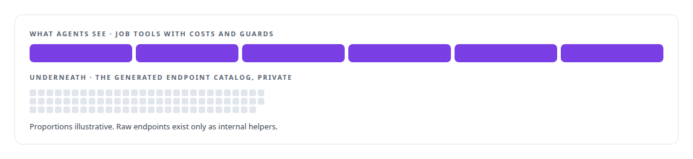
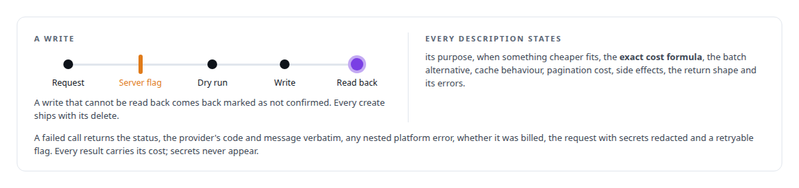
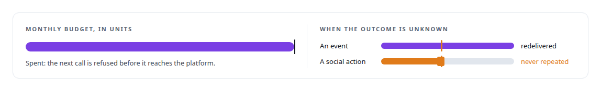
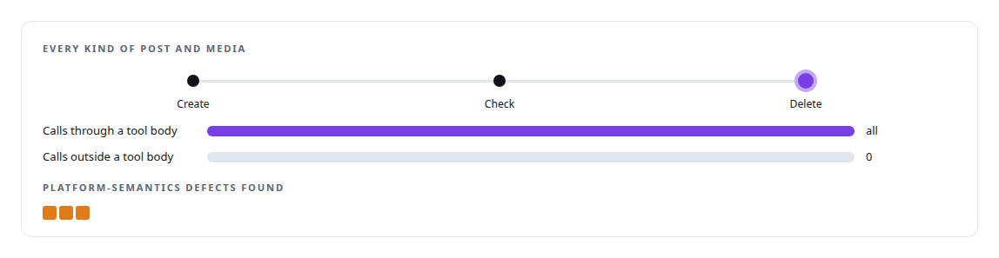
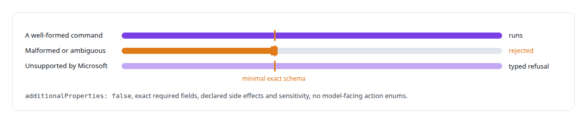
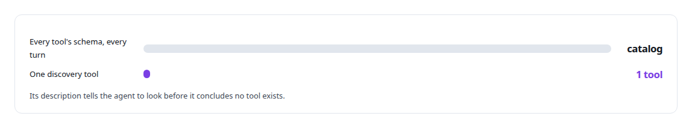

# MCP tool design

**Tools shaped as jobs, cost stated on every call, every write read back, every create with a delete: the written standard every MCP tool in my estate must meet.**

Canonical: https://coreyjames.ai/technologies/mcp-tool-design/  
Author: Corey James · Published: 2026-10-28 · Kind: technology  
Systems: [FAFOHive](https://github.com/coreyjames-ai/fafohive) · [Helix](https://github.com/coreyjames-ai/helix) · [Capabilities model](https://github.com/coreyjames-ai/capabilities-model)  
Skills: [tool synthesis and governed API integration](https://github.com/coreyjames-ai/portfolio/tree/main/skills/tool-synthesis-and-governed-api-integration) · [MCP server design](https://github.com/coreyjames-ai/portfolio/tree/main/skills/mcp-server-design) · [cost attribution for AI work](https://github.com/coreyjames-ai/portfolio/tree/main/skills/cost-attribution-for-ai-work) · [AI-assisted engineering methodology](https://github.com/coreyjames-ai/portfolio/tree/main/skills/ai-assisted-engineering-methodology)  


## Result

| Figure | What it measures |
| --- | --- |
| **~42,000** | tokens of tool schema an agent had carried every turn |
| **24** | meeting tools, each with a minimal exact schema |
| **520** | characters in the discovery tool's description, held there by a test |

## What was built

### Tools shaped like jobs, not endpoints

[FAFOHive](https://coreyjames.ai/systems/fafohive): when I added in-house social integrations to the tool hub, the fast path was to generate one tool per vendor endpoint. I took it once. The X module's first build compiled its tools straight from the vendor's OpenAPI specification. They were cheap to make, expensive to call and easy for an agent to misuse. I withdrew that surface and replaced it with tools shaped like the jobs agents actually do, trading generated breadth for designed workflow tools with costs and guards.



### A written standard every tool must meet

I wrote the standard every tool in the estate has to meet, and its rulings. Its first rule is that a tool is a job. Errors come back verbatim, and an empty result never stands in for a failure.



### Cost and repeats an agent can reason about

The X tools state their cost in units and refuse work once the monthly budget is spent.




### A lifecycle test through the agent tools alone

The Facebook module proved the standard against a real platform, with nothing allowed to reach it except through a tool.



The governed gateway these tools sit behind is in [Agents with real tools and no keys](https://coreyjames.ai/stories/agents-with-real-tools-and-no-keys).

### Meeting tools a model cannot misuse

[Helix](https://coreyjames.ai/systems/helix): the meeting action server lets any model act in a Teams meeting as one employee. I wanted a model to be unable to send a malformed or ambiguous command.



See [A meeting attendee that will not fake it](https://coreyjames.ai/stories/a-meeting-attendee-that-will-not-fake-it).

### One discovery tool instead of a catalog

[Capabilities model](https://coreyjames.ai/systems/capabilities-model): here the design problem was the size of the tool surface itself. The whole schema on every turn became one discovery tool, whose description length is enforced by a test.



See [A hundred tokens instead of forty-two thousand](https://coreyjames.ai/stories/a-hundred-tokens-instead-of-forty-two-thousand).

> An agent cannot budget what it cannot see, so every call states its cost.

## What was verified

Each line is a claim the canonical page supports, with the figure as the page states it.

- MCP server design: a written standard for every tool, shaped as a job, with a stated cost formula, verbatim errors, read-back writes and a delete for every create.
- Tool surface design for agents: ~42,000 tokens of per-turn tool schema replaced by one discovery tool whose 520-character description is held by a test.
- Lifecycle testing of agent tools: every kind of post and media created, checked and deleted through agent tools alone, finding 3 platform-semantics defects.
- Agent-safe API integration: 24 meeting tools with minimal exact schemas and typed refusals where Microsoft offers no supported action.

## Related

- [A meeting attendee that will not fake it](https://github.com/coreyjames-ai/helix/tree/main/stories/a-meeting-attendee-that-will-not-fake-it) · https://coreyjames.ai/stories/a-meeting-attendee-that-will-not-fake-it/
- [A hundred tokens instead of forty-two thousand](https://github.com/coreyjames-ai/capabilities-model/tree/main/stories/a-hundred-tokens-instead-of-forty-two-thousand) · https://coreyjames.ai/stories/a-hundred-tokens-instead-of-forty-two-thousand/
- [Agents with real tools and no keys](https://github.com/coreyjames-ai/fafohive/tree/main/stories/agents-with-real-tools-and-no-keys) · https://coreyjames.ai/stories/agents-with-real-tools-and-no-keys/
- System: [FAFOHive](https://github.com/coreyjames-ai/fafohive)
- System: [Helix](https://github.com/coreyjames-ai/helix)
- System: [Capabilities model](https://github.com/coreyjames-ai/capabilities-model)

## Citation

Corey James. "MCP tool design." coreyjames.ai, 2026. https://coreyjames.ai/technologies/mcp-tool-design/

```bibtex
@misc{coreyjames-mcp-tool-design,
  author = {Corey James},
  title = {MCP tool design},
  year = {2026},
  howpublished = {\url{https://coreyjames.ai/technologies/mcp-tool-design/}},
  note = {GitHub copy: https://github.com/coreyjames-ai/portfolio/tree/main/technologies/mcp-tool-design}
}
```

Part of [Corey James's portfolio](https://github.com/coreyjames-ai/portfolio) · site: https://coreyjames.ai/ · MCP server: https://coreyjames.ai/mcp · agent card: https://coreyjames.ai/.well-known/agent.json
