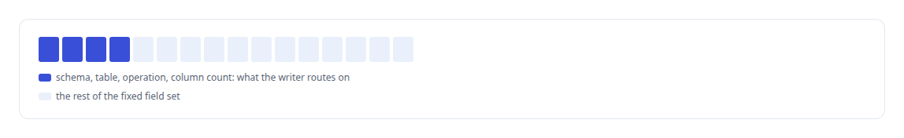
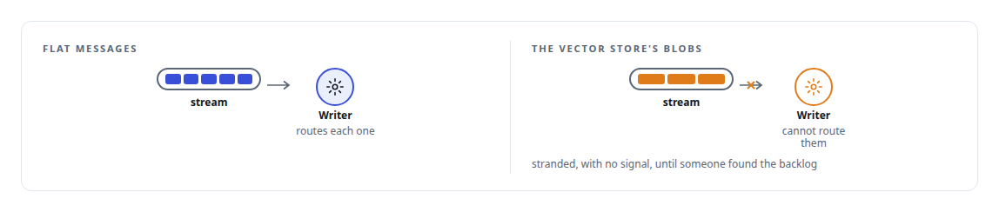
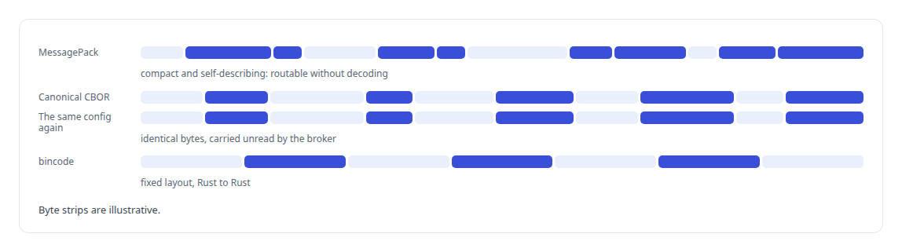

# MessagePack

**Compact binary serialisation on the agent runtime's message bus and the broker's internal entries.**

Canonical: https://coreyjames.ai/technologies/messagepack/  
Author: Corey James · Published: 2026-10-28 · Kind: technology  
Systems: [Agent Swarm](https://github.com/coreyjames-ai/agent-swarm) · [FAFO Core and Function Forge](https://github.com/coreyjames-ai/fafo-core) · [Inference Fabric](https://github.com/coreyjames-ai/inference-fabric) · [PostgreSQL Fabric](https://github.com/coreyjames-ai/postgresql-fabric)  
Skills: [append-only log design](https://github.com/coreyjames-ai/portfolio/tree/main/skills/append-only-log-design) · [message broker and queue design](https://github.com/coreyjames-ai/portfolio/tree/main/skills/message-broker-and-queue-design) · [distributed systems correctness](https://github.com/coreyjames-ai/portfolio/tree/main/skills/distributed-systems-correctness) · [technical leadership of agent teams](https://github.com/coreyjames-ai/portfolio/tree/main/skills/technical-leadership-of-agent-teams)  


## Result

| Figure | What it measures |
| --- | --- |
| **16** | fixed fields in every write message |
| **3** | encodings, each chosen for its path |

## What was built

### One write path, no database connections

In [FAFO Core and Function Forge](https://coreyjames.ai/systems/fafo-core) I wanted hundreds of workers to write results without any of them holding a database connection, so functions never write to PostgreSQL directly. A producer client encodes each write as a flat MessagePack message and appends it fire-and-forget to a [Redis](https://coreyjames.ai/technologies/redis) stream. A single governed write service then owns the write, one path from many producers into the database.

I chose MessagePack because producers needed a compact, self-describing encoding that the writer could route without decoding the whole message. On a hot path I prefer a flat, fixed field set: the writer reads where a message goes with no database query and no schema lookup.



### A contract checked only by convention

The flat contract also taught me a lesson. It was enforced by convention, and one producer, the vector store, sent a single-field blob instead.



Consumer-side contract checks are now part of the design. The write path's own performance diagnosis is in [196 deadlocks to zero](https://coreyjames.ai/stories/196-deadlocks-to-zero), and the [Write-behind persistence](https://coreyjames.ai/technologies/write-behind-persistence) page covers the pattern.


### An encoding for each path

The [Inference Fabric](https://coreyjames.ai/systems/inference-fabric) moves several kinds of data between Rust services, and I chose each encoding for its job.



The vector shard manager takes framed [CBOR](https://coreyjames.ai/technologies/cbor) requests over TCP and carries MessagePack in its dependency set. Extraction specifications for hidden-state capture are canonical CBOR, so a given configuration always produces the same bytes, and the broker carries them to the GPU consumer without interpreting them, which keeps it independent of any one model. The broker is in [A message broker that understands tokens](https://coreyjames.ai/stories/a-message-broker-that-understands-tokens).

### Relay frames in the agent runtime

In [Agent Swarm](https://coreyjames.ai/systems/agent-swarm) the cross-host relay and hub router frame their wire messages in MessagePack. The durability writers read journal streams in the same encoding before writing agent activity and message journals to PostgreSQL.


I pay attention to the failure mode of a contract as much as to its format. MessagePack, CBOR and bincode come in through standard Rust crates (`rmp-serde`, `ciborium`, `bincode`); the contracts on top of them are my design, and the write path they feed is on the [PostgreSQL Fabric](https://coreyjames.ai/systems/postgresql-fabric) page.

> A wire contract that matters has to be checked where it is consumed.

## What was verified

Each line is a claim the canonical page supports, with the figure as the page states it.

- Write-path design: producers append flat MessagePack messages with 16 fixed fields to a Redis stream, so no worker holds a database connection.
- Data contract enforcement: a convention-only contract left one producer's messages stranded, so contracts are now checked where they are consumed.
- Serialisation design: MessagePack, canonical CBOR and bincode each chosen for what its path needs.

## Related

- [196 deadlocks to zero](https://github.com/coreyjames-ai/fafo-core/tree/main/stories/196-deadlocks-to-zero) · https://coreyjames.ai/stories/196-deadlocks-to-zero/
- [A message broker that understands tokens](https://github.com/coreyjames-ai/inference-fabric/tree/main/stories/a-message-broker-that-understands-tokens) · https://coreyjames.ai/stories/a-message-broker-that-understands-tokens/
- [Redis](https://github.com/coreyjames-ai/portfolio/tree/main/technologies/redis) · https://coreyjames.ai/technologies/redis/
- [Write-behind persistence](https://github.com/coreyjames-ai/portfolio/tree/main/technologies/write-behind-persistence) · https://coreyjames.ai/technologies/write-behind-persistence/
- [CBOR](https://github.com/coreyjames-ai/portfolio/tree/main/technologies/cbor) · https://coreyjames.ai/technologies/cbor/
- System: [Agent Swarm](https://github.com/coreyjames-ai/agent-swarm)
- System: [FAFO Core and Function Forge](https://github.com/coreyjames-ai/fafo-core)
- System: [Inference Fabric](https://github.com/coreyjames-ai/inference-fabric)
- System: [PostgreSQL Fabric](https://github.com/coreyjames-ai/postgresql-fabric)

## Citation

Corey James. "MessagePack." coreyjames.ai, 2026. https://coreyjames.ai/technologies/messagepack/

```bibtex
@misc{coreyjames-messagepack,
  author = {Corey James},
  title = {MessagePack},
  year = {2026},
  howpublished = {\url{https://coreyjames.ai/technologies/messagepack/}},
  note = {GitHub copy: https://github.com/coreyjames-ai/portfolio/tree/main/technologies/messagepack}
}
```

Part of [Corey James's portfolio](https://github.com/coreyjames-ai/portfolio) · site: https://coreyjames.ai/ · MCP server: https://coreyjames.ai/mcp · agent card: https://coreyjames.ai/.well-known/agent.json
