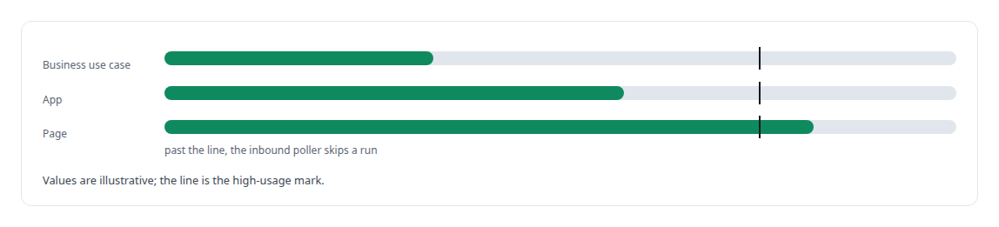
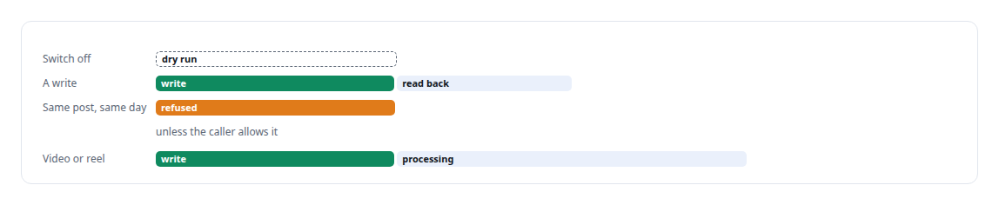
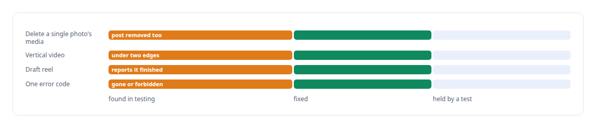
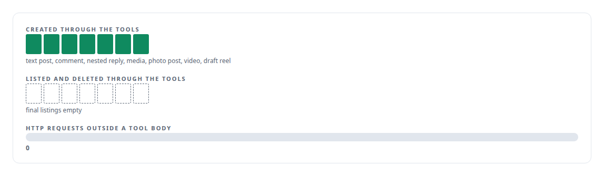

# Meta Graph API

**An in-house integration with Meta's Graph API, with usage telemetry, a ledger of everything the app created, and signature-checked webhooks.**

Canonical: https://coreyjames.ai/technologies/meta-graph-api/  
Author: Corey James · Published: 2026-10-28 · Kind: technology  
Systems: [FAFOHive](https://github.com/coreyjames-ai/fafohive)  
Skills: [tool synthesis and governed API integration](https://github.com/coreyjames-ai/portfolio/tree/main/skills/tool-synthesis-and-governed-api-integration) · [append-only log design](https://github.com/coreyjames-ai/portfolio/tree/main/skills/append-only-log-design) · [AI-assisted engineering methodology](https://github.com/coreyjames-ai/portfolio/tree/main/skills/ai-assisted-engineering-methodology) · [distributed systems correctness](https://github.com/coreyjames-ai/portfolio/tree/main/skills/distributed-systems-correctness)  


## Result

| Figure | What it measures |
| --- | --- |
| **24** | agent tools on the Graph API |
| **24 hours** | Messenger response window the inbox works inside |

## What was built

### A module built on the Graph API

In [FAFOHive](https://coreyjames.ai/systems/fafohive), agents managing a business Page needed to publish every kind of media, answer comments and messages inside Meta's rules, read insights, and undo anything they created. The social-publishing provider I had covered posting and little else, so I built an in-house module directly on Meta's Graph API and held it to my tool standard.


### A rate budget in every result

Every result carries the Graph usage headers for the business use case, the app and the Page, so an agent can see how much of its rate budget remains before it hits a throttle. The inbound poller skips a run when usage is high.



### Guarded writes

A local ledger lists everything the app created. It can refuse a delete but never authorise one on its own; Graph's own answer to which app created an object remains the authority. That keeps objects created before the ledger existed deletable and stops a stale ledger row from authorising a mistake.



### What testing against Graph taught

Graph's actual semantics came from tests against the real platform, and each finding became a fix with a test.



### Webhooks and the acceptance bar

Inbound webhooks are checked with an HMAC over the raw body and rejected on any mismatch, and events flow into the same signed event feed as the other social modules.

I set one acceptance bar for it: manage any post entirely through the agent tools. The acceptance test did exactly that, against an unpublished page, while a guard counted every HTTP request made outside a tool body.



The gateway these tools sit behind is in [Agents with real tools and no keys](https://coreyjames.ai/stories/agents-with-real-tools-and-no-keys). This is client and adapter engineering on Meta's platform; the Graph API and its rules are Meta's.


> I learn a platform's real behaviour by exercising it end to end.

## What was verified

Each line is a claim the canonical page supports, with the figure as the page states it.

- Social platform API integration: 24 agent tools built on Meta's Graph API, covering posts of every media kind, comments, the inbox and insights.
- Safe destructive operations for agents: a ledger that can veto a delete but never authorise one, with Graph's own record as the authority.
- Acceptance testing for agent tools: a full post lifecycle created and deleted through the tools with zero HTTP requests outside a tool body.

## Related

- [Agents with real tools and no keys](https://github.com/coreyjames-ai/fafohive/tree/main/stories/agents-with-real-tools-and-no-keys) · https://coreyjames.ai/stories/agents-with-real-tools-and-no-keys/
- System: [FAFOHive](https://github.com/coreyjames-ai/fafohive)

## Citation

Corey James. "Meta Graph API." coreyjames.ai, 2026. https://coreyjames.ai/technologies/meta-graph-api/

```bibtex
@misc{coreyjames-meta-graph-api,
  author = {Corey James},
  title = {Meta Graph API},
  year = {2026},
  howpublished = {\url{https://coreyjames.ai/technologies/meta-graph-api/}},
  note = {GitHub copy: https://github.com/coreyjames-ai/portfolio/tree/main/technologies/meta-graph-api}
}
```

Part of [Corey James's portfolio](https://github.com/coreyjames-ai/portfolio) · site: https://coreyjames.ai/ · MCP server: https://coreyjames.ai/mcp · agent card: https://coreyjames.ai/.well-known/agent.json
