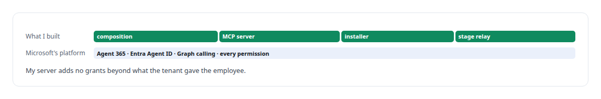
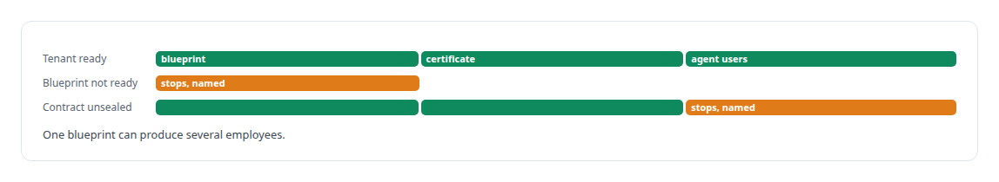
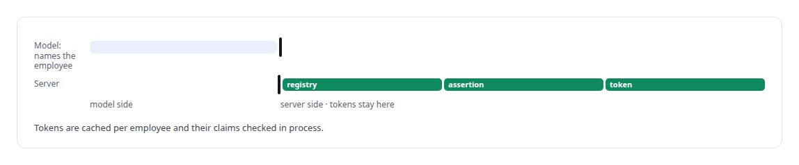

# Microsoft Agent 365

**I provisioned a governed digital employee under Microsoft's Agent 365, and built the MCP server through which any model acts in a meeting as that specific employee.**

Canonical: https://coreyjames.ai/technologies/microsoft-agent-365/  
Author: Corey James · Published: 2026-10-28 · Kind: technology  
Systems: [Helix](https://github.com/coreyjames-ai/helix)  
Skills: [MCP server design](https://github.com/coreyjames-ai/portfolio/tree/main/skills/mcp-server-design) · [Rust systems engineering](https://github.com/coreyjames-ai/portfolio/tree/main/skills/rust-systems-engineering) · [tool synthesis and governed API integration](https://github.com/coreyjames-ai/portfolio/tree/main/skills/tool-synthesis-and-governed-api-integration) · [AI-assisted engineering methodology](https://github.com/coreyjames-ai/portfolio/tree/main/skills/ai-assisted-engineering-methodology)  


## Result

| Figure | What it measures |
| --- | --- |
| **24** | tools across identity, meetings, documents and grounding |
| **≈11,000** | lines of Rust in the meeting action server |
| **3** | Microsoft principals composed into one employee |

## What was built

### An identity that can act

Microsoft's Agent 365 lets an organisation give an AI a real identity in its tenant: an Entra Agent ID blueprint and an agent user with its own mailbox, Teams presence and licence. For [Helix](https://coreyjames.ai/systems/helix), making that identity do things turned out to involve three Microsoft principals, combinations the platform rejects, and preview behaviour the documentation did not cover.

I decided to probe the real tenant, keep the wire traffic, and build only on the paths that worked. I provisioned the employee with Microsoft's tooling and configured it on their platform; what I built is everything that lets it act.



### An installer that refuses half an identity

The tenant installer is a set of portable shell scripts over Microsoft Graph. A half-configured identity never gets provisioned.



### A meeting action server that keeps tokens from the model

The Agent 365 MCP server is Rust, with a YAML tool catalog. Every call names the acting employee, and a registry refuses names it does not know. The server signs certificate client assertions bound to that agent identity and exchanges them for the employee's own Microsoft Graph tokens: calling and roster use an application token, and actions attributed to the employee use an agent-user token.



### Calls and the meeting stage

People call the employee in Teams and it answers. It joins meetings, confirmed against the meeting roster, posts in the chat as itself, puts a deck on the meeting stage, shares a screen and calls on raised hands. Graph offers no bot API for driving slides, so presentation runs through an installed Teams meeting app and an authenticated relay bound to the exact tenant, employee and meeting, which refuses any command it cannot confirm on screen. Raising its own hand returns a typed "hand mutation unavailable", because Microsoft lets a bot observe hand state and offers no supported way to change it.


An outbound call presents as a separate calling bot, because that is how Microsoft's model works. I did not disguise it as the employee.


The identity work is told in [Solving the digital-employee identity](https://coreyjames.ai/stories/solving-the-digital-employee-identity), and the meeting behaviour in [A meeting attendee that will not fake it](https://coreyjames.ai/stories/a-meeting-attendee-that-will-not-fake-it).

> An identity layer that spoofs is no identity layer.

## What was verified

Each line is a claim the canonical page supports, with the figure as the page states it.

- Identity for AI agents in Microsoft 365 and Entra: a digital employee under Agent 365 composed from 3 Microsoft principals.
- MCP server design: about 11,000 lines of Rust with 24 tools through which any model acts in a meeting as one named employee without holding a token.
- Tenant provisioning automation: an installer that stops with a named reason rather than provision a half-configured identity.

## Related

- [Solving the digital-employee identity](https://github.com/coreyjames-ai/helix/tree/main/stories/solving-the-digital-employee-identity) · https://coreyjames.ai/stories/solving-the-digital-employee-identity/
- [A meeting attendee that will not fake it](https://github.com/coreyjames-ai/helix/tree/main/stories/a-meeting-attendee-that-will-not-fake-it) · https://coreyjames.ai/stories/a-meeting-attendee-that-will-not-fake-it/
- System: [Helix](https://github.com/coreyjames-ai/helix)

## Citation

Corey James. "Microsoft Agent 365." coreyjames.ai, 2026. https://coreyjames.ai/technologies/microsoft-agent-365/

```bibtex
@misc{coreyjames-microsoft-agent-365,
  author = {Corey James},
  title = {Microsoft Agent 365},
  year = {2026},
  howpublished = {\url{https://coreyjames.ai/technologies/microsoft-agent-365/}},
  note = {GitHub copy: https://github.com/coreyjames-ai/portfolio/tree/main/technologies/microsoft-agent-365}
}
```

Part of [Corey James's portfolio](https://github.com/coreyjames-ai/portfolio) · site: https://coreyjames.ai/ · MCP server: https://coreyjames.ai/mcp · agent card: https://coreyjames.ai/.well-known/agent.json
