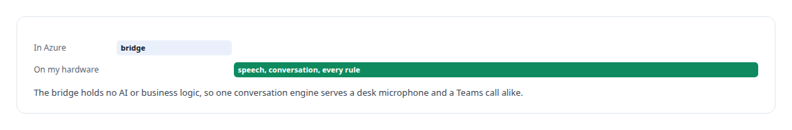
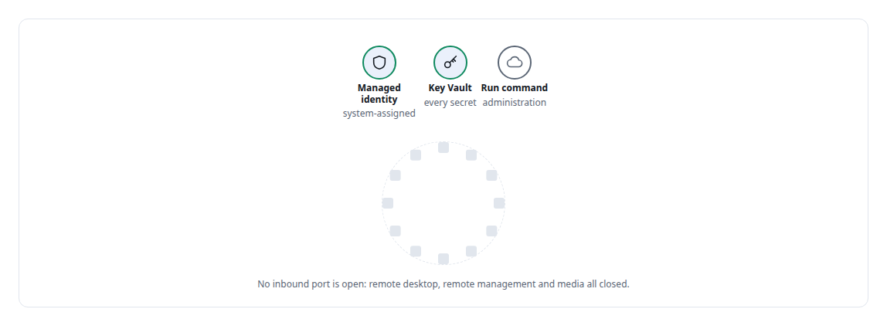
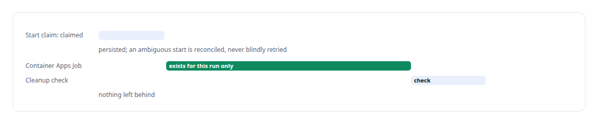

# Microsoft Azure

**Azure hosts the Windows side of my Teams integration: a media bridge with managed identity, vault-held secrets and authenticated access.**

Canonical: https://coreyjames.ai/technologies/microsoft-azure/  
Author: Corey James · Published: 2026-10-28 · Kind: technology  
Systems: [Helix](https://github.com/coreyjames-ai/helix) · [Auth and access plane](https://github.com/coreyjames-ai/auth-and-access-plane)  
Skills: [Microsoft Teams real-time media](https://github.com/coreyjames-ai/portfolio/tree/main/skills/microsoft-teams-real-time-media) · [zero-trust and zero-inbound networking](https://github.com/coreyjames-ai/portfolio/tree/main/skills/zero-trust-and-zero-inbound-networking) · [tool synthesis and governed API integration](https://github.com/coreyjames-ai/portfolio/tree/main/skills/tool-synthesis-and-governed-api-integration)  


## Result

| Figure | What it measures |
| --- | --- |
| **91,643** | buffers carried in a 30-minute soak, Azure to my host |
| **50.001/s** | buffer rate held across the soak |
| **11** | job definitions removed and credentials revoked by one cleanup |

## What was built

### A media bridge on a Windows VM

Microsoft Teams hands raw call audio only to a Windows application built on Microsoft's real-time media SDK. The speech models and conversation engine behind [Helix](https://coreyjames.ai/systems/helix) run on Linux GPUs, and I was not going to send call audio to someone else's AI service to get around that. I put the smallest possible piece in Azure and kept the brain on my own hardware.

That piece is a .NET 8 media bridge on an Azure Windows Server virtual machine. The region turned down two smaller VM sizes for lack of capacity, so it runs on a larger general-purpose size. It carries call audio to my GPU host over one authenticated full-duplex WebSocket per call and plays the agent's voice back into the call; a long soak ran with zero receive stalls and zero reconnects.



The whole path is in [A self-hosted colleague in a Teams call](https://coreyjames.ai/stories/a-self-hosted-colleague-in-a-teams-call).

### Held without open ports

A system-assigned managed identity and vault-held secrets keep everything sensitive out of images and configuration. I reach the VM only through Azure's control plane.



### Jobs that exist only for their run

The second Azure piece serves the Teams working service. A user hands a coding job to an AI worker, and I did not want a cloud VM sitting idle between jobs. A job runs on an enrolled local host or as an Azure Container Apps Job that exists only for that run, with the infrastructure defined in Bicep. A real frontier-model job ran in Azure through this path, and the service estimates the price of each run before submission.



Container Apps also hosts the weather MCP server I built for Microsoft Copilot Studio in the [Auth and access plane](https://coreyjames.ai/systems/auth-and-access-plane), packaged as a versioned container image with a deployment guide.

In the cloud I keep identity, secrets and cost under control. This work covers VMs, Key Vault, managed identity, Container Apps Jobs and Bicep for specific workloads in one subscription. The engineering that matters is the voice path on the [Helix](https://coreyjames.ai/systems/helix) page and in [Real-time audio pipeline engineering](https://coreyjames.ai/technologies/real-time-audio-pipeline-engineering).


> I use the cloud for exactly the part of a system that has to live there.

## What was verified

Each line is a claim the canonical page supports, with the figure as the page states it.

- Cloud architecture with a minimal footprint: only the Windows media bridge on Azure, with managed identity, Key Vault and no open inbound ports.
- Soak testing for real-time media: 91,643 buffers in a 30-minute soak at 50.001 per second with zero stalls.
- Ephemeral compute for AI jobs: Container Apps Jobs that exist only for their run, with cleanup checks leaving 0 executions active.

## Related

- [A self-hosted colleague in a Teams call](https://github.com/coreyjames-ai/helix/tree/main/stories/a-self-hosted-colleague-in-a-teams-call) · https://coreyjames.ai/stories/a-self-hosted-colleague-in-a-teams-call/
- [Real-time audio pipeline engineering](https://github.com/coreyjames-ai/portfolio/tree/main/technologies/real-time-audio-pipeline-engineering) · https://coreyjames.ai/technologies/real-time-audio-pipeline-engineering/
- System: [Helix](https://github.com/coreyjames-ai/helix)
- System: [Auth and access plane](https://github.com/coreyjames-ai/auth-and-access-plane)

## Citation

Corey James. "Microsoft Azure." coreyjames.ai, 2026. https://coreyjames.ai/technologies/microsoft-azure/

```bibtex
@misc{coreyjames-microsoft-azure,
  author = {Corey James},
  title = {Microsoft Azure},
  year = {2026},
  howpublished = {\url{https://coreyjames.ai/technologies/microsoft-azure/}},
  note = {GitHub copy: https://github.com/coreyjames-ai/portfolio/tree/main/technologies/microsoft-azure}
}
```

Part of [Corey James's portfolio](https://github.com/coreyjames-ai/portfolio) · site: https://coreyjames.ai/ · MCP server: https://coreyjames.ai/mcp · agent card: https://coreyjames.ai/.well-known/agent.json
