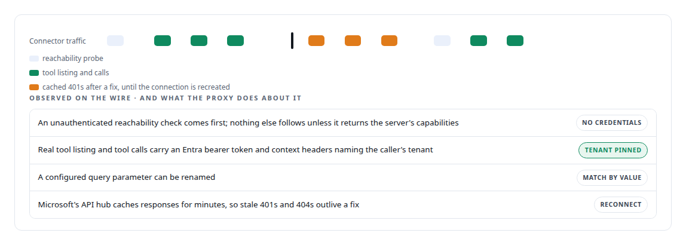
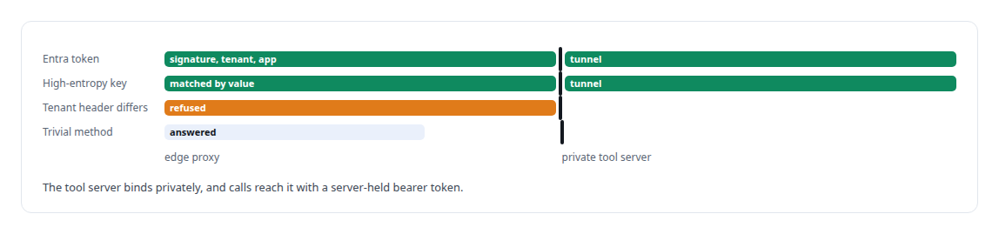
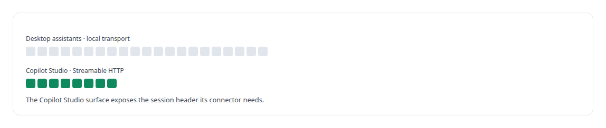

# Microsoft Copilot Studio

**I expose a trimmed, authenticated tool surface to Microsoft Copilot Studio through an edge proxy, and worked out from the wire why its connector stalled after initialisation.**

Canonical: https://coreyjames.ai/technologies/microsoft-copilot-studio/  
Author: Corey James · Published: 2026-10-28 · Kind: technology  
Systems: [Auth and access plane](https://github.com/coreyjames-ai/auth-and-access-plane)  
Skills: [zero-trust and zero-inbound networking](https://github.com/coreyjames-ai/portfolio/tree/main/skills/zero-trust-and-zero-inbound-networking) · [tool synthesis and governed API integration](https://github.com/coreyjames-ai/portfolio/tree/main/skills/tool-synthesis-and-governed-api-integration) · [AI-assisted engineering methodology](https://github.com/coreyjames-ai/portfolio/tree/main/skills/ai-assisted-engineering-methodology) · [distributed systems correctness](https://github.com/coreyjames-ai/portfolio/tree/main/skills/distributed-systems-correctness)  


## Result

| Figure | What it measures |
| --- | --- |
| **≈300** | lines in the edge proxy |
| **21** | tools for desktop assistants, over a local transport |
| **8** | tools offered to Copilot Studio |

## What was built

### Reading the connector from the wire

I wanted Microsoft Copilot Studio agents to call tools on my private MCP server in the [Auth and access plane](https://coreyjames.ai/systems/auth-and-access-plane), and I wanted that server to accept no public connection. The standard MCP OAuth path stalled right after `initialize`, and Copilot Studio's MCP connector was thinly documented. I decided to work out its behaviour from the wire and build around what it actually does.

I read the connector's traffic end to end in edge logs and wrote it down as observed fact, which made each proxy decision traceable to something the connector does.



### An edge proxy as the only public surface

From that I built a small edge proxy. It answers the discovery probe without credentials: authentication applies to operations and stays off the reachability probe, because gating the probe makes the connector stop.

On every real call it checks the tenant-pinned Entra JWT, an RS256 signature against cached signing keys plus tenant and application checks, or it matches a high-entropy key by value, which survives the vendor renaming the parameter. For defence in depth it compares the tenant header with the token.



My OAuth server also carries client profiles for Copilot Studio. The [JavaScript](https://coreyjames.ai/technologies/javascript) page covers the edge implementation, and the [Zero inbound network exposure](https://coreyjames.ai/technologies/zero-inbound-network-exposure) page covers the pattern.

### A tool surface shaped for the connector

I also built a weather-intelligence MCP server shaped for Copilot Studio. It has two surfaces, because the connector and its users need fewer, simpler tools than a desktop assistant.



I packaged it as a container and later ported it to .NET on the official MCP C# SDK. The consent model behind both is in [The hardening fix that locked everyone out](https://coreyjames.ai/stories/the-hardening-fix-that-locked-everyone-out).

The integration holds up against the connector's quirks without opening my estate. Copilot Studio is Microsoft's platform; the proxy, the tool surfaces and the connector findings are mine.


> When a vendor platform is under-documented, I learn it from the wire.

## What was verified

Each line is a claim the canonical page supports, with the figure as the page states it.

- Reverse-engineering vendor integrations: Copilot Studio's MCP connector behaviour worked out from edge logs and answered by an edge proxy of about 300 lines.
- Zero-trust and zero-inbound networking: a private tool server reachable only through a tunnel, with tenant-pinned Entra token checks at the edge.
- MCP tool surface design: 21 tools for desktop assistants and a trimmed 8-tool surface shaped for Copilot Studio.

## Related

- [The hardening fix that locked everyone out](https://github.com/coreyjames-ai/auth-and-access-plane/tree/main/stories/the-hardening-fix-that-locked-everyone-out) · https://coreyjames.ai/stories/the-hardening-fix-that-locked-everyone-out/
- [JavaScript](https://github.com/coreyjames-ai/portfolio/tree/main/technologies/javascript) · https://coreyjames.ai/technologies/javascript/
- [Zero-inbound network exposure](https://github.com/coreyjames-ai/portfolio/tree/main/technologies/zero-inbound-network-exposure) · https://coreyjames.ai/technologies/zero-inbound-network-exposure/
- System: [Auth and access plane](https://github.com/coreyjames-ai/auth-and-access-plane)

## Citation

Corey James. "Microsoft Copilot Studio." coreyjames.ai, 2026. https://coreyjames.ai/technologies/microsoft-copilot-studio/

```bibtex
@misc{coreyjames-microsoft-copilot-studio,
  author = {Corey James},
  title = {Microsoft Copilot Studio},
  year = {2026},
  howpublished = {\url{https://coreyjames.ai/technologies/microsoft-copilot-studio/}},
  note = {GitHub copy: https://github.com/coreyjames-ai/portfolio/tree/main/technologies/microsoft-copilot-studio}
}
```

Part of [Corey James's portfolio](https://github.com/coreyjames-ai/portfolio) · site: https://coreyjames.ai/ · MCP server: https://coreyjames.ai/mcp · agent card: https://coreyjames.ai/.well-known/agent.json
