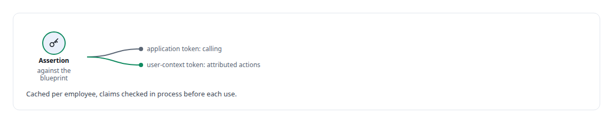
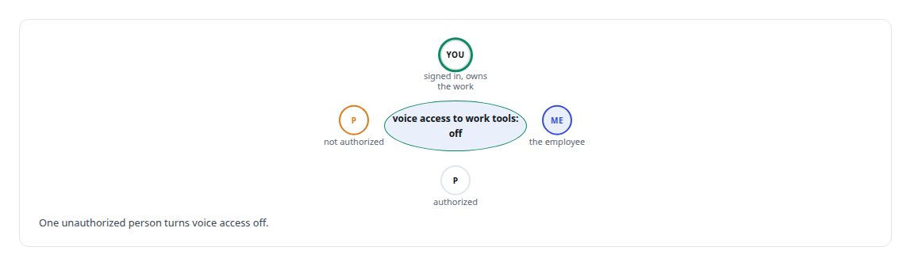
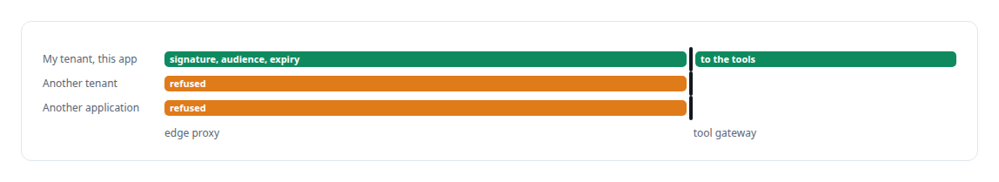

# Microsoft Entra ID

**Entra Agent ID gives my digital employee its identity; I compose the Microsoft principals it involves into paths the platform actually accepts.**

Canonical: https://coreyjames.ai/technologies/microsoft-entra-id/  
Author: Corey James · Published: 2026-10-28 · Kind: technology  
Systems: [Helix](https://github.com/coreyjames-ai/helix) · [Auth and access plane](https://github.com/coreyjames-ai/auth-and-access-plane)  
Skills: [Microsoft 365, Graph and Entra integration](https://github.com/coreyjames-ai/portfolio/tree/main/skills/microsoft-365-graph-and-entra-integration) · [OAuth 2.0 and identity architecture](https://github.com/coreyjames-ai/portfolio/tree/main/skills/oauth-2-0-and-identity-architecture) · [tool synthesis and governed API integration](https://github.com/coreyjames-ai/portfolio/tree/main/skills/tool-synthesis-and-governed-api-integration) · [distributed systems correctness](https://github.com/coreyjames-ai/portfolio/tree/main/skills/distributed-systems-correctness)  


## Result

| Figure | What it measures |
| --- | --- |
| **3** | Microsoft principals composed for one employee |

## What was built

### An agent identity for each employee

[Helix](https://coreyjames.ai/systems/helix) needed an AI that acts in Microsoft 365 as one named employee, with its own identity and no shared super-account. I decided Microsoft would stay the permission authority and my code would compose and check identities. Each digital employee is an agent identity in the tenant under Microsoft Entra Agent ID.

The meeting action server signs certificate client assertions against the employee's agent blueprint and receives that employee's own [Microsoft Graph](https://coreyjames.ai/technologies/microsoft-graph) tokens. Calling and attributed actions use separate token kinds, matching what the platform expects for each, and the tokens never reach a model.



I worked out which principal may call, act or be attributed by probing the real tenant and capturing the wire responses, because the platform's behaviour was ahead of its documentation. When outbound calls presented as a separate calling bot, I went with the platform's model; an identity layer that spoofs the caller is worthless. How the principals fit together is in [Solving the digital-employee identity](https://coreyjames.ai/stories/solving-the-digital-employee-identity).

### Provisioning and sign-in

A tenant installer provisions the employee and refuses to finish until its calling contract is sealed, so a half-configured identity never exists in the tenant. In the Teams working service, ownership of delegated work comes from the person's Entra sign-in in a Teams tab.



### A tenant-pinned check at the edge

The [Auth and access plane](https://coreyjames.ai/systems/auth-and-access-plane) had to let [Microsoft Copilot Studio](https://coreyjames.ai/technologies/microsoft-copilot-studio) reach my private tools without opening the estate, so I put the identity check at the edge. Copilot Studio requests carry Entra-issued tokens, and an edge proxy on [Cloudflare Workers](https://coreyjames.ai/technologies/cloudflare-workers) checks each RS256 signature with WebCrypto against the tenant's signing keys, cached in the edge key-value store so a round trip to Microsoft stays off every request.



Behind the proxy, the tool gateway accepts tokens from my own authorization server and from Microsoft, each checked against its issuer's published keys. I can build on Microsoft's identity platform past the point where its documentation stops.


> I keep credentials out of model context and identity checks at the boundary where requests enter.

## What was verified

Each line is a claim the canonical page supports, with the figure as the page states it.

- Microsoft Graph and Entra integration: each digital employee an Entra Agent ID identity receiving its own Graph tokens through certificate assertions.
- Edge token validation: tenant-pinned RS256 checks with WebCrypto against cached signing keys, refusing tokens from other tenants or applications.
- Credential isolation for AI agents: tokens checked in process and never passed to a model.

## Related

- [Solving the digital-employee identity](https://github.com/coreyjames-ai/helix/tree/main/stories/solving-the-digital-employee-identity) · https://coreyjames.ai/stories/solving-the-digital-employee-identity/
- [Microsoft Graph](https://github.com/coreyjames-ai/portfolio/tree/main/technologies/microsoft-graph) · https://coreyjames.ai/technologies/microsoft-graph/
- [Microsoft Copilot Studio](https://github.com/coreyjames-ai/portfolio/tree/main/technologies/microsoft-copilot-studio) · https://coreyjames.ai/technologies/microsoft-copilot-studio/
- [Cloudflare Workers](https://github.com/coreyjames-ai/portfolio/tree/main/technologies/cloudflare-workers) · https://coreyjames.ai/technologies/cloudflare-workers/
- System: [Helix](https://github.com/coreyjames-ai/helix)
- System: [Auth and access plane](https://github.com/coreyjames-ai/auth-and-access-plane)

## Citation

Corey James. "Microsoft Entra ID." coreyjames.ai, 2026. https://coreyjames.ai/technologies/microsoft-entra-id/

```bibtex
@misc{coreyjames-microsoft-entra-id,
  author = {Corey James},
  title = {Microsoft Entra ID},
  year = {2026},
  howpublished = {\url{https://coreyjames.ai/technologies/microsoft-entra-id/}},
  note = {GitHub copy: https://github.com/coreyjames-ai/portfolio/tree/main/technologies/microsoft-entra-id}
}
```

Part of [Corey James's portfolio](https://github.com/coreyjames-ai/portfolio) · site: https://coreyjames.ai/ · MCP server: https://coreyjames.ai/mcp · agent card: https://coreyjames.ai/.well-known/agent.json
