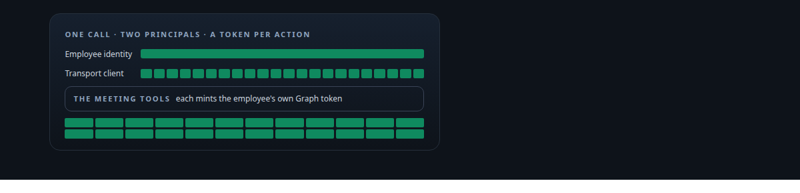
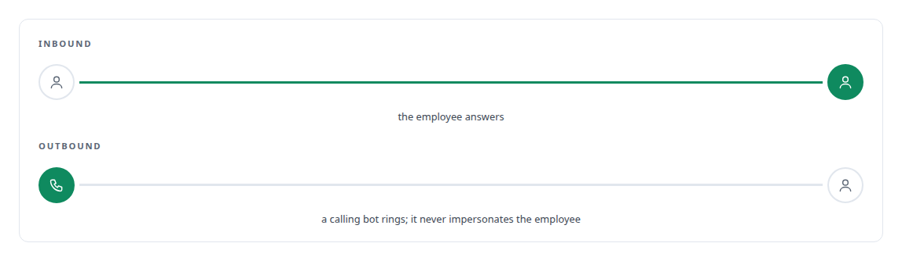
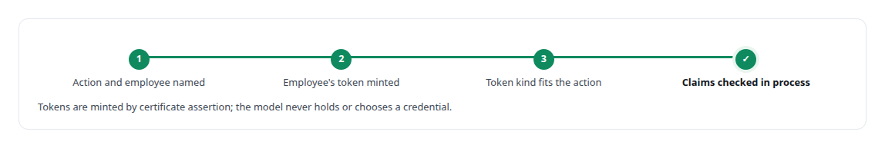
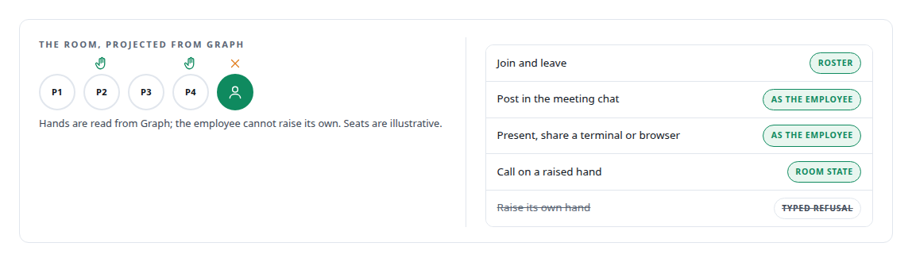
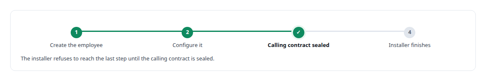
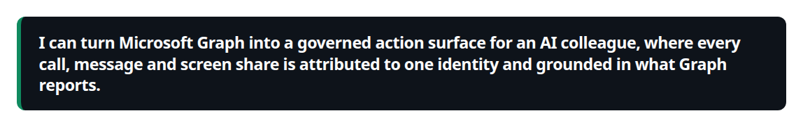

# Microsoft Graph

**Microsoft Graph is how the employee reads mail, posts in meeting chat and answers calls, with tokens minted per employee and validated before use.**

Canonical: https://coreyjames.ai/technologies/microsoft-graph/  
Author: Corey James · Published: 2026-10-28 · Kind: technology  
Systems: [Helix](https://github.com/coreyjames-ai/helix)  
Skills: [Microsoft 365, Graph and Entra integration](https://github.com/coreyjames-ai/portfolio/tree/main/skills/microsoft-365-graph-and-entra-integration) · [MCP server design](https://github.com/coreyjames-ai/portfolio/tree/main/skills/mcp-server-design) · [Rust systems engineering](https://github.com/coreyjames-ai/portfolio/tree/main/skills/rust-systems-engineering) · [tool synthesis and governed API integration](https://github.com/coreyjames-ai/portfolio/tree/main/skills/tool-synthesis-and-governed-api-integration)  



## Result

| Figure | What it measures |
| --- | --- |
| **24** | tools on the digital-employee server through which a model acts as the employee |

## What was built

### Answering calls as the employee

[Helix](https://coreyjames.ai/systems/helix) puts a governed digital employee into Teams calls and meetings, and Microsoft Graph is the surface it acts through. The first problem was calling: no single Microsoft principal can both answer a call as the employee and own the media session. I composed two Graph Communications clients. The employee's identity answers inbound calls under its own name, and a transport-only client owns the native media platform that carries the audio. That composition is the core of [A self-hosted colleague in a Teams call](https://coreyjames.ai/stories/a-self-hosted-colleague-in-a-teams-call).



### Acting in meetings under one identity

The second problem was acting in meetings with attribution any model could rely on. I built a [Rust](https://coreyjames.ai/technologies/rust) [MCP](https://coreyjames.ai/technologies/model-context-protocol-mcp) server for those meeting actions. The acting employee is an explicit argument of every tool, so the server decides attribution.

The meeting tool catalog is data, so a new action reaches every model client, the voice engine included, with no client change.



### Reading the room, refusing what Graph cannot do

A room-state projector turns Graph's participant data into a current picture of who is present and whose hand is up. A join counts only once Graph shows the employee on the roster, because only the roster shows the employee is actually in the room. Graph lets a bot read a raised hand and gives it no supported way to raise its own, so that tool returns a typed refusal. See [A meeting attendee that will not fake it](https://coreyjames.ai/stories/a-meeting-attendee-that-will-not-fake-it).



### Provisioning the employee

Graph also carries provisioning: the tenant installer creates and configures the employee. The identity design is in [Solving the digital-employee identity](https://coreyjames.ai/stories/solving-the-digital-employee-identity).



I use Graph's public APIs as Microsoft publishes them; the composition, token handling, roster checks and refusals are my engineering.



> I can turn Microsoft Graph into a governed action surface for an AI colleague, where every call, message and screen share is attributed to one identity and grounded in what Graph reports.

## What was verified

Each line is a claim the canonical page supports, with the figure as the page states it.

- Microsoft Graph and Entra integration: two composed Graph Communications clients, so a digital employee answers Teams calls under its own identity while a transport-only client owns the media.
- Identity for AI agents in Microsoft Entra: a Rust MCP server of 24 meeting tools where every call names the acting employee and the server mints that employee's token by certificate assertion.
- Fail-closed agent tool design: a room-state projector over Graph participant data, joins counted only once the roster shows the employee, and a typed refusal where Graph offers no way to raise a hand.

## Related

- [A self-hosted colleague in a Teams call](https://github.com/coreyjames-ai/helix/tree/main/stories/a-self-hosted-colleague-in-a-teams-call) · https://coreyjames.ai/stories/a-self-hosted-colleague-in-a-teams-call/
- [Solving the digital-employee identity](https://github.com/coreyjames-ai/helix/tree/main/stories/solving-the-digital-employee-identity) · https://coreyjames.ai/stories/solving-the-digital-employee-identity/
- [A meeting attendee that will not fake it](https://github.com/coreyjames-ai/helix/tree/main/stories/a-meeting-attendee-that-will-not-fake-it) · https://coreyjames.ai/stories/a-meeting-attendee-that-will-not-fake-it/
- [Rust](https://github.com/coreyjames-ai/portfolio/tree/main/technologies/rust) · https://coreyjames.ai/technologies/rust/
- [Model Context Protocol (MCP)](https://github.com/coreyjames-ai/portfolio/tree/main/technologies/model-context-protocol-mcp) · https://coreyjames.ai/technologies/model-context-protocol-mcp/
- System: [Helix](https://github.com/coreyjames-ai/helix)

## Citation

Corey James. "Microsoft Graph." coreyjames.ai, 2026. https://coreyjames.ai/technologies/microsoft-graph/

```bibtex
@misc{coreyjames-microsoft-graph,
  author = {Corey James},
  title = {Microsoft Graph},
  year = {2026},
  howpublished = {\url{https://coreyjames.ai/technologies/microsoft-graph/}},
  note = {GitHub copy: https://github.com/coreyjames-ai/portfolio/tree/main/technologies/microsoft-graph}
}
```

Part of [Corey James's portfolio](https://github.com/coreyjames-ai/portfolio) · site: https://coreyjames.ai/ · MCP server: https://coreyjames.ai/mcp · agent card: https://coreyjames.ai/.well-known/agent.json
