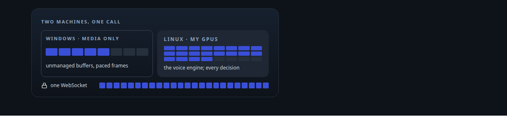
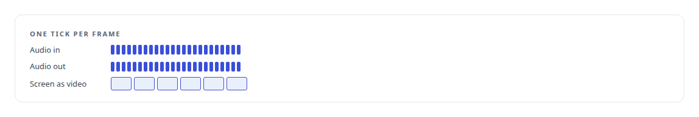
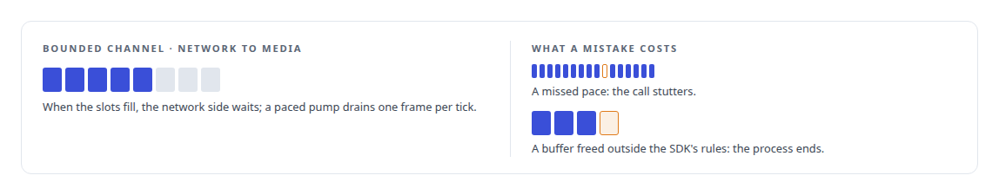
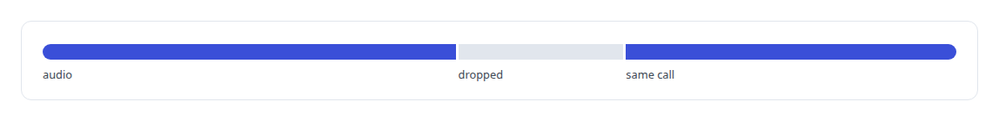
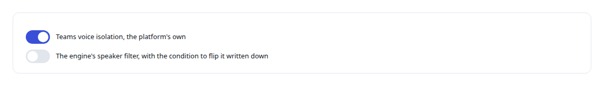

# Microsoft real-time media SDK

**A .NET 8 media service on Microsoft's real-time media SDK, handling unmanaged buffers on the SDK's clock and joined to a Linux voice engine across clouds.**

Canonical: https://coreyjames.ai/technologies/microsoft-real-time-media-sdk/  
Author: Corey James · Published: 2026-10-28 · Kind: technology  
Systems: [Helix](https://github.com/coreyjames-ai/helix)  
Skills: [Microsoft Teams real-time media](https://github.com/coreyjames-ai/portfolio/tree/main/skills/microsoft-teams-real-time-media) · [Rust systems engineering](https://github.com/coreyjames-ai/portfolio/tree/main/skills/rust-systems-engineering) · [distributed systems correctness](https://github.com/coreyjames-ai/portfolio/tree/main/skills/distributed-systems-correctness) · [tool synthesis and governed API integration](https://github.com/coreyjames-ai/portfolio/tree/main/skills/tool-synthesis-and-governed-api-integration)  



## Result

| Figure | What it measures |
| --- | --- |
| **91,643** | audio buffers through the soak, zero receive stalls and zero reconnects |
| **50.001** | buffers a second against the SDK's 20-millisecond cadence |
| **8,833** | buffers through a forced mid-call reconnect, with one 250 ms retry |
| **65–67 ms** | media round trip on one probe |

## What was built

### A media-only bridge on Windows

[Helix](https://coreyjames.ai/systems/helix) runs its speech models and conversation engine on Linux GPUs I own, and Microsoft Teams hands raw call audio only to a Windows application built on Microsoft's real-time media SDK. I refused to send call audio to a hosted AI service to avoid that mismatch, so I built a bridge and kept the brain at home.

The bridge is a [.NET 8](https://coreyjames.ai/technologies/c-sharp) solution of six projects (host, calls, media, transport, contracts and unit tests) on a [Microsoft Azure](https://coreyjames.ai/technologies/microsoft-azure) Windows machine. Its only job is media: join the call, receive and send audio frames, and publish the agent's screen as video. Every decision stays with the engine on Linux, so the Windows side can be replaced without touching the AI.



### Holding the SDK's memory and timing rules

The SDK is a preview package with strict terms. It hands out unmanaged audio buffers with exact lifetimes and expects audio on a 20-millisecond cadence. My send path allocates and frees that memory under the SDK's ownership rules.



### One authenticated link per call

Two Communications clients share one native media platform: the employee identity answers, and a transport-only client owns the media session. Audio reaches Linux over a purpose-built [binary link](https://coreyjames.ai/technologies/binary-wire-protocol-design) on one authenticated [WebSocket](https://coreyjames.ai/technologies/websocket) per call, implemented in C# and in [Rust](https://coreyjames.ai/technologies/rust) and tested byte for byte against shared golden vectors before either side is trusted. Screen share publishes [H.264](https://coreyjames.ai/technologies/h-264) frames from a headless Linux desktop through the SDK's video-based screen-sharing path.

I made a long soak and a forced mid-call reconnect requirements from the start. If the link breaks, the bridge reconnects inside the same call and drops the microphone audio captured during the break. The full account is [A self-hosted colleague in a Teams call](https://coreyjames.ai/stories/a-self-hosted-colleague-in-a-teams-call).




### Leaving voice isolation to Teams

Inside Teams calls I rely on the platform's voice isolation and leave the engine's own speaker filter off, and I wrote down when that choice should flip.



I can work inside a vendor's preview real-time media stack under its memory and timing rules and join it to a Linux system across clouds, testing failure before success. Microsoft's SDK and media runtime are used unmodified; the service on top, the wire link and the reconnect behaviour are mine.

> A colleague who answers a question from twenty seconds ago is worse than one who asks you to repeat it.

## What was verified

Each line is a claim the canonical page supports, with the figure as the page states it.

- Microsoft Teams real-time media: a .NET 8 bridge on Microsoft's real-time media SDK that moved 91,643 audio buffers at 50.001 a second from Azure to Linux with zero receive stalls.
- Real-time audio with unmanaged memory: buffers allocated and freed under the SDK's ownership rules, a paced 20-millisecond pump and bounded channels for back-pressure.
- Failure testing for real-time systems: a forced mid-call reconnect inside the same call, 8,833 buffers with one 250 ms retry, and microphone audio from the break dropped.
- Cross-language wire protocols: one authenticated WebSocket per call carrying a binary media protocol implemented in C# and Rust, tested byte for byte against shared golden vectors.

## Related

- [A self-hosted colleague in a Teams call](https://github.com/coreyjames-ai/helix/tree/main/stories/a-self-hosted-colleague-in-a-teams-call) · https://coreyjames.ai/stories/a-self-hosted-colleague-in-a-teams-call/
- [C#](https://github.com/coreyjames-ai/portfolio/tree/main/technologies/c-sharp) · https://coreyjames.ai/technologies/c-sharp/
- [Microsoft Azure](https://github.com/coreyjames-ai/portfolio/tree/main/technologies/microsoft-azure) · https://coreyjames.ai/technologies/microsoft-azure/
- [Binary wire protocol design](https://github.com/coreyjames-ai/portfolio/tree/main/technologies/binary-wire-protocol-design) · https://coreyjames.ai/technologies/binary-wire-protocol-design/
- [WebSocket](https://github.com/coreyjames-ai/portfolio/tree/main/technologies/websocket) · https://coreyjames.ai/technologies/websocket/
- [Rust](https://github.com/coreyjames-ai/portfolio/tree/main/technologies/rust) · https://coreyjames.ai/technologies/rust/
- [H.264](https://github.com/coreyjames-ai/portfolio/tree/main/technologies/h-264) · https://coreyjames.ai/technologies/h-264/
- System: [Helix](https://github.com/coreyjames-ai/helix)

## Citation

Corey James. "Microsoft real-time media SDK." coreyjames.ai, 2026. https://coreyjames.ai/technologies/microsoft-real-time-media-sdk/

```bibtex
@misc{coreyjames-microsoft-real-time-media-sdk,
  author = {Corey James},
  title = {Microsoft real-time media SDK},
  year = {2026},
  howpublished = {\url{https://coreyjames.ai/technologies/microsoft-real-time-media-sdk/}},
  note = {GitHub copy: https://github.com/coreyjames-ai/portfolio/tree/main/technologies/microsoft-real-time-media-sdk}
}
```

Part of [Corey James's portfolio](https://github.com/coreyjames-ai/portfolio) · site: https://coreyjames.ai/ · MCP server: https://coreyjames.ai/mcp · agent card: https://coreyjames.ai/.well-known/agent.json
