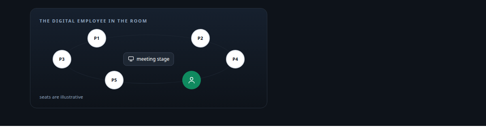
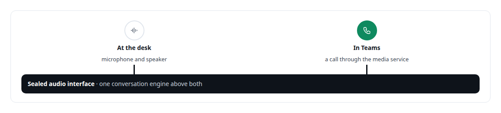
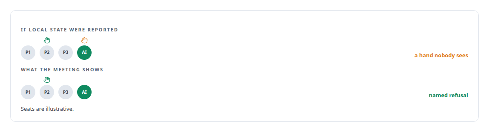
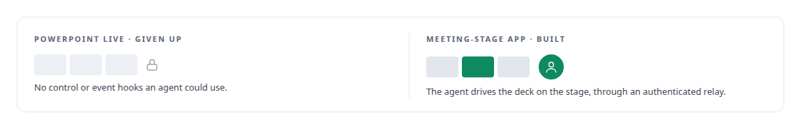
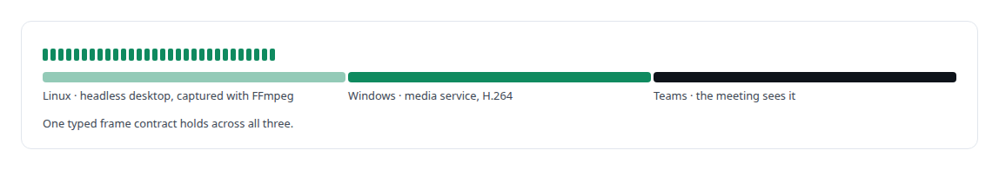

# Microsoft Teams

**People call my digital employee in Teams and it answers; they invite it to meetings and it presents, shares a screen and calls on raised hands. It does not raise its own, because the platform offers no way to.**

Canonical: https://coreyjames.ai/technologies/microsoft-teams/  
Author: Corey James · Published: 2026-10-28 · Kind: technology  
Systems: [Helix](https://github.com/coreyjames-ai/helix) · [Auth and access plane](https://github.com/coreyjames-ai/auth-and-access-plane)  
Skills: [Microsoft Teams real-time media](https://github.com/coreyjames-ai/portfolio/tree/main/skills/microsoft-teams-real-time-media) · [Rust systems engineering](https://github.com/coreyjames-ai/portfolio/tree/main/skills/rust-systems-engineering) · [real-time voice AI](https://github.com/coreyjames-ai/portfolio/tree/main/skills/real-time-voice-ai) · [tool synthesis and governed API integration](https://github.com/coreyjames-ai/portfolio/tree/main/skills/tool-synthesis-and-governed-api-integration)  



## Result

| Figure | What it measures |
| --- | --- |
| **13** | meeting actions with exact schemas, each naming the acting employee |
| **30 min** | Teams media soak from Azure to Linux |
| **0** | receive stalls through the soak and a forced mid-call reconnect |

## What was built

### Answering calls like a colleague

[Helix](https://coreyjames.ai/systems/helix) exists because I wanted one AI colleague that shows up where people already work, under an identity the organisation governs, and behaves in a call and a meeting the way a colleague does. People call the digital employee in Teams and it answers. Call audio crosses from a [.NET 8](https://coreyjames.ai/technologies/c-sharp) service on the [Microsoft real-time media SDK](https://coreyjames.ai/technologies/microsoft-real-time-media-sdk) to a [Rust](https://coreyjames.ai/technologies/rust) voice engine on my GPUs. When someone talks over the agent, it stops.

A Teams call is one more implementation of the engine's sealed audio interface, so the same conversation engine runs on a desk microphone and in Teams. See [A self-hosted colleague in a Teams call](https://coreyjames.ai/stories/a-self-hosted-colleague-in-a-teams-call).



### Acting in meetings, and refusing to fake it

In meetings, the agent acts through an [MCP](https://coreyjames.ai/technologies/model-context-protocol-mcp) server whose actions each name the acting employee. The second-generation set has exact schemas: chat as the employee, a room-state view of who is present and whose hand is up, calling on raised hands, presenting, and sharing a screen. Each action is exercised in a real meeting, and those scripts leave the meeting and clean up even when an assertion trips.



Where Teams has no supported path, the action returns a named refusal. Raising its own hand is one; see [A meeting attendee that will not fake it](https://coreyjames.ai/stories/a-meeting-attendee-that-will-not-fake-it).


### Moving presentation to the meeting stage

PowerPoint Live exposes no control or event hooks. I gave it up and paid for a rewrite: presentation moved to an installed Teams meeting-stage app built on TeamsJS with an authenticated relay, and the agent drives the deck on the stage itself.



### Sharing a screen people can read

Screen share comes from a headless Linux desktop with a browser and a terminal, captured with [FFmpeg](https://coreyjames.ai/technologies/ffmpeg), framed as [H.264](https://coreyjames.ai/technologies/h-264) and published through the media service. Video crosses Linux, Windows and Teams under one typed frame contract, and terminal text appears at a speed people can read.



### Delegating work from a Teams tab

Delegated work starts from a Teams personal tab in [React](https://coreyjames.ai/technologies/react) with Fluent UI, signed in through Teams single sign-on with MSAL and PKCE, and ownership of each request comes from that sign-in. The identity behind all of it is in [Solving the digital-employee identity](https://coreyjames.ai/stories/solving-the-digital-employee-identity).


I can make an AI colleague behave properly inside Microsoft Teams, answering, yielding the floor, presenting and sharing, with every action attributed to one governed identity. Teams and its SDKs are Microsoft's; the media service, meeting tools, stage app and relay are mine.

> Reporting a hand as raised from local state would be a lie nobody in the meeting could see through.

## What was verified

Each line is a claim the canonical page supports, with the figure as the page states it.

- Microsoft Teams real-time media: a self-hosted AI participant whose Rust voice engine treats a Teams call as one more implementation of its sealed audio interface, with a 30 min soak and 0 receive stalls.
- AI agents in Microsoft Teams meetings: 13 meeting actions with exact schemas, each naming the acting employee, each counted done only when it works in a real meeting.
- Teams app development: a meeting-stage app on TeamsJS with an authenticated relay so the agent drives a deck, and a React personal tab signed in through Teams single sign-on with MSAL and PKCE.
- Screen-sharing pipelines: a headless Linux desktop captured with FFmpeg and framed as H.264 under one typed frame contract across Linux, Windows and Teams.

## Related

- [A self-hosted colleague in a Teams call](https://github.com/coreyjames-ai/helix/tree/main/stories/a-self-hosted-colleague-in-a-teams-call) · https://coreyjames.ai/stories/a-self-hosted-colleague-in-a-teams-call/
- [Solving the digital-employee identity](https://github.com/coreyjames-ai/helix/tree/main/stories/solving-the-digital-employee-identity) · https://coreyjames.ai/stories/solving-the-digital-employee-identity/
- [A meeting attendee that will not fake it](https://github.com/coreyjames-ai/helix/tree/main/stories/a-meeting-attendee-that-will-not-fake-it) · https://coreyjames.ai/stories/a-meeting-attendee-that-will-not-fake-it/
- [C#](https://github.com/coreyjames-ai/portfolio/tree/main/technologies/c-sharp) · https://coreyjames.ai/technologies/c-sharp/
- [Microsoft real-time media SDK](https://github.com/coreyjames-ai/portfolio/tree/main/technologies/microsoft-real-time-media-sdk) · https://coreyjames.ai/technologies/microsoft-real-time-media-sdk/
- [Rust](https://github.com/coreyjames-ai/portfolio/tree/main/technologies/rust) · https://coreyjames.ai/technologies/rust/
- [Model Context Protocol (MCP)](https://github.com/coreyjames-ai/portfolio/tree/main/technologies/model-context-protocol-mcp) · https://coreyjames.ai/technologies/model-context-protocol-mcp/
- [FFmpeg](https://github.com/coreyjames-ai/portfolio/tree/main/technologies/ffmpeg) · https://coreyjames.ai/technologies/ffmpeg/
- [H.264](https://github.com/coreyjames-ai/portfolio/tree/main/technologies/h-264) · https://coreyjames.ai/technologies/h-264/
- [React](https://github.com/coreyjames-ai/portfolio/tree/main/technologies/react) · https://coreyjames.ai/technologies/react/
- System: [Helix](https://github.com/coreyjames-ai/helix)
- System: [Auth and access plane](https://github.com/coreyjames-ai/auth-and-access-plane)

## Citation

Corey James. "Microsoft Teams." coreyjames.ai, 2026. https://coreyjames.ai/technologies/microsoft-teams/

```bibtex
@misc{coreyjames-microsoft-teams,
  author = {Corey James},
  title = {Microsoft Teams},
  year = {2026},
  howpublished = {\url{https://coreyjames.ai/technologies/microsoft-teams/}},
  note = {GitHub copy: https://github.com/coreyjames-ai/portfolio/tree/main/technologies/microsoft-teams}
}
```

Part of [Corey James's portfolio](https://github.com/coreyjames-ai/portfolio) · site: https://coreyjames.ai/ · MCP server: https://coreyjames.ai/mcp · agent card: https://coreyjames.ai/.well-known/agent.json
