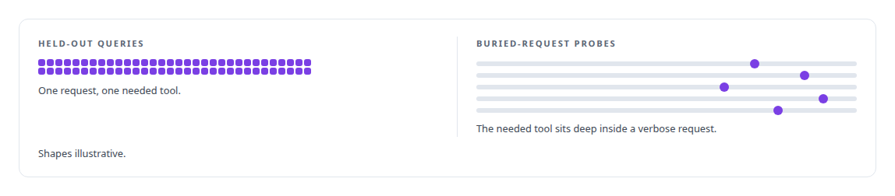
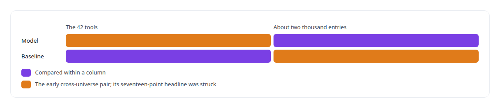
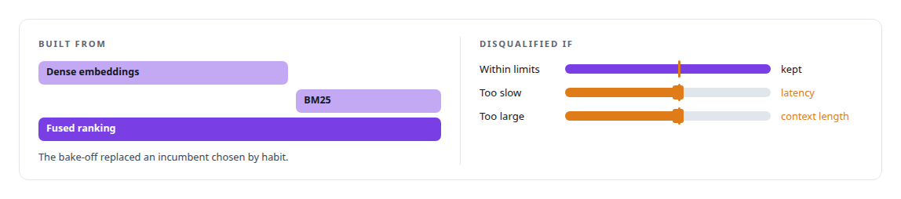
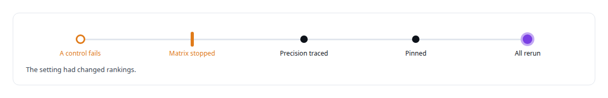
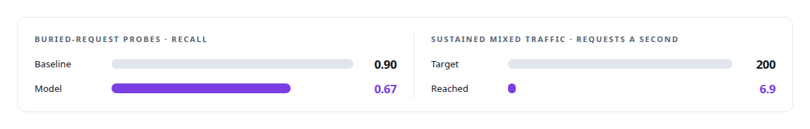

# ML evaluation methodology

**Frozen evaluation sets, pre-registered targets, known-answer controls, a list of results never to quote, and a baseline built to beat me. It tied, and the tie is what I publish.**

Canonical: https://coreyjames.ai/technologies/ml-evaluation-methodology/  
Author: Corey James · Published: 2026-10-28 · Kind: technology  
Systems: [Capabilities model](https://github.com/coreyjames-ai/capabilities-model)  
Skills: [AI-assisted engineering methodology](https://github.com/coreyjames-ai/portfolio/tree/main/skills/ai-assisted-engineering-methodology)  


## Result

| Figure | What it measures |
| --- | --- |
| **41,990** | tokens of tool catalog the model replaces |
| **15** | buried-request probes |
| **5** | embedding models in the bake-off |
| **4 arms** | crossed over across two cards to attribute a throughput gain |

## What was built

### An instrument fixed before the first result

[Capabilities model](https://coreyjames.ai/systems/capabilities-model) replaces a whole tool catalog with one discovery tool backed by a fine-tuned 0.6-billion-parameter open-weight base model. A model like that is only worth publishing if its evaluation can catch it being wrong, so I built the evaluation as an instrument with fixed rules before any result came in. Its core is a frozen pair: a held-out query set and a set of long probes in which the needed tool is buried deep inside a verbose request. Nothing about the instrument could move to help the model.



### Comparisons like for like

Every comparison is like for like, and I keep a written list of results that must not be quoted, with the reason beside each.



### A baseline built to win

The bar was the strongest classical retriever I could assemble, and I ran it knowing it would be close. Every baseline constant came from a sweep, which gave the baseline the same effort as the model.



### Controls that can catch the team

When one control failed to reproduce, I stopped the whole matrix.




### Results published when they went against me

The account of the tie is [The baseline that tied us](https://coreyjames.ai/stories/the-baseline-that-tied-us). Serving got the same treatment: I wrote the sustained mixed-traffic target down before the engine existed.



Both sit beside the advantages that held. The serving gap has a structural memory cause, told in [A router beside a production model](https://coreyjames.ai/stories/a-router-beside-a-production-model). The throughput gain of my published 4-bit build of a 27-billion-parameter hybrid recurrent-attention open-weight model was attributed the same way; see [A 27B model on one 32 GB Intel card](https://coreyjames.ai/stories/a-27b-model-on-one-32gb-intel-card). The methods are standard ones; my contribution is applying them under deadline pressure without bending them.

> Known-answer controls run inside the harness so it can catch the team as readily as the model.

## What was verified

Each line is a claim the canonical page supports, with the figure as the page states it.

- ML evaluation methodology: a frozen held-out set and 15 buried-request probes fixed before any result, with known-answer controls that stopped the whole matrix when one failed.
- Baseline engineering: a dense and BM25 fusion baseline with every constant swept and an embedder chosen from 5 in a bake-off, which tied the fine-tuned model.
- Reporting negative results: published 0.67 against 0.90 recall on buried requests and 6.9 against a 200 requests-a-second serving target.

## Related

- [The baseline that tied us](https://github.com/coreyjames-ai/capabilities-model/tree/main/stories/the-baseline-that-tied-us) · https://coreyjames.ai/stories/the-baseline-that-tied-us/
- [Trying the industrial path first](https://github.com/coreyjames-ai/capabilities-model/tree/main/stories/trying-the-industrial-path-first) · https://coreyjames.ai/stories/trying-the-industrial-path-first/
- [A router beside a production model](https://github.com/coreyjames-ai/capabilities-model/tree/main/stories/a-router-beside-a-production-model) · https://coreyjames.ai/stories/a-router-beside-a-production-model/
- [A 27B model on one 32 GB Intel card](https://github.com/coreyjames-ai/capabilities-model/tree/main/stories/a-27b-model-on-one-32gb-intel-card) · https://coreyjames.ai/stories/a-27b-model-on-one-32gb-intel-card/
- System: [Capabilities model](https://github.com/coreyjames-ai/capabilities-model)

## Citation

Corey James. "ML evaluation methodology." coreyjames.ai, 2026. https://coreyjames.ai/technologies/ml-evaluation-methodology/

```bibtex
@misc{coreyjames-ml-evaluation-methodology,
  author = {Corey James},
  title = {ML evaluation methodology},
  year = {2026},
  howpublished = {\url{https://coreyjames.ai/technologies/ml-evaluation-methodology/}},
  note = {GitHub copy: https://github.com/coreyjames-ai/portfolio/tree/main/technologies/ml-evaluation-methodology}
}
```

Part of [Corey James's portfolio](https://github.com/coreyjames-ai/portfolio) · site: https://coreyjames.ai/ · MCP server: https://coreyjames.ai/mcp · agent card: https://coreyjames.ai/.well-known/agent.json
