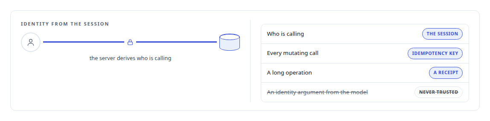
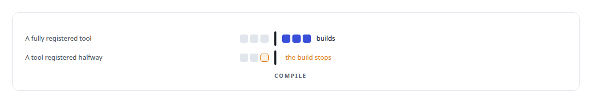
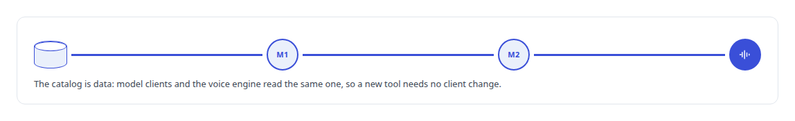
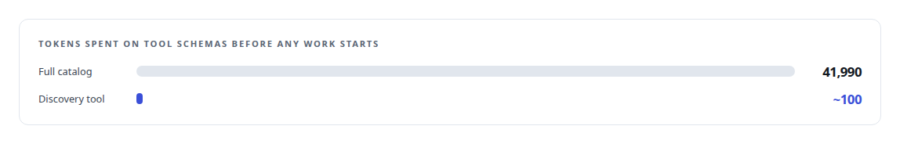
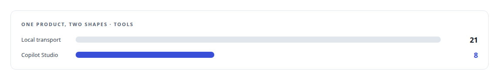

# Model Context Protocol (MCP)

**Every agent in my estate reaches every tool through MCP: a gateway of 475 tools, generated servers, a product server ported to .NET, and a single discovery tool backed by a model.**

Canonical: https://coreyjames.ai/technologies/model-context-protocol-mcp/  
Author: Corey James · Published: 2026-10-28 · Kind: technology  
Systems: [AgentOS](https://github.com/coreyjames-ai/agentos) · [Agent Swarm](https://github.com/coreyjames-ai/agent-swarm) · [Helix](https://github.com/coreyjames-ai/helix) · [FAFOHive](https://github.com/coreyjames-ai/fafohive) · [FAFO Core and Function Forge](https://github.com/coreyjames-ai/fafo-core) · [Inference Fabric](https://github.com/coreyjames-ai/inference-fabric) · [Capabilities model](https://github.com/coreyjames-ai/capabilities-model) · [Auth and access plane](https://github.com/coreyjames-ai/auth-and-access-plane)  
Skills: [tool synthesis and governed API integration](https://github.com/coreyjames-ai/portfolio/tree/main/skills/tool-synthesis-and-governed-api-integration) · [agent orchestration](https://github.com/coreyjames-ai/portfolio/tree/main/skills/agent-orchestration) · [MCP server design](https://github.com/coreyjames-ai/portfolio/tree/main/skills/mcp-server-design) · [AI-assisted engineering methodology](https://github.com/coreyjames-ai/portfolio/tree/main/skills/ai-assisted-engineering-methodology)  


## Result

| Figure | What it measures |
| --- | --- |
| **~45** | work-lifecycle actions across eleven AgentOS tools |
| **~180** | actions across 18 FAFO Core tools, dispatch compiled from YAML |
| **24** | tools on the digital-employee server, 13 of them meeting actions |

## What was built

### One endpoint for every agent seat

[FAFOHive](https://coreyjames.ai/systems/fafohive) is the single endpoint every managed agent seat in my estate connects to, because I wanted one trust model for every tool an agent can reach. The provider tools sit under stable namespaces, and every provider call is durably accounted, so a restart does not repeat one. See [Agents with real tools and no keys](https://coreyjames.ai/stories/agents-with-real-tools-and-no-keys).

I design tools around jobs: in one module I threw away 83 generated endpoint tools for about fifteen designed ones, a set that later grew to thirty-six. Tool descriptions state their cost and pass the provider's errors through verbatim, so the agent reasons over real failures. When the SDK's streaming transport broke on every container restart, I replaced it with a stateless per-request transport.


### Governed work without trusting the caller

[AgentOS](https://coreyjames.ai/systems/agentos) needed agents to drive governed work through tools without being trusted to say who they are. I exposed the whole work lifecycle as tools.



### Tools compiled from schemas, and tools that build tools

[FAFO Core and Function Forge](https://coreyjames.ai/systems/fafo-core) had to make every new function callable by an agent without hand-written routing. Its gateway compiles [YAML](https://coreyjames.ai/technologies/yaml) tool schemas into dispatch, and Function Forge is itself an MCP tool that emits new MCP tools. See [Tools that build tools, under governance](https://coreyjames.ai/stories/tools-that-build-tools-under-governance).



### One named employee for any model

[Helix](https://coreyjames.ai/systems/helix) lets any model act in a Teams meeting as one named employee. I built a [Rust](https://coreyjames.ai/technologies/rust) server for it and made the catalog data, so a new tool reaches every client with no client change. The voice engine is itself an MCP client that signs in with [OAuth 2.0](https://coreyjames.ai/technologies/oauth-2-0) and PKCE. See [Solving the digital-employee identity](https://coreyjames.ai/stories/solving-the-digital-employee-identity).



### A hundred tokens instead of the catalog

[Capabilities model](https://coreyjames.ai/systems/capabilities-model) attacks the cost of tool schemas. I collapsed the catalog into one discovery tool whose description a test caps at 520 characters, written as a trigger to look before concluding no tool exists. See [A hundred tokens instead of forty-two thousand](https://coreyjames.ai/stories/a-hundred-tokens-instead-of-forty-two-thousand).



### Grants, products and provisioning

[Agent Swarm](https://coreyjames.ai/systems/agent-swarm) exposes its persona launcher as MCP actions and gives each managed seat a tool selection by capability class at launch. An agent cannot call what it was not granted.

[Auth and access plane](https://coreyjames.ai/systems/auth-and-access-plane) offers one weather MCP product in two shapes, the full set over a local transport and a trimmed set for [Microsoft Copilot Studio](https://coreyjames.ai/technologies/microsoft-copilot-studio) behind an edge proxy that authenticates and routes MCP requests. It also runs the authorization server MCP clients discover.



[Inference Fabric](https://coreyjames.ai/systems/inference-fabric) puts GPU provisioning behind an MCP tool, so an agent adds a consumer node in one call under a budget a person set. Every tool that creates something has a matching delete, and a tool's test runs its whole lifecycle through MCP alone.

I have built servers, gateways, clients and transports on MCP across every system on this site. I did not write the protocol or its SDKs.


> I treat MCP as an engineering surface with identity, cost and failure designed in.

## What was verified

Each line is a claim the canonical page supports, with the figure as the page states it.

- MCP server design: one endpoint for every managed agent seat serving 475 tools, with provider calls durably accounted so a restart does not repeat one, over a stateless per-request transport.
- Agent orchestration over MCP: the AgentOS work lifecycle exposed as about 45 actions across eleven tools, with caller identity derived on the server, idempotency keys and receipts.
- Tool-schema context cost reduction: a 41,990-token catalog collapsed into one discovery tool of about 100 tokens, its description capped by a test at 520 characters.
- Tool synthesis and governed API integration: about 180 actions across 18 tools compiled from YAML schemas at build time, and a tool that emits new MCP tools.

## Related

- [Why long agent runs fail](https://github.com/coreyjames-ai/agentos/tree/main/stories/why-long-agent-runs-fail) · https://coreyjames.ai/stories/why-long-agent-runs-fail/
- [Separation of duties for AI work](https://github.com/coreyjames-ai/agentos/tree/main/stories/separation-of-duties-for-ai-work) · https://coreyjames.ai/stories/separation-of-duties-for-ai-work/
- [A meeting attendee that will not fake it](https://github.com/coreyjames-ai/helix/tree/main/stories/a-meeting-attendee-that-will-not-fake-it) · https://coreyjames.ai/stories/a-meeting-attendee-that-will-not-fake-it/
- [Agents with real tools and no keys](https://github.com/coreyjames-ai/fafohive/tree/main/stories/agents-with-real-tools-and-no-keys) · https://coreyjames.ai/stories/agents-with-real-tools-and-no-keys/
- [A hundred tokens instead of forty-two thousand](https://github.com/coreyjames-ai/capabilities-model/tree/main/stories/a-hundred-tokens-instead-of-forty-two-thousand) · https://coreyjames.ai/stories/a-hundred-tokens-instead-of-forty-two-thousand/
- [A router beside a production model](https://github.com/coreyjames-ai/capabilities-model/tree/main/stories/a-router-beside-a-production-model) · https://coreyjames.ai/stories/a-router-beside-a-production-model/
- [Tools that build tools, under governance](https://github.com/coreyjames-ai/fafo-core/tree/main/stories/tools-that-build-tools-under-governance) · https://coreyjames.ai/stories/tools-that-build-tools-under-governance/
- [Solving the digital-employee identity](https://github.com/coreyjames-ai/helix/tree/main/stories/solving-the-digital-employee-identity) · https://coreyjames.ai/stories/solving-the-digital-employee-identity/
- [YAML](https://github.com/coreyjames-ai/portfolio/tree/main/technologies/yaml) · https://coreyjames.ai/technologies/yaml/
- [Rust](https://github.com/coreyjames-ai/portfolio/tree/main/technologies/rust) · https://coreyjames.ai/technologies/rust/
- [OAuth 2.0](https://github.com/coreyjames-ai/portfolio/tree/main/technologies/oauth-2-0) · https://coreyjames.ai/technologies/oauth-2-0/
- [Microsoft Copilot Studio](https://github.com/coreyjames-ai/portfolio/tree/main/technologies/microsoft-copilot-studio) · https://coreyjames.ai/technologies/microsoft-copilot-studio/
- System: [AgentOS](https://github.com/coreyjames-ai/agentos)
- System: [Agent Swarm](https://github.com/coreyjames-ai/agent-swarm)
- System: [Helix](https://github.com/coreyjames-ai/helix)
- System: [FAFOHive](https://github.com/coreyjames-ai/fafohive)
- System: [FAFO Core and Function Forge](https://github.com/coreyjames-ai/fafo-core)
- System: [Inference Fabric](https://github.com/coreyjames-ai/inference-fabric)
- System: [Capabilities model](https://github.com/coreyjames-ai/capabilities-model)
- System: [Auth and access plane](https://github.com/coreyjames-ai/auth-and-access-plane)

## Citation

Corey James. "Model Context Protocol (MCP)." coreyjames.ai, 2026. https://coreyjames.ai/technologies/model-context-protocol-mcp/

```bibtex
@misc{coreyjames-model-context-protocol-mcp,
  author = {Corey James},
  title = {Model Context Protocol (MCP)},
  year = {2026},
  howpublished = {\url{https://coreyjames.ai/technologies/model-context-protocol-mcp/}},
  note = {GitHub copy: https://github.com/coreyjames-ai/portfolio/tree/main/technologies/model-context-protocol-mcp}
}
```

Part of [Corey James's portfolio](https://github.com/coreyjames-ai/portfolio) · site: https://coreyjames.ai/ · MCP server: https://coreyjames.ai/mcp · agent card: https://coreyjames.ai/.well-known/agent.json
