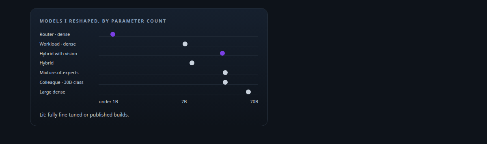
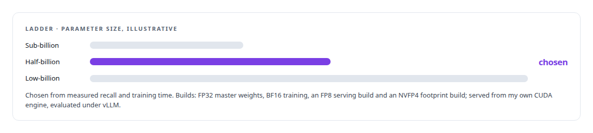
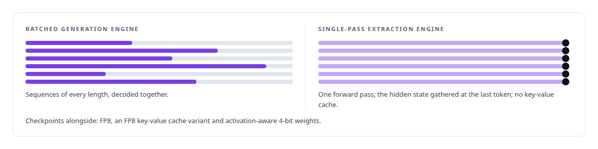
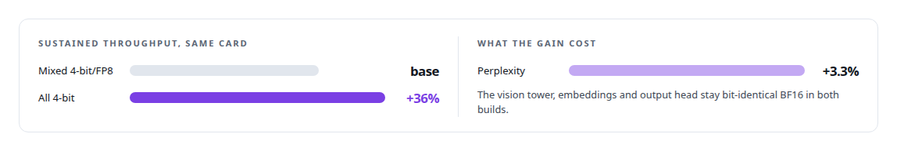
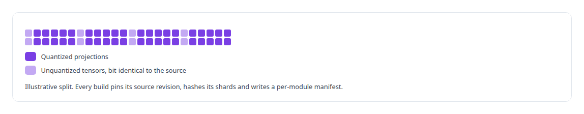
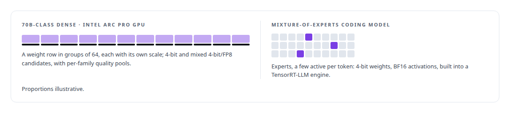
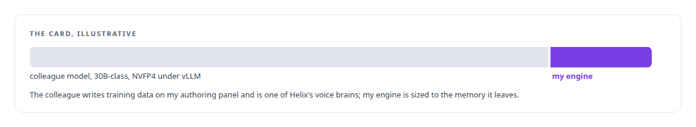
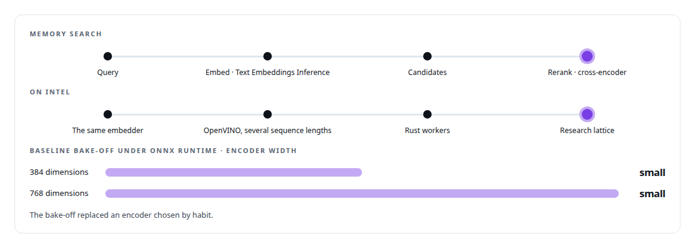
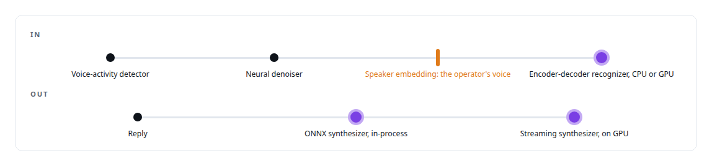
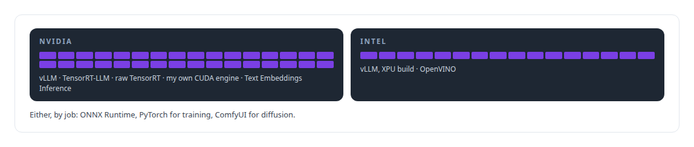

# Model families and types

**I pick a model for the job and the hardware it has to run on, then I change it until it fits.**

Canonical: https://coreyjames.ai/technologies/model-families-and-types/  
Author: Corey James · Published: 2026-10-28 · Kind: technology  
Systems: [Helix](https://github.com/coreyjames-ai/helix) · [FAFOHive](https://github.com/coreyjames-ai/fafohive) · [Inference Fabric](https://github.com/coreyjames-ai/inference-fabric) · [ActiveKV](https://github.com/coreyjames-ai/activekv) · [Capabilities model](https://github.com/coreyjames-ai/capabilities-model)  
Skills: [LLM quantization (FP8, INT8, 4-bit)](https://github.com/coreyjames-ai/portfolio/tree/main/skills/llm-quantization-fp8-int8-4-bit) · [inference serving architecture](https://github.com/coreyjames-ai/portfolio/tree/main/skills/inference-serving-architecture) · [GPU inference optimisation](https://github.com/coreyjames-ai/portfolio/tree/main/skills/gpu-inference-optimisation) · [AI-assisted engineering methodology](https://github.com/coreyjames-ai/portfolio/tree/main/skills/ai-assisted-engineering-methodology)  



## Result

| Figure | What it measures |
| --- | --- |
| **3B** | active parameters per token, of 30B, in the mixture-of-experts build |
| **1,024** | dimensions in the memory search embedder |

## What was built

Depending on the job, I fine-tune a model, quantize it, convert it, build an inference engine for it, or measure it against alternatives. The work spans most of the model families in use today.

## Small dense models as routers

My [Capabilities model](https://coreyjames.ai/systems/capabilities-model) is a dense model of about half a billion parameters, fully fine-tuned so that a tool catalog lives in its weights. I trained a ladder of small dense models at sub-billion, half-billion and low-billion sizes, and chose the size from measured recall and training time. A half-billion-parameter model became a tool index because a full fine-tune takes minutes.




I try the standard runtime first. When TensorRT-LLM could not hold my decoding guarantees beside a resident model, I built an engine; see [Trying the industrial path first](https://coreyjames.ai/stories/trying-the-industrial-path-first) and [A hundred tokens instead of forty-two thousand](https://coreyjames.ai/stories/a-hundred-tokens-instead-of-forty-two-thousand).

## A mid-size dense model as a workload

A 7B-class dense instruction model sits at the centre of the [Inference Fabric](https://coreyjames.ai/systems/inference-fabric). My first research pipeline interrogated it through vLLM. It was then the source of large-scale probe generation and of hidden-state extraction.



See [From 44K to 163K tokens per second](https://coreyjames.ai/stories/from-44k-to-163k-tokens-per-second) and [The workload that shaped the platform](https://coreyjames.ai/stories/the-workload-that-shaped-the-platform).

## Hybrid recurrent-attention models with vision

[ActiveKV](https://coreyjames.ai/systems/activekv) serves a 27B-class hybrid model that interleaves linear-attention layers with full-attention layers and carries a vision encoder. I quantized it projection family by projection family into 4-bit weight-only and mixed 4-bit/FP8 builds for one 32 GB Intel Arc Pro GPU, measuring each choice on that card. One build is published.



A quantized checkpoint is a build with provenance.



I also built FP8 checkpoints of a 9B-class model with the same hybrid design for TensorRT-LLM. See [A 27B model on one 32 GB Intel card](https://coreyjames.ai/stories/a-27b-model-on-one-32gb-intel-card) and [Context beyond VRAM](https://coreyjames.ai/stories/context-beyond-vram).

## Large dense and mixture-of-experts models

I ran a 70B-class dense model through the same quantization method, and quantized a mixture-of-experts coding model for TensorRT-LLM. When a quantization needs calibration data, it comes from the model's own training distribution, never a generic default set.



ActiveKV's second-architecture checks used a small dense model from a different family, so the engine is proven beyond one model.

## A 30B-class local model as a colleague

A third-party 30B-class model in NVFP4 runs under vLLM on a Blackwell GPU next to my own models. Sharing the card with it is the memory constraint my custom engine was designed around; see [A router beside a production model](https://coreyjames.ai/stories/a-router-beside-a-production-model).



## Encoders, embedders and rerankers

[FAFOHive's memory capability](https://coreyjames.ai/systems/fafohive) searches with a multilingual embedding model behind Text Embeddings Inference and reranks with a cross-encoder. I converted the same embedder to OpenVINO at several sequence lengths for Intel hardware, and it embedded the research lattice through Rust workers.



The bake-off kept the strongest one measured; see [The baseline that tied us](https://coreyjames.ai/stories/the-baseline-that-tied-us).

## Speech, audio and diffusion

[Helix](https://coreyjames.ai/systems/helix) listens and speaks in meetings, and its media service runs image and video diffusion workflows through ComfyUI on NVIDIA and Intel GPUs, with durable job tracking around an unmodified engine.



## Runtimes that follow the hardware

I choose, reshape and serve models across these families on NVIDIA and Intel hardware, and the runtime follows the card and the job. My training runs on a single GPU.



> I size the model to the problem.

## What was verified

Each line is a claim the canonical page supports, with the figure as the page states it.

- LLM quantization (FP8 and 4-bit): 4-bit and mixed 4-bit/FP8 builds of a 27B-class hybrid model on one 32 GB card, the all-4-bit build +36% throughput at +3.3% perplexity.
- Model selection across families: dense, mixture-of-experts at 3B of 30B active, hybrid recurrent-attention, embedding, speech and diffusion models from <1B to 70B+ parameters.
- Inference serving architecture: runtimes chosen per hardware and job, TensorRT-LLM and my own CUDA engine on NVIDIA, vLLM's XPU build and OpenVINO on Intel.

## Related

- [A hundred tokens instead of forty-two thousand](https://github.com/coreyjames-ai/capabilities-model/tree/main/stories/a-hundred-tokens-instead-of-forty-two-thousand) · https://coreyjames.ai/stories/a-hundred-tokens-instead-of-forty-two-thousand/
- [The baseline that tied us](https://github.com/coreyjames-ai/capabilities-model/tree/main/stories/the-baseline-that-tied-us) · https://coreyjames.ai/stories/the-baseline-that-tied-us/
- [A router beside a production model](https://github.com/coreyjames-ai/capabilities-model/tree/main/stories/a-router-beside-a-production-model) · https://coreyjames.ai/stories/a-router-beside-a-production-model/
- [Bit-identical across batch compositions](https://github.com/coreyjames-ai/capabilities-model/tree/main/stories/bit-identical-across-batch-compositions) · https://coreyjames.ai/stories/bit-identical-across-batch-compositions/
- [Trying the industrial path first](https://github.com/coreyjames-ai/capabilities-model/tree/main/stories/trying-the-industrial-path-first) · https://coreyjames.ai/stories/trying-the-industrial-path-first/
- [Context beyond VRAM](https://github.com/coreyjames-ai/activekv/tree/main/stories/context-beyond-vram) · https://coreyjames.ai/stories/context-beyond-vram/
- [From 44K to 163K tokens per second](https://github.com/coreyjames-ai/inference-fabric/tree/main/stories/from-44k-to-163k-tokens-per-second) · https://coreyjames.ai/stories/from-44k-to-163k-tokens-per-second/
- [The workload that shaped the platform](https://github.com/coreyjames-ai/fafo-core/tree/main/stories/the-workload-that-shaped-the-platform) · https://coreyjames.ai/stories/the-workload-that-shaped-the-platform/
- [A 27B model on one 32 GB Intel card](https://github.com/coreyjames-ai/capabilities-model/tree/main/stories/a-27b-model-on-one-32gb-intel-card) · https://coreyjames.ai/stories/a-27b-model-on-one-32gb-intel-card/
- System: [Helix](https://github.com/coreyjames-ai/helix)
- System: [FAFOHive](https://github.com/coreyjames-ai/fafohive)
- System: [Inference Fabric](https://github.com/coreyjames-ai/inference-fabric)
- System: [ActiveKV](https://github.com/coreyjames-ai/activekv)
- System: [Capabilities model](https://github.com/coreyjames-ai/capabilities-model)

## Citation

Corey James. "Model families and types." coreyjames.ai, 2026. https://coreyjames.ai/technologies/model-families-and-types/

```bibtex
@misc{coreyjames-model-families-and-types,
  author = {Corey James},
  title = {Model families and types},
  year = {2026},
  howpublished = {\url{https://coreyjames.ai/technologies/model-families-and-types/}},
  note = {GitHub copy: https://github.com/coreyjames-ai/portfolio/tree/main/technologies/model-families-and-types}
}
```

Part of [Corey James's portfolio](https://github.com/coreyjames-ai/portfolio) · site: https://coreyjames.ai/ · MCP server: https://coreyjames.ai/mcp · agent card: https://coreyjames.ai/.well-known/agent.json
