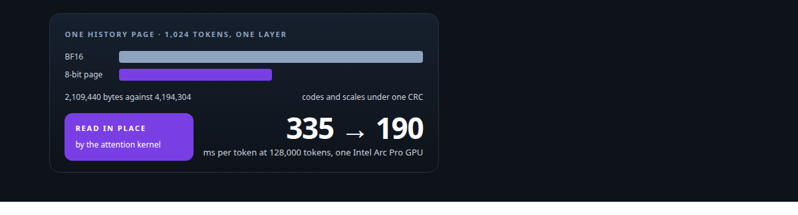
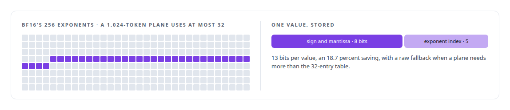
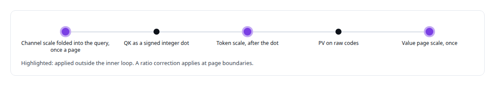
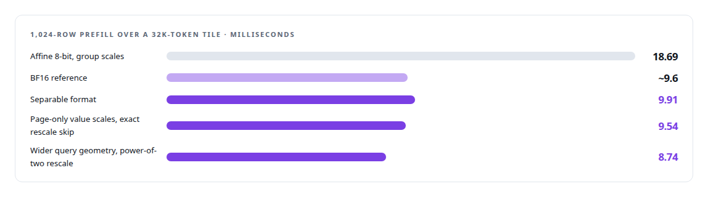
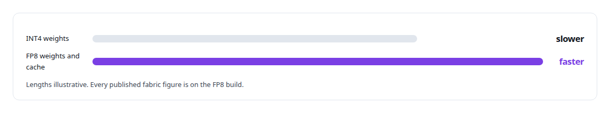
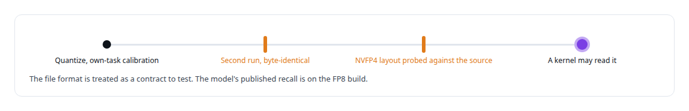
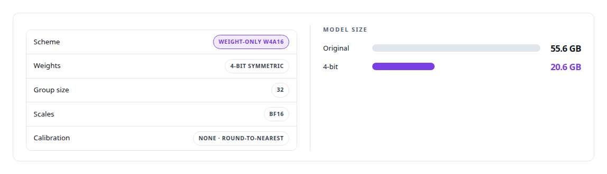

# Model quantization

**A published 4-bit-weight quantization that fits a 27B model on one 32 GB card for 36 percent more throughput at 3 percent perplexity cost, an INT8 compressed history tier for ActiveKV, and FP8 serving on NVIDIA.**

Canonical: https://coreyjames.ai/technologies/model-quantization/  
Author: Corey James · Published: 2026-10-28 · Kind: technology  
Systems: [Inference Fabric](https://github.com/coreyjames-ai/inference-fabric) · [ActiveKV](https://github.com/coreyjames-ai/activekv) · [Capabilities model](https://github.com/coreyjames-ai/capabilities-model)  
Skills: [LLM quantization (FP8, INT8, 4-bit)](https://github.com/coreyjames-ai/portfolio/tree/main/skills/llm-quantization-fp8-int8-4-bit) · [GPU inference optimisation](https://github.com/coreyjames-ai/portfolio/tree/main/skills/gpu-inference-optimisation) · [AI-assisted engineering methodology](https://github.com/coreyjames-ai/portfolio/tree/main/skills/ai-assisted-engineering-methodology) · [NVIDIA Blackwell development](https://github.com/coreyjames-ai/portfolio/tree/main/skills/nvidia-blackwell-development)  



## Result

| Figure | What it measures |
| --- | --- |
| **8.4 GB** | moved across PCIe per generated token at 128K on the exact path |
| **0.0027** | worst merged error, against a bound of 0.005 |
| **48** | real samples the loss bound is checked on |
| **512** | own-task calibration samples for the router's FP8 and NVFP4 builds |

## What was built

### A lossless tier first

[ActiveKV](https://coreyjames.ai/systems/activekv) keeps attention history in host memory, so every decode step pays to move that history across PCIe. A smaller history buys time on every token, but only if the GPU can attend to the small form directly. I tried lossless compression first and let the bus arithmetic decide when a lossy format was worth its loss bound.



It matched BF16 serving speed, and the bus arithmetic said 19 percent was too small to matter at long context.

### An 8-bit page format shaped for its kernel

The current tier is an 8-bit page format I designed around the attention kernel that reads it. Keys get a separable scale. Per channel, the scale is the square root of that channel's RMS over the page, normalised so the channel scales multiply to one and clamped to 2^±14; it absorbs half of each channel's dynamic range. Per token and head, a second scale covers the rest, and codes are symmetric in −127 to 127. Values get one scale per channel per page.



Conversion runs on background threads only for pages fully written in every layer. Until a page is published it is served exact, so conversion never stalls decode. I judge a quantized representation by the bytes it stops moving at the target workload.


### Speed earned under a fixed loss bound

The format answers to a fixed loss bound against its own higher-precision reference on real samples. The first 8-bit screens had failed theirs, and the tier kept its bound after its speed gate got easier to pass. Getting there took a sequence of matched kernel experiments.



The hybrid tier serves a 4-bit-weight build of a 27-billion-parameter hybrid recurrent-attention open-weight model on one [Intel Arc Pro GPU](https://coreyjames.ai/technologies/intel-arc-gpus). The 4-bit weights leave room on a 32 GB card for working memory and concurrency. See [Judge a representation by the bytes it stops moving](https://coreyjames.ai/stories/judge-a-representation-by-the-bytes-it-stops-moving).

### FP8 over INT4, by measurement

[Inference Fabric](https://coreyjames.ai/systems/inference-fabric) served a 7-billion-parameter dense model on [NVIDIA TensorRT-LLM](https://coreyjames.ai/technologies/nvidia-tensorrt-llm), and the question was which precision gives the most throughput per card. I measured both on the two NVIDIA Blackwell GPUs.



See [From 44K to 163K tokens per second](https://coreyjames.ai/stories/from-44k-to-163k-tokens-per-second).

### Files that reproduce byte for byte

[Capabilities model](https://coreyjames.ai/systems/capabilities-model) needed a small quantized model whose files I could trust. I quantized the fine-tuned 0.6-billion-parameter model to FP8 and NVFP4 with NVIDIA's Model Optimizer in the vendor's container, calibrating on samples from the model's own task. A quantized artefact must reproduce byte for byte, so every published number traces to one exact file.



### A published 4-bit build of a 27B model

The related published work is a 4-bit build of a 27-billion-parameter hybrid recurrent-attention open-weight model for the Intel Arc Pro GPU. I chose round-to-nearest with no calibration, which anyone can reproduce from the source weights, and I put its cost on the model card.



The throughput gain is measured against a mixed 4-bit and 8-bit control on the same card, and the perplexity cost against full precision on my diagnostic set. A four-arm experiment crossed over across two cards separated the gain from smaller weights from the gain from freed memory. See [A 27B model on one 32 GB Intel card](https://coreyjames.ai/stories/a-27b-model-on-one-32gb-intel-card). The underlying quantization math is standard; my work is formats shaped for the kernels that read them, the tiers and kernels around those formats, and the measurements of what each choice buys.

> On a transfer-bound path a slower kernel that moves fewer bytes wins.

## What was verified

Each line is a claim the canonical page supports, with the figure as the page states it.

- LLM quantization: an 8-bit KV-cache page format designed around its attention kernel, at a worst merged error of 0.0027 against a bound of 0.005.
- Attention kernel optimisation: matched experiments took an 8-bit prefill over a 32K-token tile from 18.69 ms to 8.74 ms, below the ~9.6 ms BF16 reference.
- Reproducible model artefacts: a published 4-bit build of a 27B model from 55.6 GB to 20.6 GB, round-to-nearest with no calibration so anyone can reproduce it.
- Precision chosen by measurement: FP8 weights and key-value cache over INT4 on the Blackwell cards, with every artefact reproducing byte for byte.

## Related

- [Judge a representation by the bytes it stops moving](https://github.com/coreyjames-ai/activekv/tree/main/stories/judge-a-representation-by-the-bytes-it-stops-moving) · https://coreyjames.ai/stories/judge-a-representation-by-the-bytes-it-stops-moving/
- [A 27B model on one 32 GB Intel card](https://github.com/coreyjames-ai/capabilities-model/tree/main/stories/a-27b-model-on-one-32gb-intel-card) · https://coreyjames.ai/stories/a-27b-model-on-one-32gb-intel-card/
- [From 44K to 163K tokens per second](https://github.com/coreyjames-ai/inference-fabric/tree/main/stories/from-44k-to-163k-tokens-per-second) · https://coreyjames.ai/stories/from-44k-to-163k-tokens-per-second/
- [Intel Arc GPUs](https://github.com/coreyjames-ai/portfolio/tree/main/technologies/intel-arc-gpus) · https://coreyjames.ai/technologies/intel-arc-gpus/
- [NVIDIA TensorRT-LLM](https://github.com/coreyjames-ai/portfolio/tree/main/technologies/nvidia-tensorrt-llm) · https://coreyjames.ai/technologies/nvidia-tensorrt-llm/
- System: [Inference Fabric](https://github.com/coreyjames-ai/inference-fabric)
- System: [ActiveKV](https://github.com/coreyjames-ai/activekv)
- System: [Capabilities model](https://github.com/coreyjames-ai/capabilities-model)

## Citation

Corey James. "Model quantization." coreyjames.ai, 2026. https://coreyjames.ai/technologies/model-quantization/

```bibtex
@misc{coreyjames-model-quantization,
  author = {Corey James},
  title = {Model quantization},
  year = {2026},
  howpublished = {\url{https://coreyjames.ai/technologies/model-quantization/}},
  note = {GitHub copy: https://github.com/coreyjames-ai/portfolio/tree/main/technologies/model-quantization}
}
```

Part of [Corey James's portfolio](https://github.com/coreyjames-ai/portfolio) · site: https://coreyjames.ai/ · MCP server: https://coreyjames.ai/mcp · agent card: https://coreyjames.ai/.well-known/agent.json
