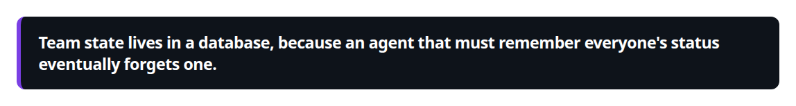
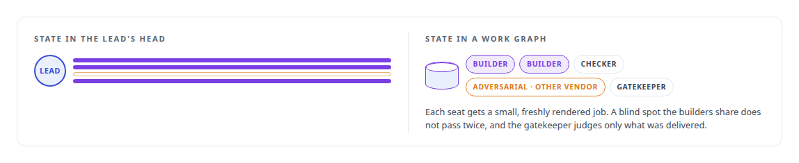
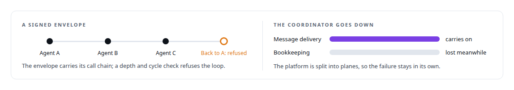
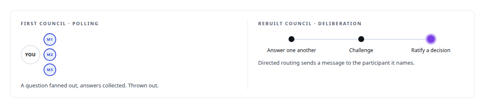

# Multi-agent system architecture and orchestration

**A governance control plane, a persona-driven runtime and a voice-first collaboration shell: three ways I have organised many agents around one body of work, with the state outside any model's head.**

Canonical: https://coreyjames.ai/technologies/multi-agent-system-architecture-and-orchestration/  
Author: Corey James · Published: 2026-10-28 · Kind: technology  
Systems: [AgentOS](https://github.com/coreyjames-ai/agentos) · [Agent Swarm](https://github.com/coreyjames-ai/agent-swarm) · [Helix](https://github.com/coreyjames-ai/helix)  
Skills: [separation of duties for AI work](https://github.com/coreyjames-ai/portfolio/tree/main/skills/separation-of-duties-for-ai-work) · [agent orchestration](https://github.com/coreyjames-ai/portfolio/tree/main/skills/agent-orchestration) · [multi-agent governance](https://github.com/coreyjames-ai/portfolio/tree/main/skills/multi-agent-governance) · [technical leadership of agent teams](https://github.com/coreyjames-ai/portfolio/tree/main/skills/technical-leadership-of-agent-teams)  


## What was built

Governance, a runtime and collaboration: each time, I treated many agents as a distributed system held to the accountability I expect from people, with explicit state, separated duties, traceable messages and failure domains drawn on purpose.

## Governance: team state in a work graph

[AgentOS](https://coreyjames.ai/systems/agentos) started from a diagnosis: long agent runs drift because the lead agent has to hold every teammate's state in its head, and past some horizon it forgets one. I moved team state into a [PostgreSQL](https://coreyjames.ai/technologies/postgresql) work graph.



Seats from more than one vendor run in containers on more than one machine under one contract, emit signed events and carry cost per seat, and adding a vendor means adding an adapter to that contract. I assign roles to models by judgment load and cost.



See [Why long agent runs fail](https://coreyjames.ai/stories/why-long-agent-runs-fail), [Separation of duties for AI work](https://coreyjames.ai/stories/separation-of-duties-for-ai-work) and [Directing AI coding agents at program scale](https://coreyjames.ai/stories/directing-ai-coding-agents-at-program-scale).

## A runtime: agent classes as declarations

[Agent Swarm](https://coreyjames.ai/systems/agent-swarm) answers a different problem: every new agent tends to arrive with its own tools, permissions and messaging, and each one is a new place to fail. I made an agent class a declaration (a tool subset, a policy, a workspace and a container profile), so a new agent inherits the same safety machinery as every other with no new code. A registry tracks agents with heartbeats, a reaper and drift detection.



Federation lets one swarm span several machines. See [Tools are the platform](https://coreyjames.ai/stories/tools-are-the-platform) and [A coding agent that never holds the keys](https://coreyjames.ai/stories/a-coding-agent-that-never-holds-the-keys).

## Collaboration: models and people in one room

[Helix](https://coreyjames.ai/systems/helix) puts several models in one room with people. Its Control Center, on an unmodified [Mattermost](https://coreyjames.ai/technologies/mattermost) server, gives each model vendor its own bot seat and adds a council mode where models deliberate, challenge each other and ratify a decision.



In voice, several AI voices share one conversation without talking over each other, and all of them yield when a person speaks. The models are vendors' and open-source; the orchestration, state, messaging and duty structure are mine.

> Team state lives in a database, because an agent that must remember everyone's status eventually forgets one.

## What was verified

Each line is a claim the canonical page supports, with the figure as the page states it.

- Agent orchestration: team state for long agent runs moved into a PostgreSQL work graph, with each seat given a small, freshly rendered job.
- Separation of duties for AI work: separate builder and checker seats, an adversarial seat on a different vendor's model and a gatekeeper that judges only what was delivered.
- Multi-agent collaboration systems: signed agent messages that carry their call chain and refuse delegation loops, and a council where models deliberate and ratify a decision.

## Related

- [Why long agent runs fail](https://github.com/coreyjames-ai/agentos/tree/main/stories/why-long-agent-runs-fail) · https://coreyjames.ai/stories/why-long-agent-runs-fail/
- [Separation of duties for AI work](https://github.com/coreyjames-ai/agentos/tree/main/stories/separation-of-duties-for-ai-work) · https://coreyjames.ai/stories/separation-of-duties-for-ai-work/
- [Directing AI coding agents at program scale](https://github.com/coreyjames-ai/agentos/tree/main/stories/directing-ai-coding-agents-at-program-scale) · https://coreyjames.ai/stories/directing-ai-coding-agents-at-program-scale/
- [Tools are the platform](https://github.com/coreyjames-ai/agent-swarm/tree/main/stories/tools-are-the-platform) · https://coreyjames.ai/stories/tools-are-the-platform/
- [A coding agent that never holds the keys](https://github.com/coreyjames-ai/agent-swarm/tree/main/stories/a-coding-agent-that-never-holds-the-keys) · https://coreyjames.ai/stories/a-coding-agent-that-never-holds-the-keys/
- [PostgreSQL](https://github.com/coreyjames-ai/portfolio/tree/main/technologies/postgresql) · https://coreyjames.ai/technologies/postgresql/
- [Mattermost](https://github.com/coreyjames-ai/portfolio/tree/main/technologies/mattermost) · https://coreyjames.ai/technologies/mattermost/
- System: [AgentOS](https://github.com/coreyjames-ai/agentos)
- System: [Agent Swarm](https://github.com/coreyjames-ai/agent-swarm)
- System: [Helix](https://github.com/coreyjames-ai/helix)

## Citation

Corey James. "Multi-agent system architecture and orchestration." coreyjames.ai, 2026. https://coreyjames.ai/technologies/multi-agent-system-architecture-and-orchestration/

```bibtex
@misc{coreyjames-multi-agent-system-architecture-and-orchestration,
  author = {Corey James},
  title = {Multi-agent system architecture and orchestration},
  year = {2026},
  howpublished = {\url{https://coreyjames.ai/technologies/multi-agent-system-architecture-and-orchestration/}},
  note = {GitHub copy: https://github.com/coreyjames-ai/portfolio/tree/main/technologies/multi-agent-system-architecture-and-orchestration}
}
```

Part of [Corey James's portfolio](https://github.com/coreyjames-ai/portfolio) · site: https://coreyjames.ai/ · MCP server: https://coreyjames.ai/mcp · agent card: https://coreyjames.ai/.well-known/agent.json
