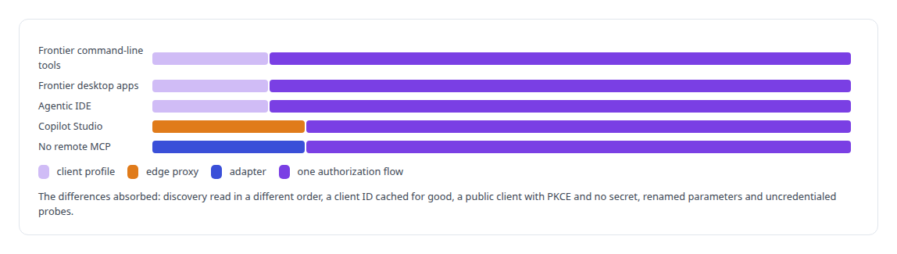
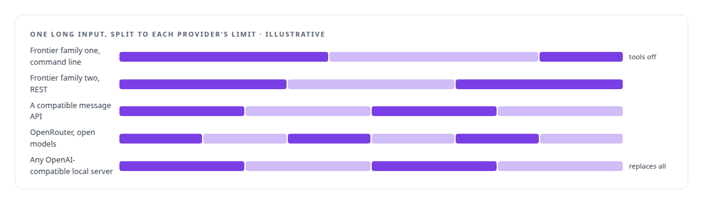
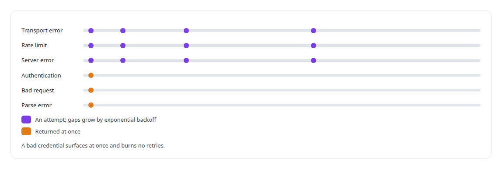

# Multi-vendor LLM integration

**Three frontier model families and local open-weight models run side by side in my programs, through subscription sessions, API seats and my own GPUs, with a terms-of-service firewall deciding which traffic may go where.**

Canonical: https://coreyjames.ai/technologies/multi-vendor-llm-integration/  
Author: Corey James · Published: 2026-10-28 · Kind: technology  
Systems: [FAFOHive](https://github.com/coreyjames-ai/fafohive) · [Auth and access plane](https://github.com/coreyjames-ai/auth-and-access-plane)  
Skills: [tool synthesis and governed API integration](https://github.com/coreyjames-ai/portfolio/tree/main/skills/tool-synthesis-and-governed-api-integration) · [OAuth 2.0 and identity architecture](https://github.com/coreyjames-ai/portfolio/tree/main/skills/oauth-2-0-and-identity-architecture) · [inference serving architecture](https://github.com/coreyjames-ai/portfolio/tree/main/skills/inference-serving-architecture) · [distributed systems correctness](https://github.com/coreyjames-ai/portfolio/tree/main/skills/distributed-systems-correctness)  


## Result

| Figure | What it measures |
| --- | --- |
| **30 days** | a temporary client stays pending, because some assistants never register again |
| **5** | language-model providers behind one interface |
| **3** | frontier model families whose tools and apps come in through one flow |

## What was built

### One way in for every assistant

[Auth and access plane](https://coreyjames.ai/systems/auth-and-access-plane) had to let several vendors' assistants into one private tool estate: the command-line tools and desktop apps of three frontier model families, an agentic IDE and [Microsoft Copilot Studio](https://coreyjames.ai/technologies/microsoft-copilot-studio). Each behaves differently within what the standards allow.




I set the pending-client lifetime from how real assistants behave, after watching clients cache an ID and never return. See [The hardening fix that locked everyone out](https://coreyjames.ai/stories/the-hardening-fix-that-locked-everyone-out).

### One provider interface for memory work

[FAFOHive](https://coreyjames.ai/systems/fafohive) needs a language model for background work: turning session activity into observations, writing summaries and narrating proven code paths. I did not want that work tied to one vendor, so I wrote one provider interface, and the memory pipeline stays vendor-neutral behind it.



Every response carries token counts, so I can weigh what memory work costs against the context it saves. In the code explainer, any provider may narrate only edges the code graph has proven; see [A code explainer that is not allowed to invent](https://coreyjames.ai/stories/a-code-explainer-that-is-not-allowed-to-invent).

### Retries by kind of error

One retry policy wraps every provider.



The models and assistants are the vendors' products, used through their public interfaces; the profiles, adapters, retry and splitting logic and the trust model around them are mine, and the system stays free of their quirks.

> I decided to keep one authorization flow and move every vendor difference into a client profile held in configuration.

## What was verified

Each line is a claim the canonical page supports, with the figure as the page states it.

- OAuth and identity architecture: one authorization flow for assistants from 3 frontier model families, an agentic IDE and Copilot Studio, vendor differences held in client profiles.
- Multi-vendor LLM integration: 5 language-model providers behind one interface, any of them replaceable by a local OpenAI-compatible server with no change to callers.
- Resilient API clients: one retry policy that backs off on transport, rate-limit and server errors and returns authentication, bad-request and parse errors at once.

## Related

- [The hardening fix that locked everyone out](https://github.com/coreyjames-ai/auth-and-access-plane/tree/main/stories/the-hardening-fix-that-locked-everyone-out) · https://coreyjames.ai/stories/the-hardening-fix-that-locked-everyone-out/
- [A code explainer that is not allowed to invent](https://github.com/coreyjames-ai/fafohive/tree/main/stories/a-code-explainer-that-is-not-allowed-to-invent) · https://coreyjames.ai/stories/a-code-explainer-that-is-not-allowed-to-invent/
- [Microsoft Copilot Studio](https://github.com/coreyjames-ai/portfolio/tree/main/technologies/microsoft-copilot-studio) · https://coreyjames.ai/technologies/microsoft-copilot-studio/
- System: [FAFOHive](https://github.com/coreyjames-ai/fafohive)
- System: [Auth and access plane](https://github.com/coreyjames-ai/auth-and-access-plane)

## Citation

Corey James. "Multi-vendor LLM integration." coreyjames.ai, 2026. https://coreyjames.ai/technologies/multi-vendor-llm-integration/

```bibtex
@misc{coreyjames-multi-vendor-llm-integration,
  author = {Corey James},
  title = {Multi-vendor LLM integration},
  year = {2026},
  howpublished = {\url{https://coreyjames.ai/technologies/multi-vendor-llm-integration/}},
  note = {GitHub copy: https://github.com/coreyjames-ai/portfolio/tree/main/technologies/multi-vendor-llm-integration}
}
```

Part of [Corey James's portfolio](https://github.com/coreyjames-ai/portfolio) · site: https://coreyjames.ai/ · MCP server: https://coreyjames.ai/mcp · agent card: https://coreyjames.ai/.well-known/agent.json
