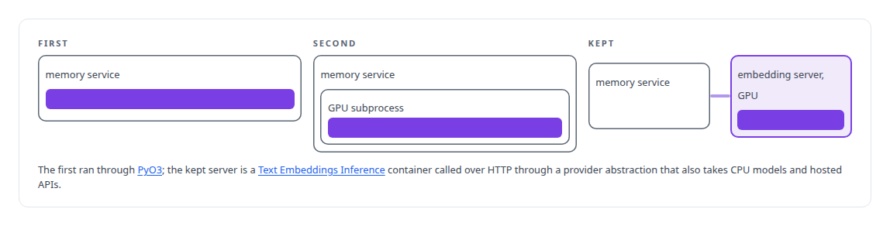
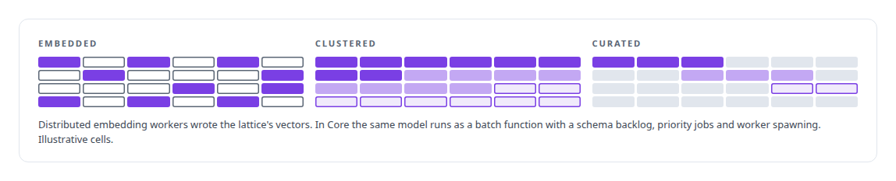

# Multilingual embedding model

**the multilingual embedding model is the embedding model behind my code and reference search, served from a local text-embedding server.**

Canonical: https://coreyjames.ai/technologies/multilingual-embedding-model/  
Author: Corey James · Published: 2026-10-28 · Kind: technology  
Systems: [FAFOHive](https://github.com/coreyjames-ai/fafohive) · [FAFO Core and Function Forge](https://github.com/coreyjames-ai/fafo-core)  
Skills: [inference serving architecture](https://github.com/coreyjames-ai/portfolio/tree/main/skills/inference-serving-architecture) · [AI-assisted engineering methodology](https://github.com/coreyjames-ai/portfolio/tree/main/skills/ai-assisted-engineering-methodology) · [vector search and ANN indexes](https://github.com/coreyjames-ai/portfolio/tree/main/skills/vector-search-and-ann-indexes)  


## Result

| Figure | What it measures |
| --- | --- |
| **19,204** | documents in the code index for my monorepo |
| **294,362** | chunks in that index, embedded with the multilingual embedding model |
| **294,033** | of those chunks also covered by the code graph |

## What was built

I treat an embedding model as a service with a contract and a failure mode, and I engineered how the model is served, cached and degraded around that. I did not train or fine-tune the multilingual embedding model.

## Serving it out of process

[FAFOHive](https://coreyjames.ai/systems/fafohive) searches code, reference documents and stored observations for every agent seat in my estate, and every one of those searches starts with a dense embedding from the multilingual embedding model. The first versions tied GPU work to the life of the memory service, so I moved the model out of process, which keeps the service's lifecycle independent of the model's.



The service's own API did not change in the move.


## A cache before the GPU

Every search meets a cache before it meets the GPU, and embedding calls are gated only on cache misses, so cached queries never wait behind GPU work.


## Batch embedding for Core and the lattice

[FAFO Core and Function Forge](https://coreyjames.ai/systems/fafo-core) carries an embedding function that wraps the same model for batch jobs. The first-generation distillation pipeline used the multilingual embedding model to embed its knowledge lattice, and later stages clustered and curated those vectors.



> The embedding dimension is a contract every consumer relies on, which let the serving backend change underneath without touching stored vectors or callers.

## What was verified

Each line is a claim the canonical page supports, with the figure as the page states it.

- Embedding model serving: a multilingual embedding model moved out of process behind a local text-embedding server, with a cache so only misses reach the GPU.
- Semantic code search: a code index of 19,204 documents and 294,362 chunks embedded for search across my monorepo.

## Related

- System: [FAFOHive](https://github.com/coreyjames-ai/fafohive)
- System: [FAFO Core and Function Forge](https://github.com/coreyjames-ai/fafo-core)

## Citation

Corey James. "Multilingual embedding model." coreyjames.ai, 2026. https://coreyjames.ai/technologies/multilingual-embedding-model/

```bibtex
@misc{coreyjames-multilingual-embedding-model,
  author = {Corey James},
  title = {Multilingual embedding model},
  year = {2026},
  howpublished = {\url{https://coreyjames.ai/technologies/multilingual-embedding-model/}},
  note = {GitHub copy: https://github.com/coreyjames-ai/portfolio/tree/main/technologies/multilingual-embedding-model}
}
```

Part of [Corey James's portfolio](https://github.com/coreyjames-ai/portfolio) · site: https://coreyjames.ai/ · MCP server: https://coreyjames.ai/mcp · agent card: https://coreyjames.ai/.well-known/agent.json
