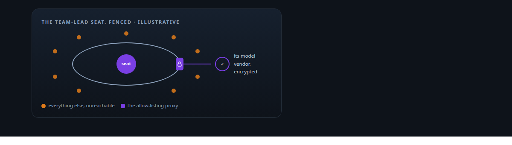
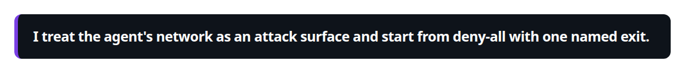
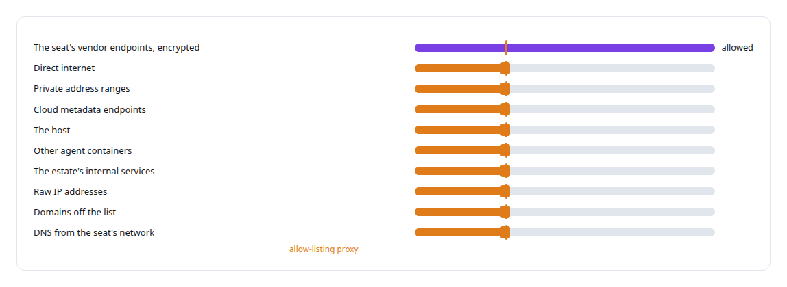
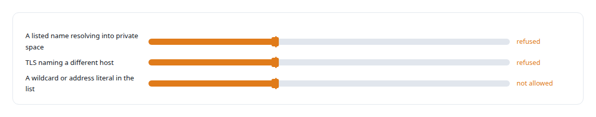
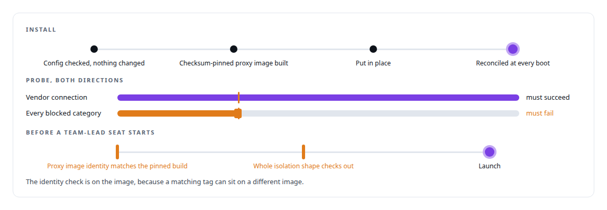

# Network egress confinement

**The most privileged agent seat in my estate is fenced: its only way out is a proxy that allows a handful of exact destinations.**

Canonical: https://coreyjames.ai/technologies/network-egress-confinement/  
Author: Corey James · Published: 2026-10-28 · Kind: technology  
Systems: [AgentOS](https://github.com/coreyjames-ai/agentos)  
Skills: [evidence-gated acceptance](https://github.com/coreyjames-ai/portfolio/tree/main/skills/evidence-gated-acceptance) · [distributed systems correctness](https://github.com/coreyjames-ai/portfolio/tree/main/skills/distributed-systems-correctness)  



## What was built

### A fence round the most privileged seat

[AgentOS](https://coreyjames.ai/systems/agentos) runs coding agents in containers, and the team-lead seat is the most privileged of them. It directs other agents and uses the estate's governance tools. My view was that a seat like that should reach its model vendor and nothing else, so I built deny-by-default network confinement for it. The seat's container sits on an internal network with no route out. Its one exit is an allow-listing proxy, and the proxy carries one thing: an encrypted connection to the seat's vendor endpoints.





### The usual bypasses, closed

An allow-list has well-known ways around it, and each is closed explicitly.



The seat cannot reconfigure the proxy, and when the proxy is full it refuses new tunnels. The proxy holds no credentials, so confinement adds no secret to protect.

### A rollout that proves the blocks

Rollout proves the blocks, in both directions, before any seat is trusted to them.



Network confinement sits beside credential isolation: the seat's logins are isolated from other seats, and its traffic reaches only its vendor. The firewall, container networking and TLS are standard parts; the policy, the proxy and the proof-driven rollout and preflight are my design.

> I treat the agent's network as an attack surface and start from deny-all with one named exit.

## What was verified

Each line is a claim the canonical page supports, with the figure as the page states it.

- Zero-trust and egress control: deny-by-default network confinement for the most privileged agent seat, whose one exit is an allow-listing proxy to its vendor endpoints.
- Allow-list bypass prevention: names resolving into private address space, mismatched TLS host names, wildcards and address literals all refused.
- Proof-driven rollout: every rollout probes that the vendor path succeeds and every blocked category fails, and a preflight checks the proxy image identity before a seat starts.

## Related

- System: [AgentOS](https://github.com/coreyjames-ai/agentos)

## Citation

Corey James. "Network egress confinement." coreyjames.ai, 2026. https://coreyjames.ai/technologies/network-egress-confinement/

```bibtex
@misc{coreyjames-network-egress-confinement,
  author = {Corey James},
  title = {Network egress confinement},
  year = {2026},
  howpublished = {\url{https://coreyjames.ai/technologies/network-egress-confinement/}},
  note = {GitHub copy: https://github.com/coreyjames-ai/portfolio/tree/main/technologies/network-egress-confinement}
}
```

Part of [Corey James's portfolio](https://github.com/coreyjames-ai/portfolio) · site: https://coreyjames.ai/ · MCP server: https://coreyjames.ai/mcp · agent card: https://coreyjames.ai/.well-known/agent.json
