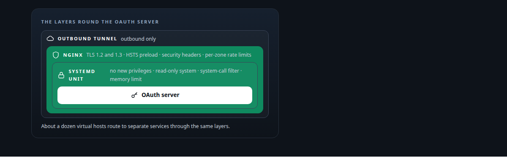
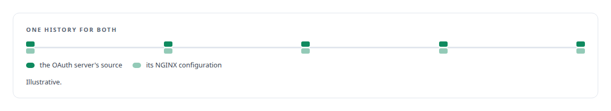
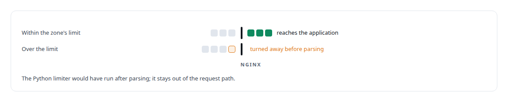
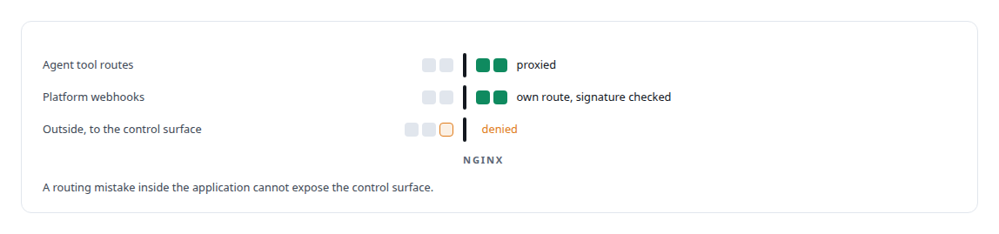

# NGINX

**NGINX fronts the OAuth server and the estate's other web services with TLS and rate limits, ahead of any application code.**

Canonical: https://coreyjames.ai/technologies/nginx/  
Author: Corey James · Published: 2026-10-28 · Kind: technology  
Systems: [Auth and access plane](https://github.com/coreyjames-ai/auth-and-access-plane) · [FAFOHive](https://github.com/coreyjames-ai/fafohive)  
Skills: [zero-trust and zero-inbound networking](https://github.com/coreyjames-ai/portfolio/tree/main/skills/zero-trust-and-zero-inbound-networking) · [inference serving architecture](https://github.com/coreyjames-ai/portfolio/tree/main/skills/inference-serving-architecture) · [sandboxing and container hardening](https://github.com/coreyjames-ai/portfolio/tree/main/skills/sandboxing-and-container-hardening)  



## What was built

### Layering controls in front of the OAuth server

[Auth and access plane](https://coreyjames.ai/systems/auth-and-access-plane) needed the OAuth server and the estate's other web services protected in a way that does not depend on each application getting security right. I put NGINX in front of them and the service sandbox behind them. Requests arrive through outbound [Cloudflare Tunnel](https://coreyjames.ai/technologies/cloudflare-tunnel) connections, which leaves no open inbound port anywhere in the estate.

Behind NGINX, the OAuth server runs under a locked-down [systemd](https://coreyjames.ai/technologies/systemd) unit, so a flaw in the application still runs without new privileges on a read-only system. The OAuth server's proxy configuration lives in version control beside its source, so a proxy change travels with the code it protects. The consent design these controls protect is in [The hardening fix that locked everyone out](https://coreyjames.ai/stories/the-hardening-fix-that-locked-everyone-out).



### Rate limiting at the proxy

In a hardening pass I had an application-layer rate limiter already written in [Python](https://coreyjames.ai/technologies/python), and I chose the proxy anyway.




### Closing the social-publishing modules to the outside

[FAFOHive](https://coreyjames.ai/systems/fafohive) serves its in-house social-publishing modules behind NGINX in the same pattern. Each module is a service whose credentials arrive through systemd's credential mechanism, kept out of files in the service's own directory. Each module also has a control surface for operator actions, and NGINX denies every outside request to it, so it is reachable only locally. Webhooks from the platforms arrive on their own route, where the modules check the platform's signature over the untouched request body.



NGINX is used unmodified; the placement of controls and the hardening around it are mine.

> I use NGINX as a deliberate security and traffic-shaping layer and put each control where it is cheapest and hardest to bypass.

## What was verified

Each line is a claim the canonical page supports, with the figure as the page states it.

- Reverse proxy security hardening: NGINX in front of an OAuth server with TLS, HSTS preload, security headers and per-zone rate limits, chosen over an application limiter so abuse is turned away before parsing.
- Zero-trust and zero-inbound networking: requests arriving only through outbound tunnels with no open inbound port, and operator control surfaces denied to every outside request at the proxy.
- Service sandboxing with systemd: a locked-down unit behind the proxy with no new privileges and a read-only system, and credentials delivered through systemd's credential mechanism.

## Related

- [The hardening fix that locked everyone out](https://github.com/coreyjames-ai/auth-and-access-plane/tree/main/stories/the-hardening-fix-that-locked-everyone-out) · https://coreyjames.ai/stories/the-hardening-fix-that-locked-everyone-out/
- [Cloudflare Tunnel](https://github.com/coreyjames-ai/portfolio/tree/main/technologies/cloudflare-tunnel) · https://coreyjames.ai/technologies/cloudflare-tunnel/
- [systemd](https://github.com/coreyjames-ai/portfolio/tree/main/technologies/systemd) · https://coreyjames.ai/technologies/systemd/
- [Python](https://github.com/coreyjames-ai/portfolio/tree/main/technologies/python) · https://coreyjames.ai/technologies/python/
- System: [Auth and access plane](https://github.com/coreyjames-ai/auth-and-access-plane)
- System: [FAFOHive](https://github.com/coreyjames-ai/fafohive)

## Citation

Corey James. "NGINX." coreyjames.ai, 2026. https://coreyjames.ai/technologies/nginx/

```bibtex
@misc{coreyjames-nginx,
  author = {Corey James},
  title = {NGINX},
  year = {2026},
  howpublished = {\url{https://coreyjames.ai/technologies/nginx/}},
  note = {GitHub copy: https://github.com/coreyjames-ai/portfolio/tree/main/technologies/nginx}
}
```

Part of [Corey James's portfolio](https://github.com/coreyjames-ai/portfolio) · site: https://coreyjames.ai/ · MCP server: https://coreyjames.ai/mcp · agent card: https://coreyjames.ai/.well-known/agent.json
