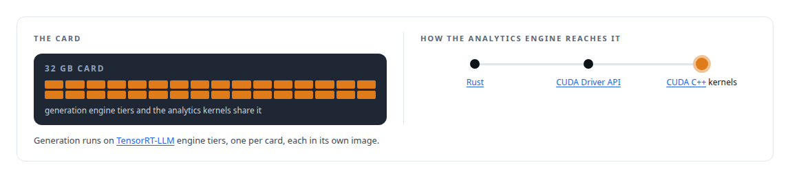
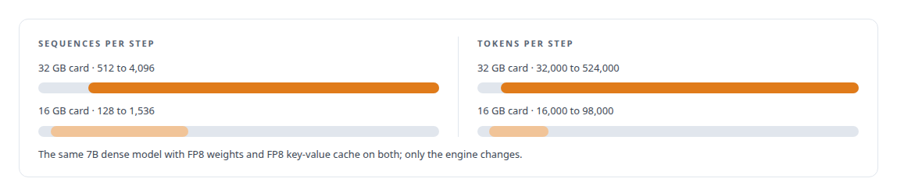
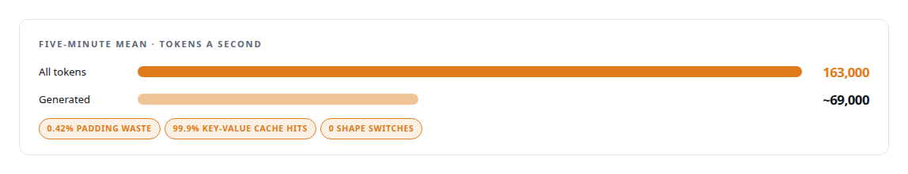
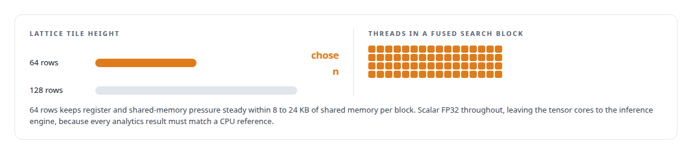
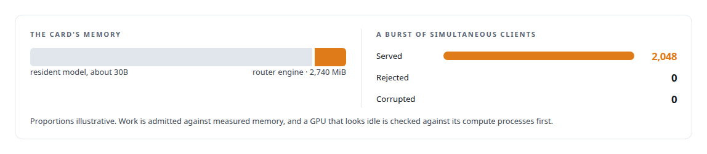
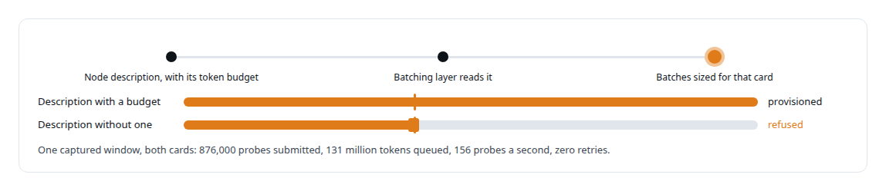
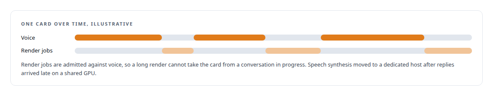

# NVIDIA Blackwell GPUs

**Consumer NVIDIA Blackwell GPUs carried the Inference Fabric, the capabilities model and early ActiveKV work, first on one card and then on two mismatched cards draining one broker queue.**

Canonical: https://coreyjames.ai/technologies/nvidia-blackwell-gpus/  
Author: Corey James · Published: 2026-10-28 · Kind: technology  
Systems: [Inference Fabric](https://github.com/coreyjames-ai/inference-fabric) · [Capabilities model](https://github.com/coreyjames-ai/capabilities-model) · [FAFO Core and Function Forge](https://github.com/coreyjames-ai/fafo-core) · [Helix](https://github.com/coreyjames-ai/helix) · [ActiveKV](https://github.com/coreyjames-ai/activekv)  
Skills: [high-throughput batch inference](https://github.com/coreyjames-ai/portfolio/tree/main/skills/high-throughput-batch-inference) · [NVIDIA Blackwell development](https://github.com/coreyjames-ai/portfolio/tree/main/skills/nvidia-blackwell-development) · [GPU inference optimisation](https://github.com/coreyjames-ai/portfolio/tree/main/skills/gpu-inference-optimisation) · [TensorRT and TensorRT-LLM engineering](https://github.com/coreyjames-ai/portfolio/tree/main/skills/tensorrt-and-tensorrt-llm-engineering)  


## Result

| Figure | What it measures |
| --- | --- |
| **96.9%** | streaming-multiprocessor utilisation on one card |
| **~65,000** | tokens a second held for ten hours on one card |
| **4.95M** | tasks in that ten-hour run, with zero retries |
| **3–4 h** | to build the shared TensorRT-LLM image from source |

## What was built

I have run consumer Blackwell GPUs hard in five roles: bulk generation, a co-resident custom decoder, real-time speech, provisioned compute and early cache-offload work. In each I measured what the card does and built to that; cache windows, memory left beside a resident model and utilisation all come from the card.

## Bulk generation on one card

[Inference Fabric](https://coreyjames.ai/systems/inference-fabric) asked how much of a consumer Blackwell GPU's real throughput a disciplined serving design could reach on bulk generation. On one 32 GB card the 7-billion-parameter dense model ran in FP8.



## Two mismatched cards, one queue

Then a second, smaller 16 GB Blackwell GPU joined it, both draining one backlog.


The big card wastes capacity on small batches, the small card gets work it cannot fit, and batches that mix prompt shapes make the engine's cache thrash. I wanted to solve that once without teaching the scheduler about either card. Each GPU consumer declares four integers that describe its limits and its model, and the broker packs batches to those numbers knowing nothing else about the card. The smaller card runs its own engine tier built for its memory, in its own per-GPU container image.



I added the second card only after the single-card path was saturated, so its gain could be measured on its own, and single-card and two-card results are reported separately, each with its model, precision and window. The broker grouped work by token shape.



See [A message broker that understands tokens](https://coreyjames.ai/stories/a-message-broker-that-understands-tokens) and [From 44K to 163K tokens per second](https://coreyjames.ai/stories/from-44k-to-163k-tokens-per-second).

## Built for compute capability 12.0

Consumer Blackwell is compute capability 12.0, and when I started on it the software had not caught up. I built [NVIDIA TensorRT-LLM](https://coreyjames.ai/technologies/nvidia-tensorrt-llm) from source for the architecture, as one image both cards share, and compiled every analytics kernel with CUDA 13.1 as a native SM 120 binary with no PTX fallback. A runtime check refuses any GPU that is not compute capability 12.0 on a CUDA 13 driver, so a kernel never runs on hardware it was not built for. The kernels are sized for the card's shared-memory budget.



Everything above the kernels is architecture-neutral, so datacentre Blackwell is a rebuild of binaries, the hardware check and an engine tier; the broker, the consumer contract and the provisioning stay as they are.

## A router beside a resident model

[Capabilities model](https://coreyjames.ai/systems/capabilities-model) had to live on a Blackwell GPU whose memory belonged to a resident model of about 30 billion parameters. I sized everything from measurements of the card itself. Full fine-tunes of a 0.6-billion-parameter open-weight base model finish in minutes on it, and the custom CUDA decoder was tuned to the cache the device actually provides.



See [A router beside a production model](https://coreyjames.ai/stories/a-router-beside-a-production-model) and [Trying the industrial path first](https://coreyjames.ai/stories/trying-the-industrial-path-first).

## The same function on either card

[FAFO Core and Function Forge](https://coreyjames.ai/systems/fafo-core) has to run the same function on whatever GPU it lands on. I made the engine's token budget a required part of each node's description and had the batching layer read it from the node that runs the work. Each card is one more provisioned node with its own runtime image, and the same function packs batches correctly for either with no code change.



See [The workload that shaped the platform](https://coreyjames.ai/stories/the-workload-that-shaped-the-platform).

## Speech, and the first cache offload

[Helix](https://coreyjames.ai/systems/helix) needed speech fast enough for conversation on hardware I own. A Blackwell GPU hosts its [the speech recognition model](https://coreyjames.ai/technologies/speech-recognition-model) speech recognition and GPU media work.



See [A self-hosted colleague in a Teams call](https://coreyjames.ai/stories/a-self-hosted-colleague-in-a-teams-call). [ActiveKV](https://coreyjames.ai/systems/activekv) began on a Blackwell GPU too: a precursor patch to [vLLM](https://coreyjames.ai/technologies/vllm) offloaded a hybrid model's attention cache to host memory on this card, and later analysis on the card produced stock reference runs for comparison. The hardware, drivers and TensorRT-LLM are NVIDIA's; the engines, kernels, per-card configuration, schedulers and admission rules that ran on them are mine.

> Mismatched cards are where a plain queue breaks down.

## What was verified

Each line is a claim the canonical page supports, with the figure as the page states it.

- NVIDIA Blackwell development: TensorRT-LLM built from source for compute capability 12.0 and kernels compiled with CUDA 13.1 as native SM 120 binaries, other GPUs refused at runtime.
- High-throughput batch inference: one 32 GB card at 96.9% streaming-multiprocessor utilisation, holding ~65,000 tokens a second for ten hours through 4.95M tasks with zero retries.
- Heterogeneous GPU scheduling: a 32 GB and a 16 GB card on one broker queue, each described by four integers, reaching a five-minute mean of 163,000 tokens a second.
- GPU memory co-residency: a router engine in 2,740 MiB beside a resident model of about 30B, serving a burst of 2,048 simultaneous clients with none rejected or corrupted.

## Related

- [A hundred tokens instead of forty-two thousand](https://github.com/coreyjames-ai/capabilities-model/tree/main/stories/a-hundred-tokens-instead-of-forty-two-thousand) · https://coreyjames.ai/stories/a-hundred-tokens-instead-of-forty-two-thousand/
- [A router beside a production model](https://github.com/coreyjames-ai/capabilities-model/tree/main/stories/a-router-beside-a-production-model) · https://coreyjames.ai/stories/a-router-beside-a-production-model/
- [Trying the industrial path first](https://github.com/coreyjames-ai/capabilities-model/tree/main/stories/trying-the-industrial-path-first) · https://coreyjames.ai/stories/trying-the-industrial-path-first/
- [A message broker that understands tokens](https://github.com/coreyjames-ai/inference-fabric/tree/main/stories/a-message-broker-that-understands-tokens) · https://coreyjames.ai/stories/a-message-broker-that-understands-tokens/
- [From 44K to 163K tokens per second](https://github.com/coreyjames-ai/inference-fabric/tree/main/stories/from-44k-to-163k-tokens-per-second) · https://coreyjames.ai/stories/from-44k-to-163k-tokens-per-second/
- [The workload that shaped the platform](https://github.com/coreyjames-ai/fafo-core/tree/main/stories/the-workload-that-shaped-the-platform) · https://coreyjames.ai/stories/the-workload-that-shaped-the-platform/
- [A self-hosted colleague in a Teams call](https://github.com/coreyjames-ai/helix/tree/main/stories/a-self-hosted-colleague-in-a-teams-call) · https://coreyjames.ai/stories/a-self-hosted-colleague-in-a-teams-call/
- [Thirty-eight metrics in a dozen passes](https://github.com/coreyjames-ai/inference-fabric/tree/main/stories/thirty-eight-metrics-in-a-dozen-passes) · https://coreyjames.ai/stories/thirty-eight-metrics-in-a-dozen-passes/
- [NVIDIA TensorRT-LLM](https://github.com/coreyjames-ai/portfolio/tree/main/technologies/nvidia-tensorrt-llm) · https://coreyjames.ai/technologies/nvidia-tensorrt-llm/
- [Speech recognition model](https://github.com/coreyjames-ai/portfolio/tree/main/technologies/speech-recognition-model) · https://coreyjames.ai/technologies/speech-recognition-model/
- [vLLM](https://github.com/coreyjames-ai/portfolio/tree/main/technologies/vllm) · https://coreyjames.ai/technologies/vllm/
- System: [Inference Fabric](https://github.com/coreyjames-ai/inference-fabric)
- System: [Capabilities model](https://github.com/coreyjames-ai/capabilities-model)
- System: [FAFO Core and Function Forge](https://github.com/coreyjames-ai/fafo-core)
- System: [Helix](https://github.com/coreyjames-ai/helix)
- System: [ActiveKV](https://github.com/coreyjames-ai/activekv)

## Citation

Corey James. "NVIDIA Blackwell GPUs." coreyjames.ai, 2026. https://coreyjames.ai/technologies/nvidia-blackwell-gpus/

```bibtex
@misc{coreyjames-nvidia-blackwell-gpus,
  author = {Corey James},
  title = {NVIDIA Blackwell GPUs},
  year = {2026},
  howpublished = {\url{https://coreyjames.ai/technologies/nvidia-blackwell-gpus/}},
  note = {GitHub copy: https://github.com/coreyjames-ai/portfolio/tree/main/technologies/nvidia-blackwell-gpus}
}
```

Part of [Corey James's portfolio](https://github.com/coreyjames-ai/portfolio) · site: https://coreyjames.ai/ · MCP server: https://coreyjames.ai/mcp · agent card: https://coreyjames.ai/.well-known/agent.json
