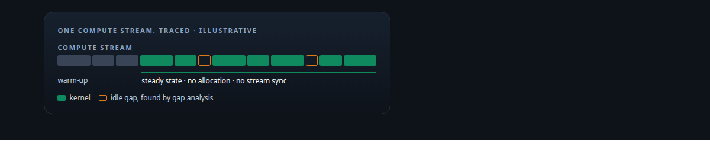
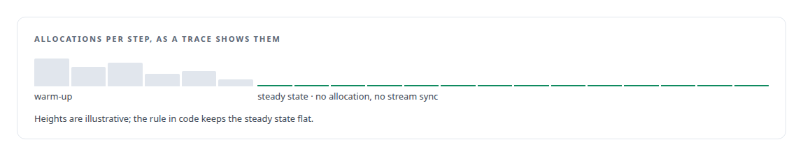
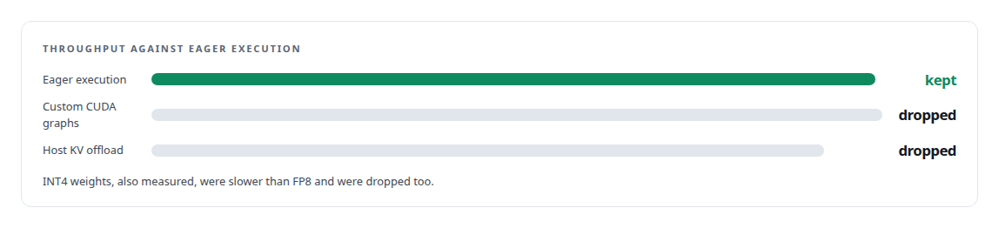

# NVIDIA Nsight Systems

**Nsight traces are where I found what the engine was actually doing, and where I learned to check that the trace was not itself the cause.**

Canonical: https://coreyjames.ai/technologies/nvidia-nsight-systems/  
Author: Corey James · Published: 2026-10-28 · Kind: technology  
Systems: [Inference Fabric](https://github.com/coreyjames-ai/inference-fabric)  
Skills: [GPU profiling (Nsight)](https://github.com/coreyjames-ai/portfolio/tree/main/skills/gpu-profiling-nsight) · [GPU inference optimisation](https://github.com/coreyjames-ai/portfolio/tree/main/skills/gpu-inference-optimisation) · [NVIDIA Blackwell development](https://github.com/coreyjames-ai/portfolio/tree/main/skills/nvidia-blackwell-development) · [AI-assisted engineering methodology](https://github.com/coreyjames-ai/portfolio/tree/main/skills/ai-assisted-engineering-methodology)  



## Result

| Figure | What it measures |
| --- | --- |
| **44K** | tokens a second on one NVIDIA Blackwell GPU at the start, 7B dense model in FP8 |
| **163K** | five-minute mean across two NVIDIA Blackwell GPUs at the end |
| **<1%** | gained by custom CUDA graphs over eager execution |
| **6.8%** | slower with the key-value cache offloaded to the host |

## What was built

### Proving the runtime's hot-path rules

[Inference Fabric](https://coreyjames.ai/systems/inference-fabric) depended on a GPU runtime that had to stay saturated, and some of its properties could only be settled with a timeline. The runtime is a [C++](https://coreyjames.ai/technologies/c-plus-plus) layer at the [NVIDIA TensorRT](https://coreyjames.ai/technologies/nvidia-tensorrt) boundary, driven from [Rust](https://coreyjames.ai/technologies/rust), feeding [NVIDIA TensorRT-LLM](https://coreyjames.ai/technologies/nvidia-tensorrt-llm) for generation and raw TensorRT for hidden-state extraction.

I gave its code two rules: after warm-up the decode loop allocates no memory, and it never synchronises the compute stream. The rules live in code and stop regressions; a timeline trace shows the property holds.




### Finding the idle time between kernels

A stray allocation or a hidden synchronisation on the hot path costs throughput on every step and disappears inside an average. I profiled the runtime on an [NVIDIA Blackwell GPU](https://coreyjames.ai/technologies/nvidia-blackwell-gpus) with Nsight Systems and ran a gap analysis of idle time between kernels. I profile on the card the system targets, because launch overheads and idle gaps differ by architecture.


### Dropping CUDA graphs and the other dead ends

Nsight also decided a design question. I captured the runtime twice on the same card, once in eager mode and once with custom CUDA graphs batching kernel launches. The graphs cost complexity and constrained shapes for too little, so I dropped them with the programme's other measured dead ends, and wrote the dead ends down with the wins so nobody tries them again. See [From 44K to 163K tokens per second](https://coreyjames.ai/stories/from-44k-to-163k-tokens-per-second).



I use a system-wide profiler to make performance claims provable and to kill attractive ideas that do not pay. Nsight Systems is NVIDIA's tool; the runtime rules it checked, the experiments and the decisions taken from the traces are mine.

> "Zero allocations after warm-up" is easy to assert and easy to break in a later change, and a trace settles it.

## What was verified

Each line is a claim the canonical page supports, with the figure as the page states it.

- GPU profiling (Nsight): timeline traces and gap analysis of idle time between kernels on an NVIDIA Blackwell GPU, used as proof that the decode loop allocates nothing after warm-up and never synchronises the stream.
- Performance benchmarking methodology: eager execution and custom CUDA graphs captured on the same card, graphs dropped for under 1% gain, host KV-cache offload dropped at 6.8% slower.
- GPU inference optimisation: part of a programme that took a 7-billion-parameter FP8 model from about 44K tokens a second on one NVIDIA Blackwell GPU to a 163K five-minute mean on two.

## Related

- [From 44K to 163K tokens per second](https://github.com/coreyjames-ai/inference-fabric/tree/main/stories/from-44k-to-163k-tokens-per-second) · https://coreyjames.ai/stories/from-44k-to-163k-tokens-per-second/
- [C++](https://github.com/coreyjames-ai/portfolio/tree/main/technologies/c-plus-plus) · https://coreyjames.ai/technologies/c-plus-plus/
- [NVIDIA TensorRT](https://github.com/coreyjames-ai/portfolio/tree/main/technologies/nvidia-tensorrt) · https://coreyjames.ai/technologies/nvidia-tensorrt/
- [Rust](https://github.com/coreyjames-ai/portfolio/tree/main/technologies/rust) · https://coreyjames.ai/technologies/rust/
- [NVIDIA TensorRT-LLM](https://github.com/coreyjames-ai/portfolio/tree/main/technologies/nvidia-tensorrt-llm) · https://coreyjames.ai/technologies/nvidia-tensorrt-llm/
- [NVIDIA Blackwell GPUs](https://github.com/coreyjames-ai/portfolio/tree/main/technologies/nvidia-blackwell-gpus) · https://coreyjames.ai/technologies/nvidia-blackwell-gpus/
- System: [Inference Fabric](https://github.com/coreyjames-ai/inference-fabric)

## Citation

Corey James. "NVIDIA Nsight Systems." coreyjames.ai, 2026. https://coreyjames.ai/technologies/nvidia-nsight-systems/

```bibtex
@misc{coreyjames-nvidia-nsight-systems,
  author = {Corey James},
  title = {NVIDIA Nsight Systems},
  year = {2026},
  howpublished = {\url{https://coreyjames.ai/technologies/nvidia-nsight-systems/}},
  note = {GitHub copy: https://github.com/coreyjames-ai/portfolio/tree/main/technologies/nvidia-nsight-systems}
}
```

Part of [Corey James's portfolio](https://github.com/coreyjames-ai/portfolio) · site: https://coreyjames.ai/ · MCP server: https://coreyjames.ai/mcp · agent card: https://coreyjames.ai/.well-known/agent.json
