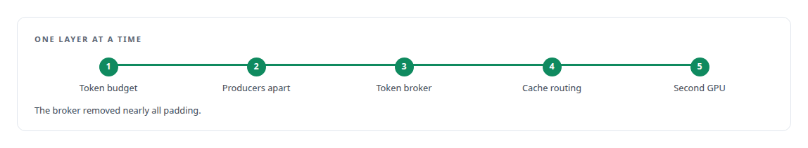
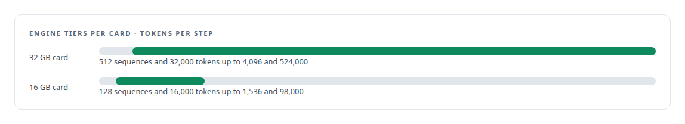
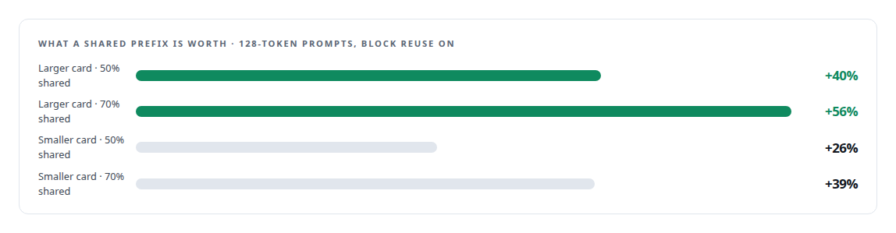
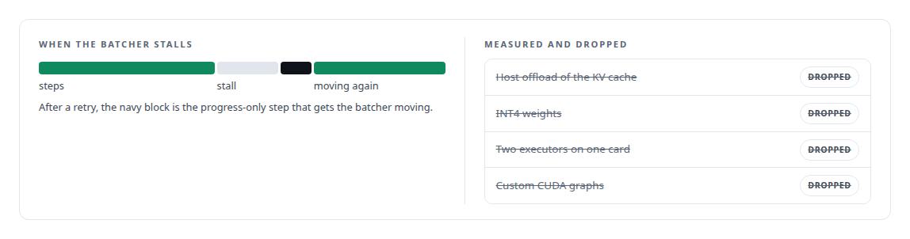
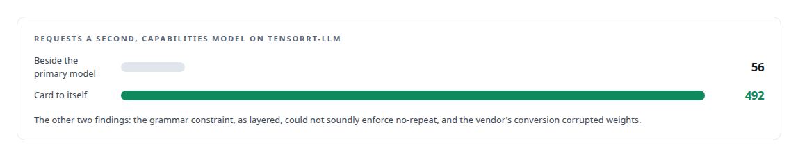

# NVIDIA TensorRT-LLM

**TensorRT-LLM is the engine under the Inference Fabric. I never touched its kernels; everything I gained came from how work was fed to it, and I tried it first for the capabilities model before closing that path on evidence.**

Canonical: https://coreyjames.ai/technologies/nvidia-tensorrt-llm/  
Author: Corey James · Published: 2026-10-28 · Kind: technology  
Systems: [Inference Fabric](https://github.com/coreyjames-ai/inference-fabric) · [Capabilities model](https://github.com/coreyjames-ai/capabilities-model) · [FAFO Core and Function Forge](https://github.com/coreyjames-ai/fafo-core)  
Skills: [TensorRT and TensorRT-LLM engineering](https://github.com/coreyjames-ai/portfolio/tree/main/skills/tensorrt-and-tensorrt-llm-engineering) · [inference serving architecture](https://github.com/coreyjames-ai/portfolio/tree/main/skills/inference-serving-architecture) · [GPU inference optimisation](https://github.com/coreyjames-ai/portfolio/tree/main/skills/gpu-inference-optimisation) · [AI-assisted engineering methodology](https://github.com/coreyjames-ai/portfolio/tree/main/skills/ai-assisted-engineering-methodology)  


## Result

| Figure | What it measures |
| --- | --- |
| **163K** | tokens a second, five-minute mean across two NVIDIA Blackwell GPUs, from about 44K on one |
| **3,840** | input tokens in the long-prompt tiers |
| **1,000×** | the worst weight corruption the vendor conversion caused on affected tensors |

## What was built

### Engineering everything around the engine

[Inference Fabric](https://coreyjames.ai/systems/inference-fabric) started from stock TensorRT-LLM set up the obvious way, which left most of a consumer GPU idle on bulk generation. My view was that the ceiling sat around the engine, so I kept NVIDIA's kernels and engineered everything else. My [C++](https://coreyjames.ai/technologies/c-plus-plus) layer drives the engine through its Executor API from a [Rust](https://coreyjames.ai/technologies/rust) service and refuses any engine configuration that leans on defaults, so a mis-sized engine is refused up front.

I changed one layer at a time on a 7-billion-parameter dense model in FP8. An engine tier sweep found the per-step token budget to be the largest lever on the engine side, and it is the first lever I measure since. See [From 44K to 163K tokens per second](https://coreyjames.ai/stories/from-44k-to-163k-tokens-per-second).



### An engine tier for each card

Each card runs its own engine tier, all built from one calibrated FP8 checkpoint with FP8 weights, an FP8 key-value cache, paged context attention and FP8 context attention. On the 16 GB card a halved-budget variant adds headroom. Most tiers cap sequences at 1,024 input and 128 output tokens so per-sequence cache stays small and slots stay many, and separate long-prompt tiers take longer inputs with larger cache blocks.

Each engine comes with a contract carrying its limits, cache memory fraction and host cache size, so a node is configured by the engine it loads. I built the TensorRT-LLM base image from source for the cards' Blackwell architecture.



### Grouping work by shared prefix

Before the broker existed I measured what shared prompts were worth, and that is why the broker groups work by prefix.



### Admission control around the batcher

After I measured a case where the GPU stopped making progress with many requests in flight, I wrapped the engine's in-flight batcher in admission control that retries first and takes a progress-only step when the batcher stalls. Four other ideas were measured and dropped; a second executor on one card, for one, reloaded the full weights with nothing shared.



### Trying the vendor path first for the capabilities model

[Capabilities model](https://coreyjames.ai/systems/capabilities-model) needed to serve about two thousand concurrent clients, and a custom engine is expensive to justify. I directed that TensorRT-LLM be tried first. Its guided-decoding extension point was traced in source and probed with the real catalog constraint, the model was converted with the vendor's tooling and compared with the source weights, and a throughput ladder ran in the vendor's container with and without the primary model resident.

I close a vendor path only on findings I can show, and three closed this one. See [Trying the industrial path first](https://coreyjames.ai/stories/trying-the-industrial-path-first).



### An engine as an input to provisioning

[FAFO Core and Function Forge](https://coreyjames.ai/systems/fafo-core) treats TensorRT-LLM engines as inputs to provisioning. The batching layer reads the token budget of the engine on the node that runs the work, and provisioning refuses a node whose description leaves it out, so the same function runs correctly against either card's engine.


TensorRT-LLM and its kernels are NVIDIA's; my change to it is one marked output in the model graph that exposes the hidden state for extraction. The runtime, engine tiers, admission control and the vendor-path study are mine.


> I get the most from NVIDIA's serving stack by engineering what surrounds it, and I judge it fairly when it does not fit.

## What was verified

Each line is a claim the canonical page supports, with the figure as the page states it.

- TensorRT and TensorRT-LLM engineering: NVIDIA's kernels kept and everything around them engineered, from about 44K to a 163K tokens-a-second five-minute mean across two NVIDIA Blackwell GPUs.
- Inference serving architecture: per-card engine tiers from one calibrated FP8 checkpoint, up to 4,096 sequences and 524,000 tokens per step on the 32 GB card, each engine carrying a contract of its limits.
- Prefix reuse in LLM serving: shared prompt prefixes measured at 40 to 56 percent more throughput on the larger card with 128-token prompts, which is why the broker groups work by prefix.
- Vendor technology evaluation: TensorRT-LLM tried first for the capabilities model and closed on three findings, including weights corrupted up to 1,000x by conversion and 56 against 492 requests a second.

## Related

- [Trying the industrial path first](https://github.com/coreyjames-ai/capabilities-model/tree/main/stories/trying-the-industrial-path-first) · https://coreyjames.ai/stories/trying-the-industrial-path-first/
- [A message broker that understands tokens](https://github.com/coreyjames-ai/inference-fabric/tree/main/stories/a-message-broker-that-understands-tokens) · https://coreyjames.ai/stories/a-message-broker-that-understands-tokens/
- [From 44K to 163K tokens per second](https://github.com/coreyjames-ai/inference-fabric/tree/main/stories/from-44k-to-163k-tokens-per-second) · https://coreyjames.ai/stories/from-44k-to-163k-tokens-per-second/
- [The workload that shaped the platform](https://github.com/coreyjames-ai/fafo-core/tree/main/stories/the-workload-that-shaped-the-platform) · https://coreyjames.ai/stories/the-workload-that-shaped-the-platform/
- [C++](https://github.com/coreyjames-ai/portfolio/tree/main/technologies/c-plus-plus) · https://coreyjames.ai/technologies/c-plus-plus/
- [Rust](https://github.com/coreyjames-ai/portfolio/tree/main/technologies/rust) · https://coreyjames.ai/technologies/rust/
- System: [Inference Fabric](https://github.com/coreyjames-ai/inference-fabric)
- System: [Capabilities model](https://github.com/coreyjames-ai/capabilities-model)
- System: [FAFO Core and Function Forge](https://github.com/coreyjames-ai/fafo-core)

## Citation

Corey James. "NVIDIA TensorRT-LLM." coreyjames.ai, 2026. https://coreyjames.ai/technologies/nvidia-tensorrt-llm/

```bibtex
@misc{coreyjames-nvidia-tensorrt-llm,
  author = {Corey James},
  title = {NVIDIA TensorRT-LLM},
  year = {2026},
  howpublished = {\url{https://coreyjames.ai/technologies/nvidia-tensorrt-llm/}},
  note = {GitHub copy: https://github.com/coreyjames-ai/portfolio/tree/main/technologies/nvidia-tensorrt-llm}
}
```

Part of [Corey James's portfolio](https://github.com/coreyjames-ai/portfolio) · site: https://coreyjames.ai/ · MCP server: https://coreyjames.ai/mcp · agent card: https://coreyjames.ai/.well-known/agent.json
