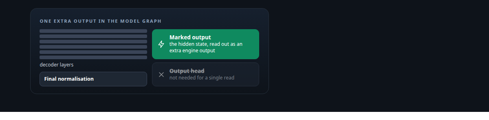
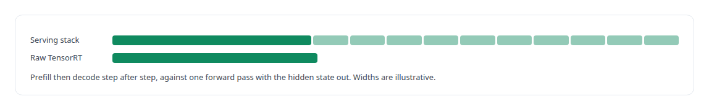
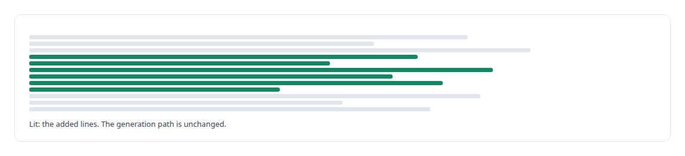
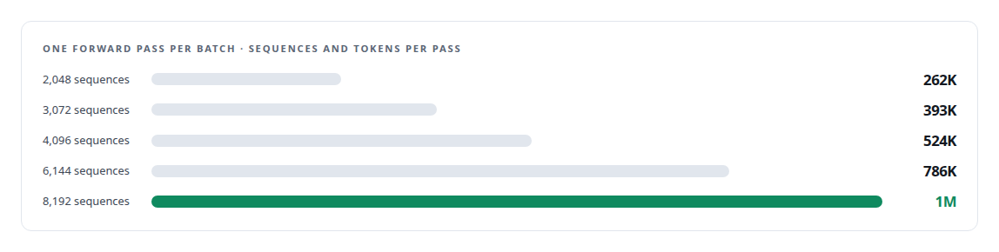
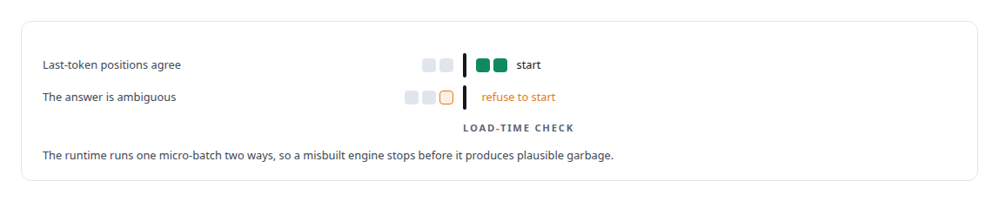
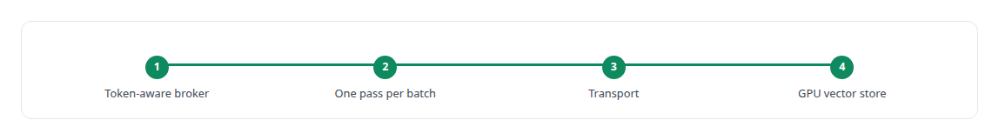

# NVIDIA TensorRT

**Raw TensorRT backs the single-pass hidden-state extraction mode in the Inference Fabric's runtime.**

Canonical: https://coreyjames.ai/technologies/nvidia-tensorrt/  
Author: Corey James · Published: 2026-10-28 · Kind: technology  
Systems: [Inference Fabric](https://github.com/coreyjames-ai/inference-fabric)  
Skills: [TensorRT and TensorRT-LLM engineering](https://github.com/coreyjames-ai/portfolio/tree/main/skills/tensorrt-and-tensorrt-llm-engineering) · [high-throughput batch inference](https://github.com/coreyjames-ai/portfolio/tree/main/skills/high-throughput-batch-inference) · [GPU inference optimisation](https://github.com/coreyjames-ai/portfolio/tree/main/skills/gpu-inference-optimisation) · [inference serving architecture](https://github.com/coreyjames-ai/portfolio/tree/main/skills/inference-serving-architecture)  



## Result

| Figure | What it measures |
| --- | --- |
| **6** | lines added to the decoder definition to expose the hidden state |
| **128** | tokens per input across every extraction build |

## What was built

### Going one level below the serving stack

[Inference Fabric](https://coreyjames.ai/systems/inference-fabric) needed to read a language model's internal representations for millions of sequences, and serving stacks are built to produce tokens. [NVIDIA TensorRT-LLM](https://coreyjames.ai/technologies/nvidia-tensorrt-llm) carries decoding machinery that a single read has no use for, so I went one level down to raw TensorRT and built the extraction path around the engine itself.



### Marking the hidden state in the model graph

The first step was in the model graph. I added lines to the decoder definition in my TensorRT-LLM source build that mark the hidden state after the final normalisation and before the output head as an extra engine output. Any decoder engine built from that tree exposes the representation the downstream work needs.



### Extraction engines that only read

The engines followed in a sequence of builds on a dense 7B-class model with FP8 weights and an FP8 GEMM plugin. The first kept a key-value cache and generated a single token. The final ones have the cache disabled and generate nothing, because a single read needs neither and pays for both in memory. They run one forward pass over a whole batch, and dropping the cache is what frees the memory for batches that size.

The build recipe is part of the consumer onboarding procedure and each engine comes with a contract describing its limits, so every extraction engine is a reproducible artefact, built per card for the Blackwell generation the cards belong to.



### A runtime that keeps the GPU fed

The runtime that drives them is a [C++](https://coreyjames.ai/technologies/c-plus-plus) layer at the TensorRT boundary, called from [Rust](https://coreyjames.ai/technologies/rust). For extraction it sets dynamic input shapes per batch, checks that the marked output has the shape it expects, runs one enqueue of the whole engine per pass, and hands the hidden states to the fabric's transport, which carries tensors without interpreting them.

The same layer keeps the GPU fed: memory comes from a pinned allocator that pre-faults every page and is never allocated on the hot path after warm-up, the compute stream is never synchronised, and host and device coordinate through a stream-ordered doorbell, a path used for the extraction backend and kept off for the vendor's executor, which reads its requests on the CPU. I checked both rules with [NVIDIA Nsight Systems](https://coreyjames.ai/technologies/nvidia-nsight-systems) timelines.



### Feeding the vector store

Extraction jobs come through the same [token-aware broker](https://coreyjames.ai/technologies/token-aware-gpu-batch-scheduling) as generation; see [A message broker that understands tokens](https://coreyjames.ai/stories/a-message-broker-that-understands-tokens). The extracted vectors flow into the fabric's GPU-resident vector store, where hand-written CUDA kernels search them and score cluster quality.



I build the runtime discipline that keeps the result saturated and safe. TensorRT and its kernels are NVIDIA's; the graph change, the engine builds, the runtime around them and the extraction pipeline are mine.


> I drop to NVIDIA's lower-level engine when the standard serving path is the wrong tool, and change the vendor graph only where it buys a capability.

## What was verified

Each line is a claim the canonical page supports, with the figure as the page states it.

- TensorRT and TensorRT-LLM engineering: six lines added to the decoder definition expose the hidden state as an extra engine output, with the generation path unchanged.
- High-throughput batch inference: extraction engines with no key-value cache and no generation, one forward pass over up to 8,192 sequences of 128 tokens, a million tokens per pass.
- Fail-closed GPU runtimes: a C++ runtime that measures how a loaded engine reads last-token positions and refuses to start on an ambiguous answer, with no allocation after warm-up.

## Related

- [A message broker that understands tokens](https://github.com/coreyjames-ai/inference-fabric/tree/main/stories/a-message-broker-that-understands-tokens) · https://coreyjames.ai/stories/a-message-broker-that-understands-tokens/
- [NVIDIA TensorRT-LLM](https://github.com/coreyjames-ai/portfolio/tree/main/technologies/nvidia-tensorrt-llm) · https://coreyjames.ai/technologies/nvidia-tensorrt-llm/
- [C++](https://github.com/coreyjames-ai/portfolio/tree/main/technologies/c-plus-plus) · https://coreyjames.ai/technologies/c-plus-plus/
- [Rust](https://github.com/coreyjames-ai/portfolio/tree/main/technologies/rust) · https://coreyjames.ai/technologies/rust/
- [NVIDIA Nsight Systems](https://github.com/coreyjames-ai/portfolio/tree/main/technologies/nvidia-nsight-systems) · https://coreyjames.ai/technologies/nvidia-nsight-systems/
- [Token-aware GPU batch scheduling](https://github.com/coreyjames-ai/portfolio/tree/main/technologies/token-aware-gpu-batch-scheduling) · https://coreyjames.ai/technologies/token-aware-gpu-batch-scheduling/
- System: [Inference Fabric](https://github.com/coreyjames-ai/inference-fabric)

## Citation

Corey James. "NVIDIA TensorRT." coreyjames.ai, 2026. https://coreyjames.ai/technologies/nvidia-tensorrt/

```bibtex
@misc{coreyjames-nvidia-tensorrt,
  author = {Corey James},
  title = {NVIDIA TensorRT},
  year = {2026},
  howpublished = {\url{https://coreyjames.ai/technologies/nvidia-tensorrt/}},
  note = {GitHub copy: https://github.com/coreyjames-ai/portfolio/tree/main/technologies/nvidia-tensorrt}
}
```

Part of [Corey James's portfolio](https://github.com/coreyjames-ai/portfolio) · site: https://coreyjames.ai/ · MCP server: https://coreyjames.ai/mcp · agent card: https://coreyjames.ai/.well-known/agent.json
