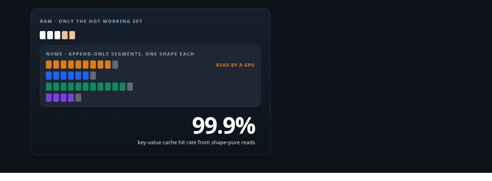
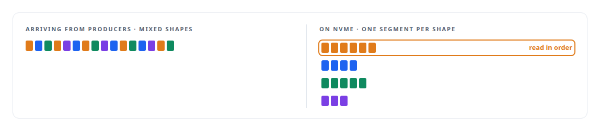
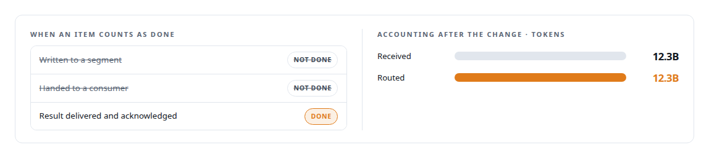

# NVMe (cold-tier storage)

**The broker's cold tier is NVMe: billions of queued tokens survive a restart in shape-pure order.**

Canonical: https://coreyjames.ai/technologies/nvme-cold-tier-storage/  
Author: Corey James · Published: 2026-10-28 · Kind: technology  
Systems: [Inference Fabric](https://github.com/coreyjames-ai/inference-fabric)  
Skills: [message broker and queue design](https://github.com/coreyjames-ai/portfolio/tree/main/skills/message-broker-and-queue-design) · [distributed systems correctness](https://github.com/coreyjames-ai/portfolio/tree/main/skills/distributed-systems-correctness) · [append-only log design](https://github.com/coreyjames-ai/portfolio/tree/main/skills/append-only-log-design) · [exactly-once delivery and crash recovery](https://github.com/coreyjames-ai/portfolio/tree/main/skills/exactly-once-delivery-and-crash-recovery)  



## Result

| Figure | What it measures |
| --- | --- |
| **0** | shape switches while draining one backlog |
| **0.42%** | padding waste across that backlog |
| **2** | NVIDIA Blackwell GPUs fed from one cold tier |

## What was built

### A cold tier laid out for how the GPUs read

[Inference Fabric](https://coreyjames.ai/systems/inference-fabric) put a broker between producers that submit millions of tokenised tasks and walk away, and GPU consumers that pull work as fast as they can process it. The two sides run at different speeds for hours. Producers burst far ahead of the GPUs, and the GPUs must never wait on a producer.

A backlog of billions of tokens does not fit in memory, and losing it on a restart would mean regenerating hours of queued work. I gave the broker a cold tier on local NVMe: an [append-only](https://coreyjames.ai/technologies/append-only-log-and-journal-design) store of memory-mapped segments, with only the hot working set in RAM, so disk sets the backlog's size. Append-only writes are sequential, the access pattern NVMe handles best, and the backlog outlives the process that wrote it.

I organised it around how the GPUs read. The broker groups incoming work by token shape before it reaches disk, so each segment holds work of one shape, and when a consumer asks for a batch the broker reads from segments that already fit that consumer, in the order it wants. Nothing ever scans the backlog to find a fit. That layout is what let one broker drain a single backlog across both GPUs. See [A message broker that understands tokens](https://coreyjames.ai/stories/a-message-broker-that-understands-tokens).




### Knowing what the storage holds

Durable storage covers half of keeping work. The other half is knowing what the storage holds. When the broker's registry and its storage disagreed by millions of items, I redefined an item as done only when its result has been delivered and acknowledged, and the accounting panels then balanced. Dashboards show what the storage holds next to what the broker believes, at any moment. See [Millions of queued items that were not there](https://coreyjames.ai/stories/millions-of-queued-items-that-were-not-there).



I also took length filtering out of the broker. The runtime returns an oversized item to the broker, and nothing strands in storage. The drives, file system and memory mapping are standard parts; the cold-tier design, its organisation and the accounting around it are mine.

> I treat local NVMe as a deliberate tier in a throughput system, laid out for the way the consumer reads.

## What was verified

Each line is a claim the canonical page supports, with the figure as the page states it.

- NVMe as a storage tier for GPU pipelines: a broker cold tier of append-only, memory-mapped segments on local NVMe that keeps a backlog of billions of queued tokens across restarts.
- Message broker and queue design: work grouped by token shape before it reaches disk, so one backlog drained across two NVIDIA Blackwell GPUs with 0 shape switches and 0.42% padding waste.
- Distributed systems correctness: an item counted done only when its result was delivered and acknowledged, after which 12.3B tokens received matched 12.3B routed.

## Related

- [A message broker that understands tokens](https://github.com/coreyjames-ai/inference-fabric/tree/main/stories/a-message-broker-that-understands-tokens) · https://coreyjames.ai/stories/a-message-broker-that-understands-tokens/
- [Millions of queued items that were not there](https://github.com/coreyjames-ai/inference-fabric/tree/main/stories/millions-of-queued-items-that-were-not-there) · https://coreyjames.ai/stories/millions-of-queued-items-that-were-not-there/
- [Append-only log and journal design](https://github.com/coreyjames-ai/portfolio/tree/main/technologies/append-only-log-and-journal-design) · https://coreyjames.ai/technologies/append-only-log-and-journal-design/
- System: [Inference Fabric](https://github.com/coreyjames-ai/inference-fabric)

## Citation

Corey James. "NVMe (cold-tier storage)." coreyjames.ai, 2026. https://coreyjames.ai/technologies/nvme-cold-tier-storage/

```bibtex
@misc{coreyjames-nvme-cold-tier-storage,
  author = {Corey James},
  title = {NVMe (cold-tier storage)},
  year = {2026},
  howpublished = {\url{https://coreyjames.ai/technologies/nvme-cold-tier-storage/}},
  note = {GitHub copy: https://github.com/coreyjames-ai/portfolio/tree/main/technologies/nvme-cold-tier-storage}
}
```

Part of [Corey James's portfolio](https://github.com/coreyjames-ai/portfolio) · site: https://coreyjames.ai/ · MCP server: https://coreyjames.ai/mcp · agent card: https://coreyjames.ai/.well-known/agent.json
