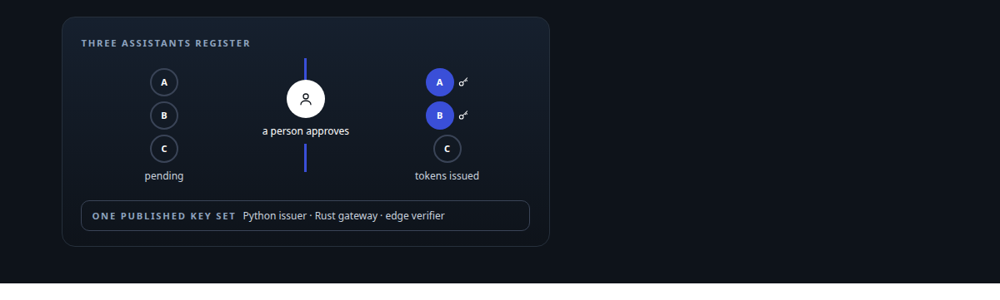
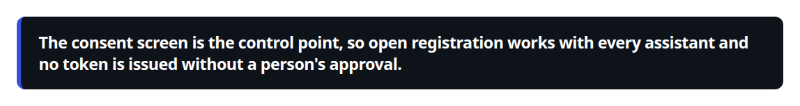
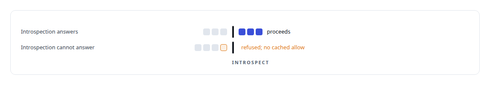
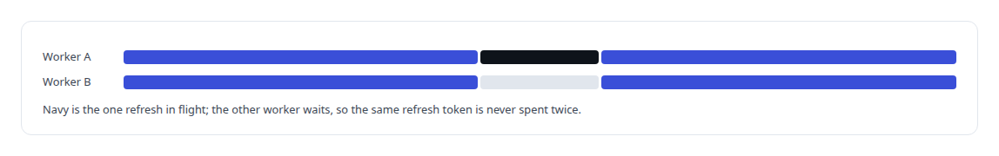
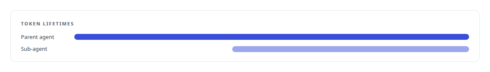
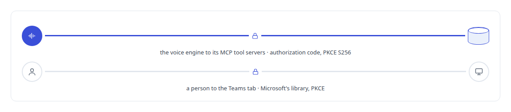

# OAuth 2.0

**I built an OAuth 2.0 authorization server for commercial AI assistants, with consent as the real control, and my memory gateway validates tokens from several issuers against published keys.**

Canonical: https://coreyjames.ai/technologies/oauth-2-0/  
Author: Corey James · Published: 2026-10-28 · Kind: technology  
Systems: [Auth and access plane](https://github.com/coreyjames-ai/auth-and-access-plane) · [FAFOHive](https://github.com/coreyjames-ai/fafohive) · [FAFO Core and Function Forge](https://github.com/coreyjames-ai/fafo-core) · [Helix](https://github.com/coreyjames-ai/helix)  
Skills: [OAuth 2.0 and identity architecture](https://github.com/coreyjames-ai/portfolio/tree/main/skills/oauth-2-0-and-identity-architecture) · [MCP server design](https://github.com/coreyjames-ai/portfolio/tree/main/skills/mcp-server-design) · [tool synthesis and governed API integration](https://github.com/coreyjames-ai/portfolio/tree/main/skills/tool-synthesis-and-governed-api-integration) · [distributed systems correctness](https://github.com/coreyjames-ai/portfolio/tree/main/skills/distributed-systems-correctness)  



## Result

| Figure | What it measures |
| --- | --- |
| **30 days** | a newly registered client waits for a person's approval before it lapses |

## What was built

### An authorization server built around consent

[Auth and access plane](https://coreyjames.ai/systems/auth-and-access-plane) exists because I wanted commercial AI assistants to reach my private tool estate through standard OAuth, with a person approving every grant. I built the authorization server. It implements the authorization-code grant with PKCE, with the S256 check written from primitives, plus client credentials, refresh tokens and revocation, with separate authentication paths for confidential and public clients. Tokens are RS256-signed [JWTs](https://coreyjames.ai/technologies/json-web-token-jwt). The signing key persists, so tokens survive restarts, and the public keys are published for every verifier.

Assistants find the server through authorization-server and protected-resource metadata, register through dynamic client registration and name the resource they want, with a default when they do not. I set the pending-client lifetime from how real assistants behave: some cache their client ID and never register again. When a hardening pass gated registration itself, every assistant with an expired cached client was locked out. I reverted it, because consent already stops an attacker-registered client from getting a code. See [The hardening fix that locked everyone out](https://coreyjames.ai/stories/the-hardening-fix-that-locked-everyone-out).




### A protected resource that fails closed

[FAFOHive](https://coreyjames.ai/systems/fafohive) is a protected resource with its own OAuth service, and I wanted an outage there to deny access. It publishes discovery metadata and accepts dynamic registration for MCP clients. Every bearer token is introspected on every request.



### Shared grants that refresh atomically

The in-house [X API](https://coreyjames.ai/technologies/x-api) module uses OAuth 2.0 with PKCE and a loopback redirect for user-context access, and it refreshes tokens atomically so two workers cannot spend the same refresh token. See [Agents with real tools and no keys](https://coreyjames.ai/stories/agents-with-real-tools-and-no-keys).



### Offline validation with a scope tree

[FAFO Core and Function Forge](https://coreyjames.ai/systems/fafo-core) validates tokens at its model-facing gateway offline, against published keys from more than one issuer. Scopes are organised as a tree, sensitive actions need a step-up with a one-time code, and tokens minted for sub-agents end with their parent, so a sub-agent identity cannot outlive the agent that created it. Together they limit what a leaked low-level token can do.



### A client in Helix

[Helix](https://coreyjames.ai/systems/helix) is an OAuth client. Its voice engine connects to its [MCP](https://coreyjames.ai/technologies/model-context-protocol-mcp) tool servers with the authorization-code flow and PKCE S256, and its Teams tab signs people in through Microsoft's library with PKCE.



I can implement OAuth 2.0 on the server side, the resource side and the client side, and make it work with several vendors' assistants whose behaviour differs within the standards. The standards are the IETF's; the server, the validation and the consent-centred design are mine.

> The consent screen is the control point, so open registration works with every assistant and no token is issued without a person's approval.

## What was verified

Each line is a claim the canonical page supports, with the figure as the page states it.

- OAuth 2.0 and identity architecture: an authorization server with the authorization-code grant and PKCE, an S256 check written from primitives, client credentials, refresh tokens, revocation and RS256-signed JWTs.
- Dynamic client registration and consent design: discovery metadata and open registration for AI assistants, a pending client lapsing after 30 days without a person's approval, and no token issued without it.
- Zero-trust architecture: a protected MCP resource that introspects every bearer token on every request and refuses, with no cached allow, when introspection cannot answer.
- Delegated authorization for AI agents: offline multi-issuer token validation with a scope tree and one-time-code step-up, sub-agent tokens that end with their parent, and atomic refresh so no refresh token is spent twice.

## Related

- [Agents with real tools and no keys](https://github.com/coreyjames-ai/fafohive/tree/main/stories/agents-with-real-tools-and-no-keys) · https://coreyjames.ai/stories/agents-with-real-tools-and-no-keys/
- [The hardening fix that locked everyone out](https://github.com/coreyjames-ai/auth-and-access-plane/tree/main/stories/the-hardening-fix-that-locked-everyone-out) · https://coreyjames.ai/stories/the-hardening-fix-that-locked-everyone-out/
- [JSON Web Token (JWT)](https://github.com/coreyjames-ai/portfolio/tree/main/technologies/json-web-token-jwt) · https://coreyjames.ai/technologies/json-web-token-jwt/
- [X API](https://github.com/coreyjames-ai/portfolio/tree/main/technologies/x-api) · https://coreyjames.ai/technologies/x-api/
- [Model Context Protocol (MCP)](https://github.com/coreyjames-ai/portfolio/tree/main/technologies/model-context-protocol-mcp) · https://coreyjames.ai/technologies/model-context-protocol-mcp/
- System: [Auth and access plane](https://github.com/coreyjames-ai/auth-and-access-plane)
- System: [FAFOHive](https://github.com/coreyjames-ai/fafohive)
- System: [FAFO Core and Function Forge](https://github.com/coreyjames-ai/fafo-core)
- System: [Helix](https://github.com/coreyjames-ai/helix)

## Citation

Corey James. "OAuth 2.0." coreyjames.ai, 2026. https://coreyjames.ai/technologies/oauth-2-0/

```bibtex
@misc{coreyjames-oauth-2-0,
  author = {Corey James},
  title = {OAuth 2.0},
  year = {2026},
  howpublished = {\url{https://coreyjames.ai/technologies/oauth-2-0/}},
  note = {GitHub copy: https://github.com/coreyjames-ai/portfolio/tree/main/technologies/oauth-2-0}
}
```

Part of [Corey James's portfolio](https://github.com/coreyjames-ai/portfolio) · site: https://coreyjames.ai/ · MCP server: https://coreyjames.ai/mcp · agent card: https://coreyjames.ai/.well-known/agent.json
