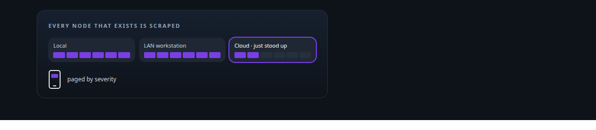
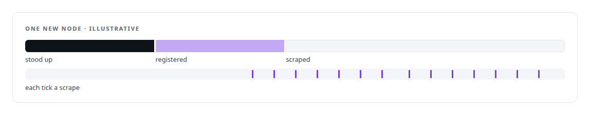
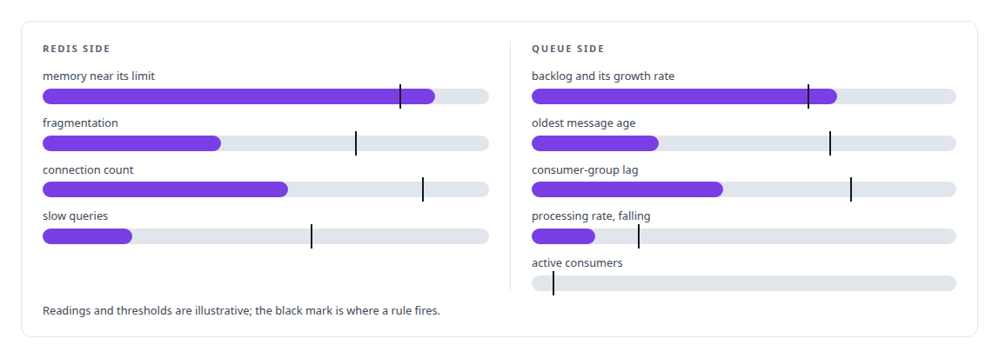
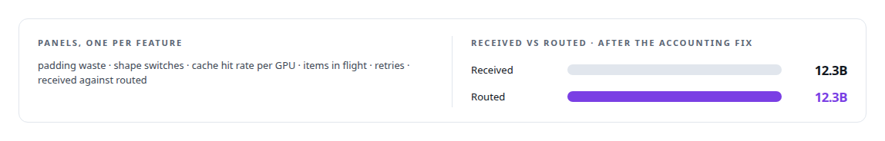
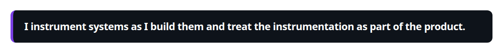
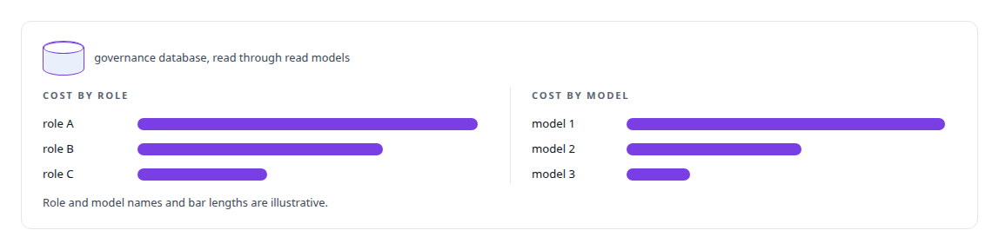

# Observability and alerting

**SMS alerting is wired to the service fleet, with a metrics stack and dashboards beside it, and a status dashboard that says plainly what each service is doing.**

Canonical: https://coreyjames.ai/technologies/observability-and-alerting/  
Author: Corey James · Published: 2026-10-28 · Kind: technology  
Systems: [Auth and access plane](https://github.com/coreyjames-ai/auth-and-access-plane) · [Inference Fabric](https://github.com/coreyjames-ai/inference-fabric) · [AgentOS](https://github.com/coreyjames-ai/agentos)  
Skills: [cost attribution for AI work](https://github.com/coreyjames-ai/portfolio/tree/main/skills/cost-attribution-for-ai-work) · [observability and alerting](https://github.com/coreyjames-ai/portfolio/tree/main/skills/observability-and-alerting) · [embedding analytics and cluster metrics](https://github.com/coreyjames-ai/portfolio/tree/main/skills/embedding-analytics-and-cluster-metrics)  



## Result

| Figure | What it measures |
| --- | --- |
| **12** | scrape jobs across hosts, GPUs and inference nodes |
| **0** | tokens between received and routed after the accounting fix |

## What was built

### Discovery wired to provisioning

[Auth and access plane](https://coreyjames.ai/systems/auth-and-access-plane) holds the observability layer for an estate one person operates, and that shaped every choice: nothing may depend on someone watching a dashboard. My Rust services expose native metrics endpoints, and a containerised [Prometheus](https://coreyjames.ai/technologies/prometheus) scrapes them, covering hosts, GPUs and inference nodes.

I wired discovery to provisioning. When the execution substrate stands up a GPU node, locally, on a LAN workstation or on rented cloud capacity, it writes the node into Prometheus's file-based service discovery and installs the host and GPU exporters on it, so a new node is monitored from its first minute with no one editing a scrape configuration.



### Alerts on work that stops

Alertmanager routes alerts by severity through escalation tiers, and a small webhook turns them into text messages on my phone, because a single operator cannot watch screens. The rules watch for what stops work, across [Redis](https://coreyjames.ai/technologies/redis) and the queues on top of it.



Alert delivery is tested too: a helper script fires a synthetic alert end to end. Others compute capacity headroom and capture a performance baseline, so a slow change shows up against a known reference. [Grafana](https://coreyjames.ai/technologies/grafana) dashboards cover the Redis queues, the system overview and the GPU pipeline.

### Dashboards for GPU economics

[Inference Fabric](https://coreyjames.ai/systems/inference-fabric) is where the instrumentation mattered most, because every number I publish about the fabric comes from a dashboard capture. I built its dashboards feature by feature as the fabric grew, each feature arriving with its panel, around the quantities that decide GPU economics. The received-against-routed panel is how the broker's accounting fix showed it held. See [Millions of queued items that were not there](https://coreyjames.ai/stories/millions-of-queued-items-that-were-not-there) and [From 44K to 163K tokens per second](https://coreyjames.ai/stories/from-44k-to-163k-tokens-per-second).



The instrumentation found the fabric's lost-work bug, it backs every number I publish, and it lets one person run a multi-service estate.



### Cost on the seat that spent it

[AgentOS](https://coreyjames.ai/systems/agentos) has its own Prometheus and Grafana pair with a [PostgreSQL](https://coreyjames.ai/technologies/postgresql) exporter. Its dashboards show cost and usage per role and per model from read models over the governance database, so the cost of an AI engineering programme lands on the seat and model that spent it.



Prometheus, Alertmanager, Grafana and the exporters are standard open-source tools; the discovery wiring, dashboards, alert rules and paging path are mine.

> I instrument systems as I build them and treat the instrumentation as part of the product.

## What was verified

Each line is a claim the canonical page supports, with the figure as the page states it.

- Observability and alerting: Prometheus, Alertmanager and Grafana for an estate one person operates, 12 scrape jobs across hosts, GPUs and inference nodes, alerts paged to a phone by severity.
- Monitoring wired to provisioning: GPU nodes written into Prometheus file-based discovery with exporters installed as they are stood up, locally, on a LAN or in the cloud.
- Dashboards for GPU economics: Inference Fabric panels for padding waste, cache hit rate and tokens received against routed, the panel that showed 12.3B received and 12.3B routed.
- Cost attribution for AI work: AgentOS dashboards of cost and usage per role and per model, read from the governance database.

## Related

- [Millions of queued items that were not there](https://github.com/coreyjames-ai/inference-fabric/tree/main/stories/millions-of-queued-items-that-were-not-there) · https://coreyjames.ai/stories/millions-of-queued-items-that-were-not-there/
- [From 44K to 163K tokens per second](https://github.com/coreyjames-ai/inference-fabric/tree/main/stories/from-44k-to-163k-tokens-per-second) · https://coreyjames.ai/stories/from-44k-to-163k-tokens-per-second/
- [Prometheus](https://github.com/coreyjames-ai/portfolio/tree/main/technologies/prometheus) · https://coreyjames.ai/technologies/prometheus/
- [Redis](https://github.com/coreyjames-ai/portfolio/tree/main/technologies/redis) · https://coreyjames.ai/technologies/redis/
- [Grafana](https://github.com/coreyjames-ai/portfolio/tree/main/technologies/grafana) · https://coreyjames.ai/technologies/grafana/
- [PostgreSQL](https://github.com/coreyjames-ai/portfolio/tree/main/technologies/postgresql) · https://coreyjames.ai/technologies/postgresql/
- System: [Auth and access plane](https://github.com/coreyjames-ai/auth-and-access-plane)
- System: [Inference Fabric](https://github.com/coreyjames-ai/inference-fabric)
- System: [AgentOS](https://github.com/coreyjames-ai/agentos)

## Citation

Corey James. "Observability and alerting." coreyjames.ai, 2026. https://coreyjames.ai/technologies/observability-and-alerting/

```bibtex
@misc{coreyjames-observability-and-alerting,
  author = {Corey James},
  title = {Observability and alerting},
  year = {2026},
  howpublished = {\url{https://coreyjames.ai/technologies/observability-and-alerting/}},
  note = {GitHub copy: https://github.com/coreyjames-ai/portfolio/tree/main/technologies/observability-and-alerting}
}
```

Part of [Corey James's portfolio](https://github.com/coreyjames-ai/portfolio) · site: https://coreyjames.ai/ · MCP server: https://coreyjames.ai/mcp · agent card: https://coreyjames.ai/.well-known/agent.json
