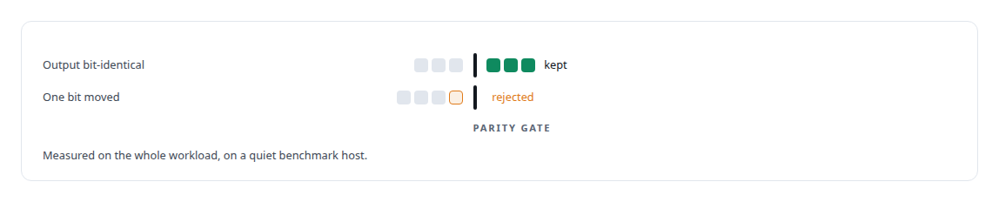
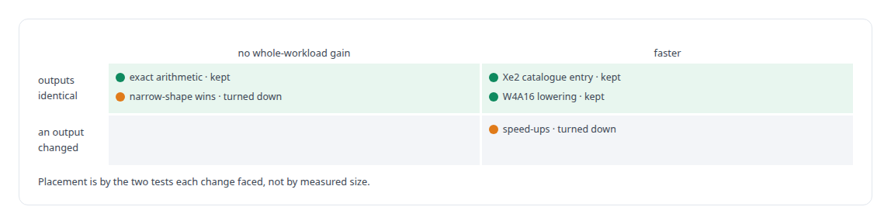

# oneDNN

**Patches to Intel's math library for a GPU architecture the ecosystem had not caught up with, each one held to bit-identical output.**

Canonical: https://coreyjames.ai/technologies/onednn/  
Author: Corey James · Published: 2026-10-28 · Kind: technology  
Systems: [ActiveKV](https://github.com/coreyjames-ai/activekv)  
Skills: [Intel GPU and SYCL/oneAPI engineering](https://github.com/coreyjames-ai/portfolio/tree/main/skills/intel-gpu-and-sycl-oneapi-engineering) · [GPU inference optimisation](https://github.com/coreyjames-ai/portfolio/tree/main/skills/gpu-inference-optimisation) · [evidence-gated acceptance](https://github.com/coreyjames-ai/portfolio/tree/main/skills/evidence-gated-acceptance) · [LLM quantization (FP8, INT8, 4-bit)](https://github.com/coreyjames-ai/portfolio/tree/main/skills/llm-quantization-fp8-int8-4-bit)  


## Result

| Figure | What it measures |
| --- | --- |
| **20%** | off cold 32,000-token prefill, outputs identical |
| **48** | special-value combinations behind the exact-arithmetic rewrite |

## What was built

### Patching the vendor's library in the vendor's toolchain

[ActiveKV](https://coreyjames.ai/systems/activekv) serves a 27-billion-parameter hybrid recurrent-attention open-weight model on one [Intel Arc Pro GPU](https://coreyjames.ai/technologies/intel-arc-gpus), and on that card prefill and the 4-bit-weight model path run their large matrix multiplications through Intel's oneDNN. The Intel Arc Pro GPU is a new architecture and the open kernel stack had gaps.

I decided to patch oneDNN's own sources inside Intel's toolchain image, so the binary matches what the serving engine loads, and to gate every change on bit-identical output against the unpatched path, measured on the whole workload on a quiet benchmark host. The gate exists because of what sits above oneDNN: ActiveKV's exact mode must match fully resident attention bit for bit.




### One catalogue entry for the Xe2 prefill shape

The patch that mattered most was one line of data. oneDNN picks a GEMM kernel configuration from a catalogue keyed by shape, and for the Xe2 prefill shape it was picking a poor tile. One added catalogue entry, the smallest change that removed the cost, fixed the choice with identical outputs.


### Tightening the 4-bit-weight path

Further patches tightened the 4-bit-weight (W4A16) lowering: weights reused once loaded, conversion and scaling done locally, scales broadcast, and the hardware's dot-product-accumulate instructions used on the tail of a computation. A separate patch adds a validation switch that pins the GEMM shapes that otherwise vary from run to run, so shape variance cannot hide a real parity failure. One rewrite produced exact instruction-set arithmetic with no whole-workload speed gain, and I kept it because exactness is a property I want in the product.



The patches travel with ActiveKV as patches to Intel's stack. See [Bringing a serving stack up on new silicon](https://coreyjames.ai/stories/bringing-a-serving-stack-up-on-new-silicon) and [Proving a rewrite is the same system](https://coreyjames.ai/stories/proving-a-rewrite-is-the-same-system). I can work inside a vendor's math library on hardware the ecosystem has not caught up with, find the one change that matters and keep every output bit where it was. oneDNN is Intel's; the patches, the gates around them and the choice of which changes to keep are mine.

> A GEMM patch that moved a single bit would void every parity result built on it.

## What was verified

Each line is a claim the canonical page supports, with the figure as the page states it.

- Intel GPU and SYCL/oneAPI engineering: oneDNN patched inside Intel's toolchain image for Xe2, one added GEMM catalogue entry cutting cold 32,000-token prefill from 21.54 s to 17.23 s.
- Bit-exact numerical verification: every vendor-library patch gated on bit-identical output against the unpatched path, measured on the whole workload on a quiet host.
- LLM quantization (4-bit): a tighter W4A16 lowering in oneDNN, and an exact instruction-set arithmetic rewrite tested across 48 special-value combinations and kept at flat speed.

## Related

- [Bringing a serving stack up on new silicon](https://github.com/coreyjames-ai/activekv/tree/main/stories/bringing-a-serving-stack-up-on-new-silicon) · https://coreyjames.ai/stories/bringing-a-serving-stack-up-on-new-silicon/
- [Proving a rewrite is the same system](https://github.com/coreyjames-ai/activekv/tree/main/stories/proving-a-rewrite-is-the-same-system) · https://coreyjames.ai/stories/proving-a-rewrite-is-the-same-system/
- [Intel Arc GPUs](https://github.com/coreyjames-ai/portfolio/tree/main/technologies/intel-arc-gpus) · https://coreyjames.ai/technologies/intel-arc-gpus/
- System: [ActiveKV](https://github.com/coreyjames-ai/activekv)

## Citation

Corey James. "oneDNN." coreyjames.ai, 2026. https://coreyjames.ai/technologies/onednn/

```bibtex
@misc{coreyjames-onednn,
  author = {Corey James},
  title = {oneDNN},
  year = {2026},
  howpublished = {\url{https://coreyjames.ai/technologies/onednn/}},
  note = {GitHub copy: https://github.com/coreyjames-ai/portfolio/tree/main/technologies/onednn}
}
```

Part of [Corey James's portfolio](https://github.com/coreyjames-ai/portfolio) · site: https://coreyjames.ai/ · MCP server: https://coreyjames.ai/mcp · agent card: https://coreyjames.ai/.well-known/agent.json
