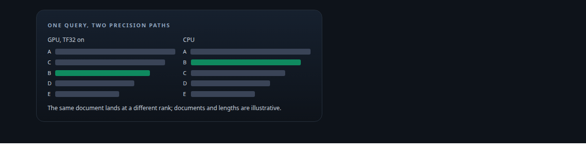
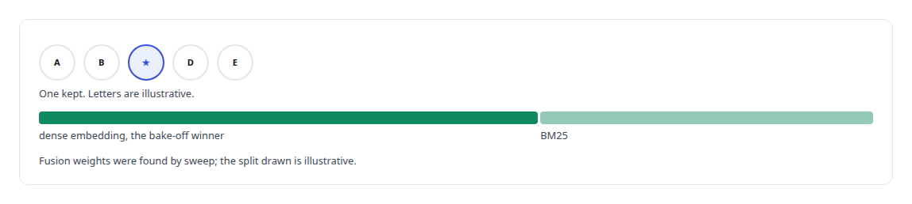
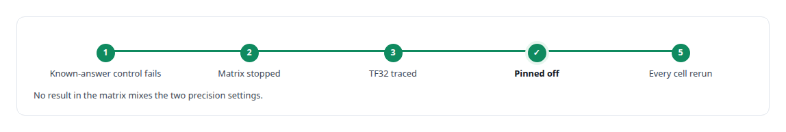
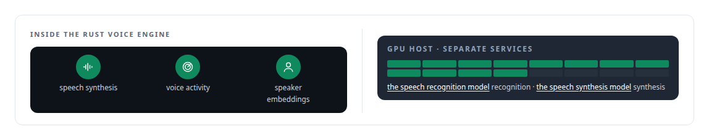

# ONNX Runtime

**ONNX Runtime serves embeddings in the evaluation harness and in the voice engine's lighter models.**

Canonical: https://coreyjames.ai/technologies/onnx-runtime/  
Author: Corey James · Published: 2026-10-28 · Kind: technology  
Systems: [Helix](https://github.com/coreyjames-ai/helix) · [Capabilities model](https://github.com/coreyjames-ai/capabilities-model)  
Skills: [speech recognition and synthesis pipelines](https://github.com/coreyjames-ai/portfolio/tree/main/skills/speech-recognition-and-synthesis-pipelines) · [inference serving architecture](https://github.com/coreyjames-ai/portfolio/tree/main/skills/inference-serving-architecture) · [AI-assisted engineering methodology](https://github.com/coreyjames-ai/portfolio/tree/main/skills/ai-assisted-engineering-methodology) · [GPU inference optimisation](https://github.com/coreyjames-ai/portfolio/tree/main/skills/gpu-inference-optimisation)  



## Result

| Figure | What it measures |
| --- | --- |
| **5** | embedding models from four families in the baseline bake-off |

## What was built

### A retrieval baseline strong enough to tie

[Capabilities model](https://coreyjames.ai/systems/capabilities-model) needed a classical retrieval baseline strong enough to beat the model it was compared with. I ran the baseline's dense embedding models through ONNX Runtime from [Rust](https://coreyjames.ai/technologies/rust), using the ort crate with the CUDA execution provider, in the same harness and the same runtime as the model under test, so the comparison differs only in method. The prebuilt runtime package lacked GPU kernels for my card and would have pushed the baseline to the CPU, so I built ONNX Runtime myself.

The embedding model came from a bake-off that replaced an incumbent chosen by habit, and it was fused with BM25 using weights found by sweep. The resulting baseline tied the fine-tuned model at recall 5 and 10. See [The baseline that tied us](https://coreyjames.ai/stories/the-baseline-that-tied-us).



### A precision mode that moved the rankings

The work that mattered was a precision finding. TF32, a reduced-precision mode for matrix multiplication enabled on the GPU path, changed the baseline's rankings relative to the CPU path, which made the baseline's score depend on where it ran.




### Small speech models inside the voice engine

[Helix](https://coreyjames.ai/systems/helix) has a conversation engine where latency decides whether talking to it feels natural. I run the small speech models in process in the [Rust](https://coreyjames.ai/technologies/rust) voice engine through ONNX Runtime and keep the large ones as services. See [A self-hosted colleague in a Teams call](https://coreyjames.ai/stories/a-self-hosted-colleague-in-a-teams-call).



I use ONNX Runtime as a portable inference layer from Rust, for evaluation and for real-time speech, and I measure its numerical behaviour. ONNX Runtime and the models it runs are third-party; the custom build, the harness integration, the precision finding and the voice-engine integration are mine.

> A baseline's numerical settings are part of the experiment.

## What was verified

Each line is a claim the canonical page supports, with the figure as the page states it.

- Retrieval evaluation methodology: a dense-embedding baseline chosen in a five-model bake-off and fused with BM25 by sweep, run in the same harness as the model under test, tying it at recall 5 and 10.
- Numerical reproducibility: TF32 on the GPU path traced as the cause of a failed known-answer control, pinned off, and the whole experiment matrix rerun.
- Speech recognition and synthesis pipelines: small speech models run in process in a Rust voice engine through ONNX Runtime, with larger recognition and synthesis models as GPU services.

## Related

- [The baseline that tied us](https://github.com/coreyjames-ai/capabilities-model/tree/main/stories/the-baseline-that-tied-us) · https://coreyjames.ai/stories/the-baseline-that-tied-us/
- [A self-hosted colleague in a Teams call](https://github.com/coreyjames-ai/helix/tree/main/stories/a-self-hosted-colleague-in-a-teams-call) · https://coreyjames.ai/stories/a-self-hosted-colleague-in-a-teams-call/
- [Rust](https://github.com/coreyjames-ai/portfolio/tree/main/technologies/rust) · https://coreyjames.ai/technologies/rust/
- System: [Helix](https://github.com/coreyjames-ai/helix)
- System: [Capabilities model](https://github.com/coreyjames-ai/capabilities-model)

## Citation

Corey James. "ONNX Runtime." coreyjames.ai, 2026. https://coreyjames.ai/technologies/onnx-runtime/

```bibtex
@misc{coreyjames-onnx-runtime,
  author = {Corey James},
  title = {ONNX Runtime},
  year = {2026},
  howpublished = {\url{https://coreyjames.ai/technologies/onnx-runtime/}},
  note = {GitHub copy: https://github.com/coreyjames-ai/portfolio/tree/main/technologies/onnx-runtime}
}
```

Part of [Corey James's portfolio](https://github.com/coreyjames-ai/portfolio) · site: https://coreyjames.ai/ · MCP server: https://coreyjames.ai/mcp · agent card: https://coreyjames.ai/.well-known/agent.json
