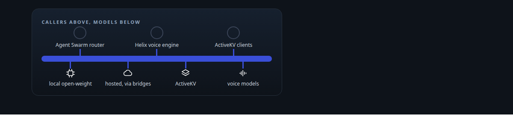
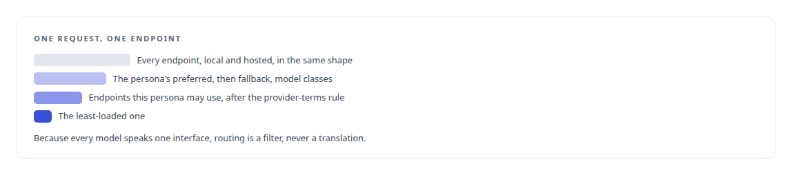
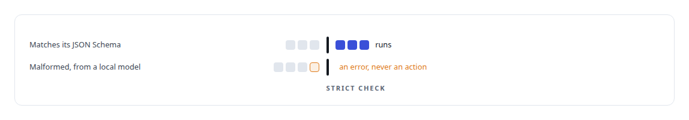
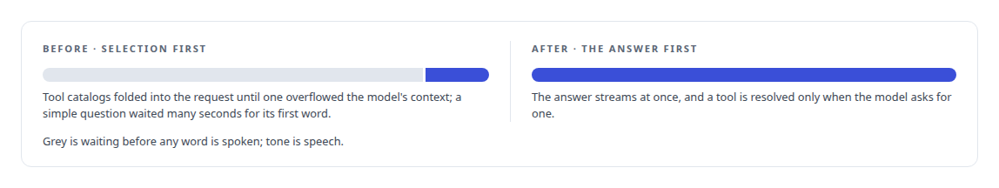
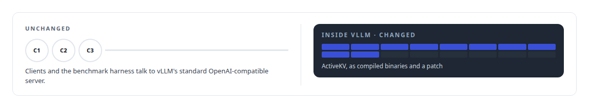
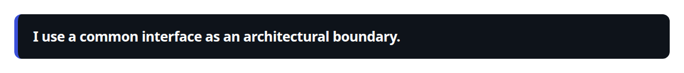

# OpenAI-compatible API

**An OpenAI-compatible endpoint is the common shape my local models, the voice engine and ActiveKV present to callers.**

Canonical: https://coreyjames.ai/technologies/openai-compatible-api/  
Author: Corey James · Published: 2026-10-28 · Kind: technology  
Systems: [Agent Swarm](https://github.com/coreyjames-ai/agent-swarm) · [Helix](https://github.com/coreyjames-ai/helix) · [ActiveKV](https://github.com/coreyjames-ai/activekv)  
Skills: [real-time voice AI](https://github.com/coreyjames-ai/portfolio/tree/main/skills/real-time-voice-ai) · [inference serving architecture](https://github.com/coreyjames-ai/portfolio/tree/main/skills/inference-serving-architecture) · [tool synthesis and governed API integration](https://github.com/coreyjames-ai/portfolio/tree/main/skills/tool-synthesis-and-governed-api-integration) · [distributed systems correctness](https://github.com/coreyjames-ai/portfolio/tree/main/skills/distributed-systems-correctness)  



## Result

| Figure | What it measures |
| --- | --- |
| **32,768** | tokens of model context the voice requests outgrew before the fix |

## What was built

### One wire shape for every agent model

In [Agent Swarm](https://coreyjames.ai/systems/agent-swarm) agents use models from my own GPUs and from hosted providers, and I did not want provider-specific code anywhere in the agent loop. I standardised every model on the OpenAI-compatible chat and tool-calling interface, so routing, budgets and tool checks are written once. Local open-weight models served by vLLM already speak it. For hosted providers that do not, I built small bridge services that translate their APIs into the same shape, rate-limit in Redis, and register and deregister themselves, so the agent loop never learns a vendor's API.

With one interface, the router picks an endpoint by policy and load.



### Checking every tool call before it runs

Tools go out as function definitions in the standard request. Every tool call that comes back is checked against the tool's JSON Schema in strict mode before it runs, because local models produce malformed calls often enough to matter. The coding agent in [A coding agent that never holds the keys](https://coreyjames.ai/stories/a-coding-agent-that-never-holds-the-keys) ran over this path.



### A seam between the voice engine and its models

In [Helix](https://coreyjames.ai/systems/helix) the same interface is the seam between the voice engine and its language models, so I can change models without touching the engine. The engine streams server-sent events from an OpenAI-compatible endpoint, one of them a 27-billion-parameter hybrid recurrent-attention open-weight model with prefix caching on an Intel Arc Pro GPU, and speaks clause by clause as text arrives. The seam exposed a real defect in how tools reached voice requests, and I removed a step to fix it.



### Adopting ActiveKV at no cost to clients

[ActiveKV](https://coreyjames.ai/systems/activekv) changes where vLLM keeps a model's attention history, and I wanted adopting it to cost clients nothing. It comes as compiled binaries plus a patch to the user's own vLLM, and clients keep talking to vLLM's standard OpenAI-compatible server. The benchmark matrix behind every ActiveKV figure drives that same server with an ordinary client. See [Context beyond VRAM](https://coreyjames.ai/stories/context-beyond-vram).



A common interface lets one agent runtime span local and hosted models, lets a voice engine swap models freely, and lets a deep change to an inference engine land without its clients noticing. The convention belongs to vLLM and the providers; the bridges, router and validation are mine.



> I use a common interface as an architectural boundary.

## What was verified

Each line is a claim the canonical page supports, with the figure as the page states it.

- Multi-provider LLM integration: local and hosted models standardised on the OpenAI-compatible chat and tool-calling interface, with bridge services translating providers and a router choosing by policy and load.
- Tool-calling validation: every returned tool call checked against its JSON Schema in strict mode before it runs, so a malformed call from a local model fails as an error.
- Real-time voice AI latency: a voice engine streaming clause by clause from an OpenAI-compatible endpoint, with a tool-selection step removed after a catalog overflowed a 32,768-token context.

## Related

- [A coding agent that never holds the keys](https://github.com/coreyjames-ai/agent-swarm/tree/main/stories/a-coding-agent-that-never-holds-the-keys) · https://coreyjames.ai/stories/a-coding-agent-that-never-holds-the-keys/
- [Context beyond VRAM](https://github.com/coreyjames-ai/activekv/tree/main/stories/context-beyond-vram) · https://coreyjames.ai/stories/context-beyond-vram/
- System: [Agent Swarm](https://github.com/coreyjames-ai/agent-swarm)
- System: [Helix](https://github.com/coreyjames-ai/helix)
- System: [ActiveKV](https://github.com/coreyjames-ai/activekv)

## Citation

Corey James. "OpenAI-compatible API." coreyjames.ai, 2026. https://coreyjames.ai/technologies/openai-compatible-api/

```bibtex
@misc{coreyjames-openai-compatible-api,
  author = {Corey James},
  title = {OpenAI-compatible API},
  year = {2026},
  howpublished = {\url{https://coreyjames.ai/technologies/openai-compatible-api/}},
  note = {GitHub copy: https://github.com/coreyjames-ai/portfolio/tree/main/technologies/openai-compatible-api}
}
```

Part of [Corey James's portfolio](https://github.com/coreyjames-ai/portfolio) · site: https://coreyjames.ai/ · MCP server: https://coreyjames.ai/mcp · agent card: https://coreyjames.ai/.well-known/agent.json
