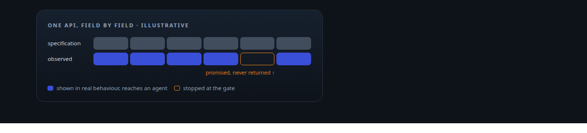
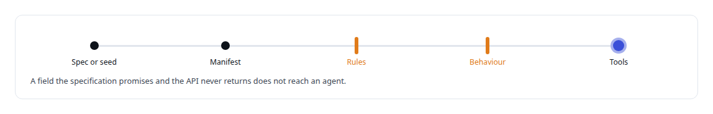
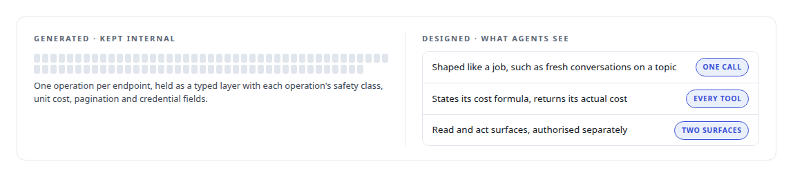

# OpenAPI

**OpenAPI descriptions are the declarative input to my API integration platform and to the generated tool surfaces behind the memory gateway.**

Canonical: https://coreyjames.ai/technologies/openapi/  
Author: Corey James · Published: 2026-10-28 · Kind: technology  
Systems: [FAFO Core and Function Forge](https://github.com/coreyjames-ai/fafo-core) · [FAFOHive](https://github.com/coreyjames-ai/fafohive)  
Skills: [tool synthesis and governed API integration](https://github.com/coreyjames-ai/portfolio/tree/main/skills/tool-synthesis-and-governed-api-integration) · [cost attribution for AI work](https://github.com/coreyjames-ai/portfolio/tree/main/skills/cost-attribution-for-ai-work) · [AI-assisted engineering methodology](https://github.com/coreyjames-ai/portfolio/tree/main/skills/ai-assisted-engineering-methodology)  



## Result

| Figure | What it measures |
| --- | --- |
| **83** | generated operations, kept internal |
| **36** | designed tools agents see |
| **A dozen** | semantic rules every manifest is checked against |

## What was built

### A specification checked against behaviour

In [FAFO Core and Function Forge](https://coreyjames.ai/systems/fafo-core) I built a platform that puts third-party APIs behind agent tools, and the first thing I decided was that an API's specification is a claim about the API. An OpenAPI 3.x document, or a hand-written seed for an API without one, is converted deterministically into a schema-checked manifest: operations, parameters, authentication and response shapes in one canonical format, checked against semantic rules. The platform's test catalogs include negative cases, so the gate itself is tested.



The delivery is told in [Closed by evidence](https://coreyjames.ai/stories/closed-by-evidence).

### Tools drawn around an agent's decisions

In [FAFOHive](https://coreyjames.ai/systems/fafohive) the same document pulled me the other way. I wanted agents on the X data API, and generating one tool per endpoint from the vendor's OpenAPI file took an afternoon. I did not give them to agents. Agents choose badly among dozens of small billed calls, and what makes the API cheap and safe, batching identifiers before fetching, reusing cached results, refusing stale data, lives between endpoints. So I draw tool boundaries around the decision an agent makes, and on top of the generated layer I designed tools shaped like the jobs an agent does, such as finding fresh conversations on a topic.



I know what an OpenAPI document is good for: a typed client and a starting manifest.


> An OpenAPI document is a poor design for an agent's tools and no proof of what an API does.

## What was verified

Each line is a claim the canonical page supports, with the figure as the page states it.

- Tool synthesis and governed API integration: OpenAPI 3.x documents converted deterministically into schema-checked manifests, with agent tools only after an API's real behaviour is shown.
- MCP tool design for agents: 83 generated operations kept as a typed internal layer, and 36 designed tools shaped like an agent's jobs, each stating its cost formula and returning its actual cost.

## Related

- [Closed by evidence](https://github.com/coreyjames-ai/agentos/tree/main/stories/closed-by-evidence) · https://coreyjames.ai/stories/closed-by-evidence/
- System: [FAFO Core and Function Forge](https://github.com/coreyjames-ai/fafo-core)
- System: [FAFOHive](https://github.com/coreyjames-ai/fafohive)

## Citation

Corey James. "OpenAPI." coreyjames.ai, 2026. https://coreyjames.ai/technologies/openapi/

```bibtex
@misc{coreyjames-openapi,
  author = {Corey James},
  title = {OpenAPI},
  year = {2026},
  howpublished = {\url{https://coreyjames.ai/technologies/openapi/}},
  note = {GitHub copy: https://github.com/coreyjames-ai/portfolio/tree/main/technologies/openapi}
}
```

Part of [Corey James's portfolio](https://github.com/coreyjames-ai/portfolio) · site: https://coreyjames.ai/ · MCP server: https://coreyjames.ai/mcp · agent card: https://coreyjames.ai/.well-known/agent.json
