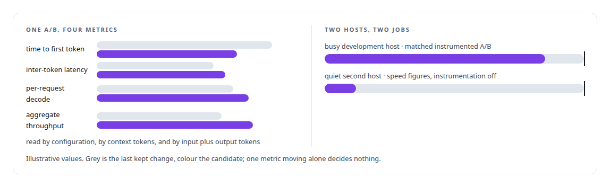
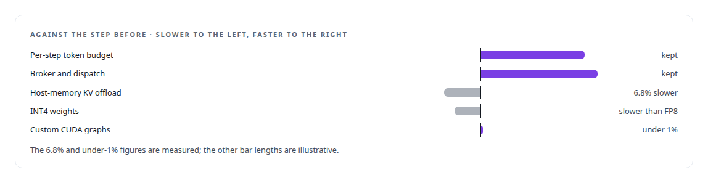
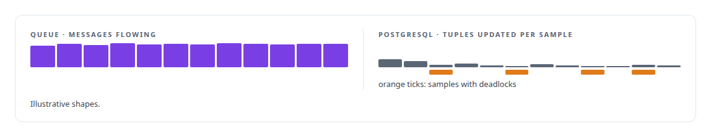
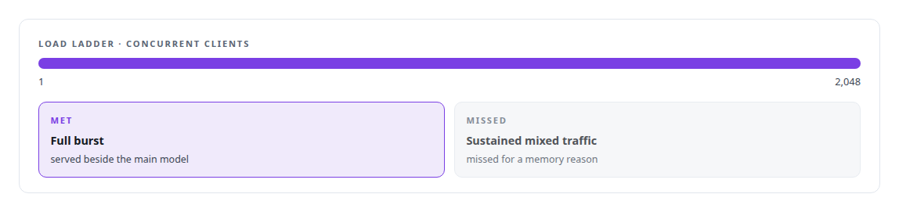

# Performance engineering and benchmarking

**Fixed model, one variable at a time, negatives beside positives, and an intake screen that rejects gains tuned to the test fixture.**

Canonical: https://coreyjames.ai/technologies/performance-engineering-and-benchmarking/  
Author: Corey James · Published: 2026-10-28 · Kind: technology  
Systems: [ActiveKV](https://github.com/coreyjames-ai/activekv) · [Inference Fabric](https://github.com/coreyjames-ai/inference-fabric) · [FAFO Core and Function Forge](https://github.com/coreyjames-ai/fafo-core) · [Capabilities model](https://github.com/coreyjames-ai/capabilities-model)  
Skills: [GPU inference optimisation](https://github.com/coreyjames-ai/portfolio/tree/main/skills/gpu-inference-optimisation) · [PostgreSQL performance tuning](https://github.com/coreyjames-ai/portfolio/tree/main/skills/postgresql-performance-tuning)  


## Result

| Figure | What it measures |
| --- | --- |
| **16** | cells in the frozen workload matrix |
| **196 → 0** | deadlocks in one bulk update after a unique index |
| **7B** | dense model in FP8, held fixed across every step |

## What was built

### A measurement doctrine for ActiveKV

In [ActiveKV](https://coreyjames.ai/systems/activekv) one metric, inter-token latency, kept declaring success or failure on its own and misled everyone, me included. I wrote a measurement doctrine to fix that, and comparison tables are generated from run data.



The workloads are a frozen matrix. Every performance change after the native port went through an intake screen that rejects behaviour keyed to benchmark fixture sizes, even when the gain is real at the fixture, then an A/B against the last kept change, and a cumulative ledger of engine hashes and runs. When a trace said host-to-device copies serialised with compute, a controlled re-measurement showed the timing events were causing it, and I retracted the conclusion: [The observer that changed the answer](https://coreyjames.ai/stories/the-observer-that-changed-the-answer).


### One layer at a time on the Inference Fabric

In [Inference Fabric](https://coreyjames.ai/systems/inference-fabric) I kept the model fixed and changed one layer at a time with a dashboard capture at each step. An engine tier sweep found the per-step token budget to be the biggest engine lever. Then I decoupled producers, added a shape-aware broker, made dispatch cache-coherent and put a second GPU on the queue. Three ideas lost on measurement, and I kept them beside the wins. See [From 44K to 163K tokens per second](https://coreyjames.ai/stories/from-44k-to-163k-tokens-per-second).



### Measuring writes where they commit

In [FAFO Core and Function Forge](https://coreyjames.ai/systems/fafo-core) a bulk update through the shared write path crawled and deadlocked while the queue's counters looked healthy. I measure from the system that commits the work: rows from the database, tokens from the engine. So I read PostgreSQL's own tuple counts, sampled every few seconds with host and Redis load, and compared runs around one schema change. One unique index ended the deadlocks: [196 deadlocks to zero](https://coreyjames.ai/stories/196-deadlocks-to-zero).



### Concurrency as a requirement

In the [Capabilities model](https://coreyjames.ai/systems/capabilities-model) I made concurrency a requirement and drove it with a load ladder of concurrent clients. The full burst was served beside the main model. The sustained target I set in advance for mixed traffic was missed, for a memory reason I explain in [A router beside a production model](https://coreyjames.ai/stories/a-router-beside-a-production-model). Every figure I publish carries its hardware, model and window.



> I design the instrument, the baseline and the reading rules as carefully as the system under test, and I retract my own conclusions when the instrument turns out to be the cause.

## What was verified

Each line is a claim the canonical page supports, with the figure as the page states it.

- Performance benchmarking methodology: a frozen 16-cell workload matrix, four metrics on every report and an intake screen that rejects gains keyed to benchmark fixture sizes.
- GPU inference optimisation: one layer changed at a time on a fixed 7B dense model in FP8, from 44K to 163K tokens per second, with three losing ideas kept beside the wins.
- PostgreSQL performance tuning: a bulk update diagnosed from PostgreSQL's own tuple counts rather than queue counters, taken from 196 deadlocks to 0 by one unique index.
- Load testing under concurrency: a load ladder from 1 to 2,048 concurrent clients set as an acceptance requirement, with the full burst served beside the main model.

## Related

- [Judge a representation by the bytes it stops moving](https://github.com/coreyjames-ai/activekv/tree/main/stories/judge-a-representation-by-the-bytes-it-stops-moving) · https://coreyjames.ai/stories/judge-a-representation-by-the-bytes-it-stops-moving/
- [From 44K to 163K tokens per second](https://github.com/coreyjames-ai/inference-fabric/tree/main/stories/from-44k-to-163k-tokens-per-second) · https://coreyjames.ai/stories/from-44k-to-163k-tokens-per-second/
- [196 deadlocks to zero](https://github.com/coreyjames-ai/fafo-core/tree/main/stories/196-deadlocks-to-zero) · https://coreyjames.ai/stories/196-deadlocks-to-zero/
- [The observer that changed the answer](https://github.com/coreyjames-ai/activekv/tree/main/stories/the-observer-that-changed-the-answer) · https://coreyjames.ai/stories/the-observer-that-changed-the-answer/
- [A router beside a production model](https://github.com/coreyjames-ai/capabilities-model/tree/main/stories/a-router-beside-a-production-model) · https://coreyjames.ai/stories/a-router-beside-a-production-model/
- System: [ActiveKV](https://github.com/coreyjames-ai/activekv)
- System: [Inference Fabric](https://github.com/coreyjames-ai/inference-fabric)
- System: [FAFO Core and Function Forge](https://github.com/coreyjames-ai/fafo-core)
- System: [Capabilities model](https://github.com/coreyjames-ai/capabilities-model)

## Citation

Corey James. "Performance engineering and benchmarking." coreyjames.ai, 2026. https://coreyjames.ai/technologies/performance-engineering-and-benchmarking/

```bibtex
@misc{coreyjames-performance-engineering-and-benchmarking,
  author = {Corey James},
  title = {Performance engineering and benchmarking},
  year = {2026},
  howpublished = {\url{https://coreyjames.ai/technologies/performance-engineering-and-benchmarking/}},
  note = {GitHub copy: https://github.com/coreyjames-ai/portfolio/tree/main/technologies/performance-engineering-and-benchmarking}
}
```

Part of [Corey James's portfolio](https://github.com/coreyjames-ai/portfolio) · site: https://coreyjames.ai/ · MCP server: https://coreyjames.ai/mcp · agent card: https://coreyjames.ai/.well-known/agent.json
