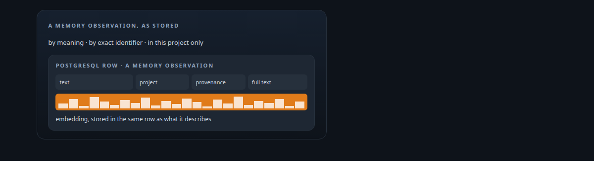
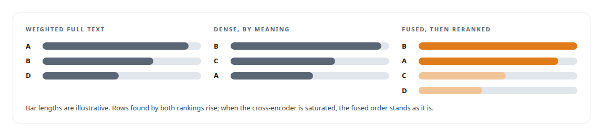
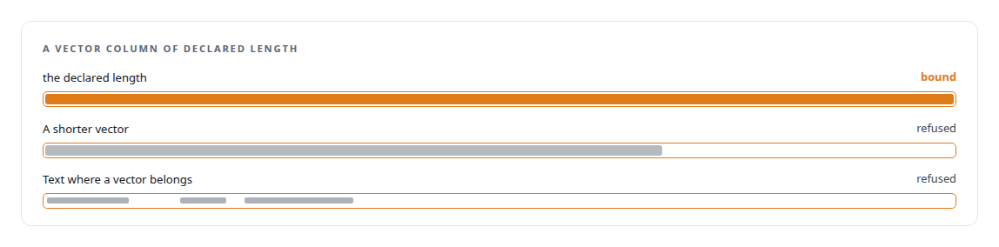
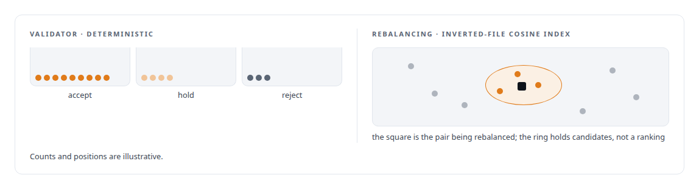
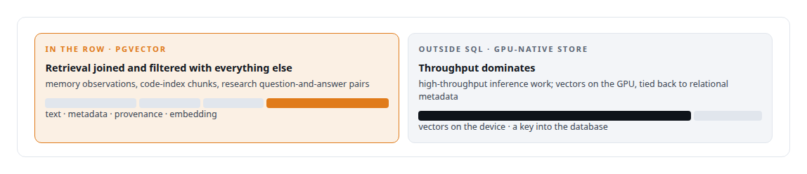

# pgvector

**Vector search inside PostgreSQL backs the memory service's hybrid retrieval and the capabilities model's data factory.**

Canonical: https://coreyjames.ai/technologies/pgvector/  
Author: Corey James · Published: 2026-10-28 · Kind: technology  
Systems: [FAFOHive](https://github.com/coreyjames-ai/fafohive) · [FAFO Core and Function Forge](https://github.com/coreyjames-ai/fafo-core) · [Capabilities model](https://github.com/coreyjames-ai/capabilities-model) · [PostgreSQL Fabric](https://github.com/coreyjames-ai/postgresql-fabric)  
Skills: [vector search and ANN indexes](https://github.com/coreyjames-ai/portfolio/tree/main/skills/vector-search-and-ann-indexes) · [inference serving architecture](https://github.com/coreyjames-ai/portfolio/tree/main/skills/inference-serving-architecture) · [AI-assisted engineering methodology](https://github.com/coreyjames-ai/portfolio/tree/main/skills/ai-assisted-engineering-methodology)  



## Result

| Figure | What it measures |
| --- | --- |
| **1,024** | dimensions declared on the memory vector column, checked at the boundary |

## What was built

### One row for meaning, identifiers and project

In the memory capability of [FAFOHive](https://coreyjames.ai/systems/fafohive) I wanted one query to search by meaning, match exact identifiers and filter by project, so I kept vectors in PostgreSQL with pgvector, in the same row as the text and metadata they describe. Retrieval, filtering and audit are then one query. Each observation, a decision or fix captured from a coding session, carries an embedding beside a weighted full-text column, provenance fields and token-savings accounting. The weighted full text catches exact identifiers that embeddings blur.



Embeddings come from a the multilingual embedding model model on a local embedding server. The code index stores chunk embeddings the same way, partitioned per index so I can add or drop one cleanly. The graph tools beside it are in [A code explainer that is not allowed to invent](https://coreyjames.ai/stories/a-code-explainer-that-is-not-allowed-to-invent).

### Vectors as a typed column

In [FAFO Core and Function Forge](https://coreyjames.ai/systems/fafo-core) functions read and write tables they were not compiled against, so vectors had to be a first-class type in a schema-agnostic data layer. A resolver reads PostgreSQL's system catalogs at runtime and binds parameters by actual column type; for a vector column it reads the declared dimension from the type modifier, so an embedding of the wrong length fails at the boundary.



### Research steps on the substrate

The research functions on the substrate rely on it. A validator scores candidate question-and-answer pairs with a deterministic accept, hold or reject decision over those vectors, and a rebalancing step finds near neighbours through an inverted-file cosine index. That index is approximate, and the bulk steps that use it never assume exact ordering from it.



When an earlier research dataset turned up split between a working database and a large backup, with placeholders where content belonged, I had it recovered phase by phase under an independent check, and the original centroid computation was reconstructed and confirmed before anything was recomputed. The full account is in [Research data forensics](https://coreyjames.ai/technologies/research-data-forensics).

### Where vectors belong

In the high-throughput inference work I kept vectors out of SQL entirely, in a GPU-native store tied to relational metadata. pgvector goes where the database is the right home for the vectors.




pgvector is an open-source PostgreSQL extension used as published; the schemas, retrieval and data layer are mine.

> For me pgvector is a decision about where vectors belong.

## What was verified

Each line is a claim the canonical page supports, with the figure as the page states it.

- Vector search and ANN indexes: pgvector embeddings in the same PostgreSQL row as text, metadata and provenance, so meaning, exact identifiers and project filters are one query.
- Hybrid retrieval: weighted full-text and dense rankings fused and reranked by a cross-encoder, with fusion alone as the fallback when the reranker is saturated.
- Type-safe data access: a resolver that reads a vector column's declared dimension from its type modifier, binding 1,024-value embeddings and refusing any other length.

## Related

- [A code explainer that is not allowed to invent](https://github.com/coreyjames-ai/fafohive/tree/main/stories/a-code-explainer-that-is-not-allowed-to-invent) · https://coreyjames.ai/stories/a-code-explainer-that-is-not-allowed-to-invent/
- [Research data forensics](https://github.com/coreyjames-ai/portfolio/tree/main/technologies/research-data-forensics) · https://coreyjames.ai/technologies/research-data-forensics/
- System: [FAFOHive](https://github.com/coreyjames-ai/fafohive)
- System: [FAFO Core and Function Forge](https://github.com/coreyjames-ai/fafo-core)
- System: [Capabilities model](https://github.com/coreyjames-ai/capabilities-model)
- System: [PostgreSQL Fabric](https://github.com/coreyjames-ai/postgresql-fabric)

## Citation

Corey James. "pgvector." coreyjames.ai, 2026. https://coreyjames.ai/technologies/pgvector/

```bibtex
@misc{coreyjames-pgvector,
  author = {Corey James},
  title = {pgvector},
  year = {2026},
  howpublished = {\url{https://coreyjames.ai/technologies/pgvector/}},
  note = {GitHub copy: https://github.com/coreyjames-ai/portfolio/tree/main/technologies/pgvector}
}
```

Part of [Corey James's portfolio](https://github.com/coreyjames-ai/portfolio) · site: https://coreyjames.ai/ · MCP server: https://coreyjames.ai/mcp · agent card: https://coreyjames.ai/.well-known/agent.json
